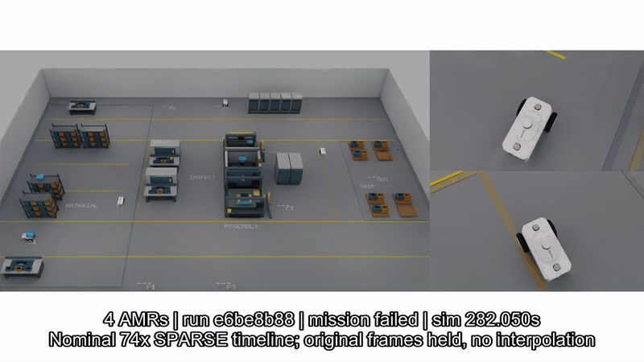

# Factory Ops Twin

가상 센서 모듈 공장에서 **4대 AMR의 자재 공급·완제품 출하·빈 용기 회수**를 Isaac Sim·ROS 2와 웹 관제로 연결하는 프로젝트입니다.



[전체 운송 영상 · 25.4초 MP4](docs/images/fleet4-local45-036/operations-business-complete.mp4) · [공장 원본 이미지](docs/images/fleet4-local45-036/overview.png) · [미디어 출처](docs/images/fleet4-local45-036/readme-preview-provenance.json)

실제 RGB의 명목 74배속 타임라인에서 12초를 골랐습니다. 촬영 사이에는 이전 프레임을 유지하며 움직임을 보간하지 않습니다. 이 실행은 **출하 3건·빈 토트 반납 3건·4대 주차를 마쳤지만, 최종 기록 종료 검사에 실패**했습니다. 전체 정상 완주는 아직 확인 중입니다.

## AMR을 클릭하면 보이는 운영 상태


차량을 선택하면 현재 작업, 목적지, 적재물 ID, 엔코더 속도, 가상 SOC와 통로 대기 원인을 확인합니다. 위 화면의 `carter4`는 빈 토트 `F4-TOTE-002`를 자재 위치로 반납하며 다른 차량의 통로 점유 해제를 기다립니다. [출하 3건·재고 54개를 확인하는 전체 화면](docs/images/fleet4-local45-036/dashboard-all-orders.jpg)도 같은 실행에서 촬영했습니다.

웹은 **Next.js·React Three Fiber·Python 운영 API**로 구성했습니다. 실제 ROS 실행은 관측 전용입니다. 주문 생성·전체 일시정지·재개와 가상 충전 조작은 별도 CPU 운영 모델에서 지원하며, 실제 차량 조작과 구분합니다. 웹의 차량·물품 형상은 원장 기반 도식입니다. [같은 실행의 원본·해시](docs/images/fleet4-local45-036/provenance.json)

## 공장과 물류 흐름

| 실제 공장 RGB | 차량 위 화물 표시 |
|---|---|
|  |  |

**자재 보관·키팅 → 공정 투입 → 조립·검사 → 완제품 출하**, 소비 후 **빈 토트 회수·재사용**을 연결합니다. 32×22 m의 가상 생산 구역이며 현장 CAD·MES와 동기화한 실공장 복제는 아닙니다.

| 실행에서 확인한 결과 | 범위 |
|---|---|
| 4대 모두 실제 운송 인계 참여 | 제품 인계 12회 + 빈 토트 인계 6회 |
| 주문 3건 출하·빈 토트 3건 반납 | 마지막에 4대 모두 주차 |
| 유한 재고와 공정 소비 | 초기 60개 = 잔량 54개 + 소비 6개 |
| 가상 충전 예약·도착·해제 | 추정 위치·정지 확인과 작성된 에너지 모델 사용 |
| 같은 실행의 웹 관제 | 작업·화물·재고·속도·가상 SOC 관측 |

위 결과는 [로컬 Isaac Sim 4.5·PhysX 실행036](docs/evidence/local45-transport-036.json)의 업무 기록입니다. 산업용 저상 차량의 접촉·승강·하중 운반, 충전 접촉 센서와 전기 충전, 최종 6.2·RTX 구성은 남아 있습니다. 현재 화물은 원장과 연결한 비충돌 시각 표현입니다.

## 가감속·회전·정지


[원속도 주행 영상 · 76초 MP4](docs/images/amr-drive-profile.mp4) · [명령·엔코더·차체 응답 그래프](docs/images/amr-drive-response.png) · [촬영·계측 출처](docs/images/motion-media-provenance.json)

정상 가감속, 곡선 감속, 회전 전 제동과 회전 후 출발, 휠 속도·가속도 제한을 물리 주행 루프에 적용했습니다. 주행 명령과 실제 차체·엔코더 응답을 구분해 기록하며, 명령이 끊기면 watchdog이 정지시킵니다. 위 영상은 별도 주행 시험이며 현재 4대 운송 실행과 같은 촬영으로 합치지 않습니다.

## 공유 통로 대기와 복구


[복구 전체 영상](docs/images/g2-f3-timelapse.mp4) · [복구 경로와 소유권 변화](docs/images/g2-f3-recovery-path.png) · [통로 차단 시 명령·정지 기록](docs/images/g2-f2-fault-timeline.png) · [실행 결과](docs/images/g2-results.json)

이전 2대 배치의 실제 복구 시험입니다. 대기 관계 감지, 주행 취소, 양보 위치 이동, 이탈 확인, 대기 차량 재개의 순서를 기록했습니다. 관측이 오래되면 점유를 유지하며, 다음 예약이 승인되기 전에 기존 점유를 해제하지 않습니다. 최종 4대 구성의 폐쇄·복구 검증은 남아 있습니다.

## 합성데이터: RGB와 라벨을 함께 확인


[조감 RGB](docs/images/g4-render-004/rgb-overhead.png) · [통로 RGB](docs/images/g4-render-004/rgb-aisle.png) · [차량 근접 RGB](docs/images/g4-render-004/rgb-amr_follow.png) · [데이터 검사 결과](docs/images/g4-render-004/dataset-validation-report.json) · [출처 명세](docs/images/g4-render-004/g4-media-provenance.json)

Isaac Sim Replicator로 기존 40×24 m 장면의 **12개 시각 구성 × 30시점 × 3카메라, RGB 1,080장**과 대응 깊이·semantic·instance·bbox·카메라 정보를 수집했습니다. 프레임·좌표·분할·파일 해시 검사와 대표 자료의 별도 AI 시각 검수를 기록했습니다.

이 자료는 기존 정적 장면의 데이터입니다. 현재 4대 운송 장면의 학습 데이터나 실제 로봇 학습 성능으로 해석하지 않습니다. 최종 공장·차량을 고정한 뒤 새 장면에서 수집하며, 웹에서 GPU 촬영을 실행하는 기능은 아직 없습니다. [데이터 계약](docs/dataset-contract.md)

## Kit 운영 패널과 모의 MES

<details>
<summary>Isaac Sim 안의 운영 패널 보기</summary>


Kit 확장 `factory.ops.console`에서 AMR 선택 상세, 주문 생성, 전체 일시정지·재개를 같은 CPU 운영 API에 연결했습니다. 실제 SDK에서 명령 적용과 확장 창 종료를 확인했습니다. 이 화면의 배경은 연결 시험용 빈 뷰포트이며 공장 렌더 결과가 아닙니다. [명령·촬영 근거](docs/evidence/kit-console-004/summary.json)

</details>

모의 MES의 주문·재고 입고·설비 관측·heartbeat를 운영 원장에 연결합니다. 실행 ID·시각·순번과 중복 입력을 검사합니다. 실제 공장 설비 연결과 실제 ROS 운송을 조작하는 Kit 통합은 남아 있습니다. [HTTP 입력 기록](docs/evidence/mock-mes-024/http-flow.json) · [실행 안내](docs/operations-guide.md)

## 현재 진행 구간

| 구간 | 현재 상태 |
|---|---|
| 1. 4대 운영 안정화 | 업무 운송 관측. 전체 정상 완주·기록 종료 확인 중 |
| 2. 공장·차량·적재 | 공장 시각 층 구현. 산업용 차량·접촉 적재는 남음 |
| 3. 웹·Kit·운영 입력 | 실제 실행의 웹 관측 연결. ROS 조작·Kit 통합은 남음 |
| 4. 혼합 운영·예외 처리 | 최종 구성의 폐쇄/복구·급증·재보충·충전 접촉 확인은 남음 |
| 5. 병목·정책 비교 | 최종 구성 고정 후 6개 파일럿·60회 비교 예정 |
| 6. 최종 장면 데이터 | 기존 자료 보존. 최종 장면의 수집·검사는 남음 |
| 7. 포트폴리오 미디어 | 실제 실행 미디어 공개. 최종 렌더·운영 결과에 맞춰 갱신 |
| 8. 보존·정리 | 실행별 보존 진행. 전체 결과의 복원·원격 SHA·종료 확인은 마지막에 수행 |

[완료 조건과 구간별 계획](docs/completion-plan.md) · [오류와 재발 방지 기록](docs/troubleshooting.md)

현재 후속 실행039는 운송 중입니다. 네 대 모두 업무 인계에 참여했고 출하 1건과 빈 토트 픽업을 관측했으며, 최종 결과는 아직 확정하지 않았습니다. 위 대표 미디어는 보존된 실행036의 자료입니다. 구간 완료와 렌더링 개선 시 현재 기능·한계와 실제 이미지·영상을 함께 갱신합니다.

## 로컬에서 보기

CPU 운영 데모는 Python 3.12·uv, 웹은 Node.js·npm을 사용합니다. GPU 시뮬레이션과 별도로 실행합니다. PowerShell 터미널 두 개를 사용합니다.

```powershell
cd "$HOME/factory-ops-twin"
uv sync --locked
uv run python -m factory_ops.dashboard --web-charging-profile configs/web-charging-model.json
```

```powershell
cd "$HOME/factory-ops-twin/dashboard"
npm ci
npm run dev -- --port 3007
```

`http://127.0.0.1:3007`에서 CPU 모델의 주문·차량·재고·가상 충전을 볼 수 있습니다. 이미 같은 포트의 관제 서버가 실행 중이면 기존 서버를 사용합니다. 실제 ROS 관측 연결, Kit 활성화, 모의 MES와 재현용 CPU 보고서는 [운영·실행 안내](docs/operations-guide.md), GPU 실행은 [GPU 연동 안내](docs/gpu-handoff.md)를 참고합니다.

## 구성과 증거의 경계

| 구성 | 역할 |
|---|---|
| `configs/` | 공장 배치·지도·주문·주행·에너지·촬영 설정 |
| `factory_ops/` | 재고·운영 원장·배차·예약·관제 API·평가와 원본 검사 |
| `scripts/isaac/`, `scripts/ros/` | 물리 주행·센서·Nav2·action과 운송 확정 연결 |
| `dashboard/`, `extensions/` | 웹3D 관제와 Kit 운영 패널 |
| `scripts/media/`, `docs/images/` | 실제 원본 기반 미디어와 출처 |

Nav2·배차·예약은 추정 위치와 센서·현재 상태를 사용합니다. 시뮬레이터 GT는 사후 평가·라벨·미디어에만 사용합니다. CPU 논리 모델·웹 도식·실제 물리 실행의 결과를 구분하며, 실물 Sim-to-Real 검증이나 공장 전체의 안전 인증을 주장하지 않습니다. [설계와 제어 경계](docs/architecture.md)

공장 설비의 시각 층은 자체 작성했으며 로봇은 NVIDIA 제공 Nova Carter를 참조합니다. 원본 로봇 에셋은 Git에 포함하지 않고 제공처 이용 조건을 따릅니다. 코드·설정·문서·대표 미디어만 Git으로 관리하며 대형 원본·USD·데이터·인증 정보는 별도 보관합니다.

웹 화면 구성은 [Dilum Sanjaya의 창고 운영 데모](https://x.com/DilumSanjaya/status/2106426962738880879)를 참고했습니다. 구현과 운영 원장은 이 저장소에서 관리합니다.
