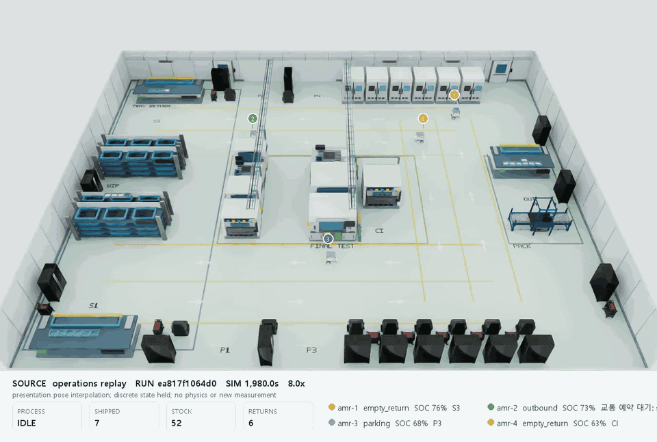

# Factory Ops Twin

반도체 후공정의 검사·포장 구역을 대상으로 4대 AMR의 자재 공급, 완제품 출하, 빈 토트 반납, 충전을 하나의 운영 원장과 관제 화면으로 연결한 디지털 트윈 포트폴리오입니다. CPU 운영 비교와 Isaac Sim 물리 시험을 분리해 기록하고, 각 결과가 증명하는 범위를 미디어와 함께 공개합니다.

[](docs/images/operations-local45-228/operations-replay.mp4)

위 미디어는 CPU 운영 모델이 1Hz로 남긴 원본 snapshot과 pose 사이를 표시용으로 보간해 Isaac Sim 4.5에서 재생한 결과입니다. 30초 분량의 MP4는 8배속·30fps, GIF는 25fps·12.8MB이며 이미지를 누르면 MP4가 열립니다. 재생 중 PhysX는 멈춰 있으므로 4대의 접촉 물리 운송 성공을 뜻하지 않습니다. 전체 원본 실행은 출하 12건·빈 토트 반납 12건·4대 주차를 완료했고, 1980~2220초 발췌 구간에서는 출하가 1건, 반납이 2건 늘었습니다. [미디어 출처와 해시](docs/images/operations-local45-228/provenance.json)

## 구현 범위

- **운영 모델:** 유한 재고와 WIP, 공정 처리, 출하, 빈 용기 회수, FIFO·ETA 배차, 구간 예약, 통로 폐쇄, 설비 고장·복구를 계산합니다.
- **4대 AMR:** 작성된 가감속·회전 한도와 정지 지점을 따라 움직이며, 충전 수요·대기열·패드 정렬·가상 충전·이탈을 운영 흐름에 포함합니다.
- **관제:** Next.js·React Three Fiber 화면에서 작업, 목적지, 적재물, 속도, SOC 원천, 예약 경로, 대기 이유, 재고와 사건을 함께 봅니다.
- **재현:** 같은 조건의 정책 비교, 읽기 전용 관측 재생, 명령 receipt, 원본 해시와 실행 ID를 보존합니다.
- **검증 경계:** CPU 운영, Isaac Sim 물리, ROS 관측, 웹 표시용 보간을 서로 다른 증거로 관리합니다.

[현재 범위와 완료 조건](docs/completion-plan.md) · [설계와 제어 경계](docs/architecture.md) · [공정 모델](docs/semiconductor-cell.md)

## 반도체 후공정 장면

| 36×28m 전체 구역 | 검사 셀 근접 장면 |
|---|---|
|  |  |

남·북 주통로와 동쪽 연결 통로를 방향별로 나누고, 19개 시각 생산 설비와 35개 제공처 모델을 배치했습니다. 제공처 모델은 정비 캐비닛·작업대·카트 34개와 NVIDIA 포장 컨베이어 1개입니다. 생산 장비 본체와 건물 서비스 형상은 기능 자료를 참고한 절차형 모델이며 제조사 CAD나 인증 공장의 복제물이 아닙니다.

현재 공정 계산은 `CELL1` 한 곳에서 수행합니다. 나머지 18개 생산 설비는 공장 맥락과 동선 제약을 만드는 시각·충돌 구성입니다. 복수 공정 셀의 생산 능력을 계산하는 모델로 해석하지 않습니다. [장면 합성 근거](docs/evidence/semiconductor-dual-lane-201.json) · [에셋과 라이선스](docs/asset-attribution.md)

## 운영 정책 비교


정상, 테스터 고장, 통로 폐쇄에 FIFO와 ETA를 조합한 6개 조건을 5,400초 지평에서 실행했습니다. 모든 조건에서 출하 12건, 빈 토트 반납 12건, 4대 주차가 완료됐습니다. 같은 seed는 확률 표본이 아니라 실행 조건 식별자로 사용했으며, 반복 통계나 실공장 성능을 뜻하지 않습니다.

- 정상 조건에서 ETA의 누적 교통 대기는 FIFO보다 **42.1% 적었습니다.**
- 통로 폐쇄 조건에서 ETA의 누적 출하 지연은 FIFO보다 **10.6% 많았습니다.**
- 거리 중심 ETA가 정상 흐름에는 유리했지만 통로 제약까지 포함하면 항상 우세하지 않았습니다.
- 납기 여유와 처리시간은 작성 가정이며, 최소 여유 1.73m는 원형 외곽 기반 CPU 관측값입니다.

[조건·실행 ID·원본 수치](docs/evidence/operations-comparison-223.md) · [기계 판독 결과](docs/evidence/operations-comparison-223.json)

## 물리 주행 기준선


Isaac Sim 4.5에서 무적재 Nova Carter 한 대가 2m 직선과 반지름 2m의 1/4 원호를 추종했습니다. 제어와 도착 판정에는 휠 엔코더만 사용했고, 시뮬레이터 GT는 독립 평가에만 사용했습니다.

| 지표 | 결과 |
|---|---:|
| 경로 횡오차 RMS | 4.76cm |
| 종점 위치 오차 | 7.12cm |
| 실제 최고 선속도 | 0.5915m/s |
| 정지 후 이동 | 0.01mm |

이 결과는 무적재 단일 차량의 구성요소 시험입니다. Nav2, 플릿 교통, 적재 접촉, 도킹, 공장 전체 운송 성능을 포함하지 않습니다. [실행·원본·프로세스 종료 근거](docs/evidence/local45-path-baseline-226.json) · [제어 기준선 설명](docs/motion-baseline.md)

<details>
<summary>보조 물리 영상: 6kg 적재 주행과 교차 통로 양보</summary>

| 6kg 적재 곡선·제동·회전 | 두 AMR의 양보·통과·재개 |
|---|---|
|  |  |

[적재 주행 60fps MP4](docs/images/loaded-mobility-local45-135/loaded-motion-60fps.mp4)는 한 대의 적재 안정성·가감속·회전을 확인한 시험이며 자동 적재나 도킹 시험이 아닙니다. [결과](docs/evidence/local45-loaded-mobility-135.json)

[교차 통로 60fps MP4](docs/images/junction-hero-local45-142/logistics-yield-60fps.mp4)는 4대가 있는 장면에서 두 차량의 정지·양보·재출발을 확인한 시연입니다. 동적 우회 경로 생성이나 전체 ROS/Nav2 운송 완주를 뜻하지 않으며 화물은 비충돌 시각 표시입니다. [결과](docs/evidence/local45-junction-hero-142.json)

</details>

## 웹 관제와 운영 기록


위 이미지는 실행070의 기존 관측 화면입니다. 차량을 고르면 작업·목적지·적재물·엔코더 속도·SOC 원천·대기 이유와 남은 경로를 확인합니다. 현재 코드에는 CPU 운영 명령, 명령 receipt, 최근 120개 관측의 저장·읽기 전용 재생이 연결돼 있습니다. 이 최신 조합의 새 브라우저 클릭 확인은 아직 수행하지 않았습니다. [이미지 출처](docs/images/web-console-070/provenance.json) · [운영 화면 사용법](docs/operations-guide.md)

선별한 정상 운영 기록 120개는 작은 공개 패키지로 제공합니다. 원본 JSON을 보간하지 않고 gzip으로 보존했으며, 복원 SHA와 전체 실행·발췌 구간의 차이를 함께 기록했습니다. [데이터 내려받기와 재생 방법](docs/data/operations-normal-223/README.md) · [공개 출처](docs/data/operations-normal-223/provenance.json)

<details>
<summary>Isaac Sim 4.5 Kit 운영 패널: 실행229</summary>


네이티브 Kit 패널에서 일시정지, 재개, 주문 생성, `CELL1` 고장, `CELL1` 복구의 5개 명령을 같은 business run에 적용하고 receipt를 확인했습니다. 종료 후 Job에 남은 소유 PID는 0개였습니다. 배경은 공장 전체 장면이 아닌 빈 viewport 연결 시험이며 ROS, 접촉 물리, 하드웨어 제어의 증거가 아닙니다. [실행 요약·해시·종료 기록](docs/evidence/kit-operations-229/summary.json)

</details>

<details>
<summary>기존 40×24m 정적 장면의 합성데이터</summary>


Isaac Sim Replicator로 12개 시각 구성, 30시점, 3카메라에서 RGB 1,080장과 깊이·semantic·instance·bbox·카메라 정보를 만들었습니다. 기존 40×24m 정적 장면의 데이터이며 현재 36×28m 장면의 학습 데이터나 학습 성능 결과가 아닙니다. [데이터 검사](docs/images/g4-render-004/dataset-validation-report.json) · [데이터 계약](docs/dataset-contract.md)

</details>

## 현재 진행 상태

| 구간 | 확보한 증거 | 남은 확인·확장 |
|---|---|---|
| 1. 공정·원장 | 유한 재고·WIP, `CELL1` 고장·복구, 출하·빈 토트 반납 | 복수 생산 셀 계산은 후속 확장 |
| 2. 4대 CPU 운영 | 6개 조건의 12건 출하·12건 반납·4대 주차, 별도 저SOC 충전·이탈 | 현장 자료 보정은 후속 확장 |
| 3. 물리 주행 기준선 | 엔코더 제어 단일 차량226, 적재135, 교차 양보142 | 도킹 정렬 제어의 CPU 검사4개 통과, 실제 SDK 시험 대기 |
| 4. 운영 비교·원인 추적 | 동일 수요의 6개 조건, 대기·출하 지연·교착 우회 기록 | 반복 통계와 실공장 성능으로 확장하지 않음 |
| 5. 관제·재현·미디어 | 실행070 관측, 공개 120표본 재생, Kit229 명령, 운영 재생228 | 최신 웹 조합의 새 브라우저 실행 확인 |
| 6. 포트폴리오 마감 | 영상·비교·물리 기준선·공개 입력과 해시 | 위 잔여 확인 이후 최종 설명과 보존 색인 마감 |

4대 전체의 접촉 물리 운송과 전기 접촉 충전은 후속 확장입니다. 현재 목표는 운영 비교와 선정된 물리 구성요소 시험을 각각 재현할 수 있게 만드는 것입니다.

실패 원인과 재발 방지는 [트러블슈팅 기록](docs/troubleshooting.md)에 남깁니다. 현재 구현과 장기 완료 기준은 [완성 계획](docs/completion-plan.md), 선별 원본·별도 드라이브 백업·만료된 후보 파일은 [보존 색인](docs/evidence/operations-storage-230.json)에서 관리합니다.

## 로컬 실행

CPU 운영과 웹은 Python 3.12·uv, Node.js·npm을 사용합니다. 물리·렌더 시험 환경은 Isaac Sim 4.5와 RTX 3060이며 헤드리스로 실행했습니다. 같은 포트의 API나 웹이 이미 실행 중이면 프로세스를 중복으로 띄우지 않습니다.

```powershell
cd "$HOME/factory-ops-twin"
uv sync --locked
uv run python -m factory_ops.dashboard --config configs/factory-semiconductor-dual-lane --execution-mode operations --dispatch-policy eta --scenario-dir runs/operator-scenarios --port 8765
```

```powershell
cd "$HOME/factory-ops-twin/dashboard"
npm ci
npm run dev -- --port 3007
```

웹 주소는 `http://127.0.0.1:3007`입니다. 기존 API가 다른 옵션으로 실행 중이라면 사용 중인 작업을 마친 뒤 해당 API만 종료하고 위 설정으로 다시 시작합니다. API 주소가 같으면 웹을 다시 시작할 필요가 없습니다.

6개 운영 조건 비교는 다음 명령으로 재현합니다.

```powershell
cd "$HOME/factory-ops-twin"
uv run python -m factory_ops.operations_experiment --config configs/factory-semiconductor-dual-lane --output artifacts/operations/my-comparison/matrix.json --all --horizon 5400
```

## 저장소 구조와 한계

| 경로 | 역할 |
|---|---|
| `configs/` | 공장 배치, 경로, 주문, 주행, 에너지 설정 |
| `factory_ops/` | 공정 원장, 재고, 배차, 예약, 충전, 관제 API, 평가 |
| `scripts/isaac/`, `scripts/ros/` | Isaac Sim 물리 시험, 센서, ROS 2·Nav2 연결 |
| `dashboard/`, `extensions/` | 웹 3D 관제와 Kit 운영 패널 |
| `docs/images/`, `docs/evidence/`, `docs/data/` | 미디어, 실행 근거, 공개 재생 데이터 |

시뮬레이터 GT는 제어 입력이 아니라 사후 평가·라벨·미디어에 사용합니다. 현재 결과는 실물 Sim-to-Real 검증, 산업 안전 인증, 처리량 보증을 포함하지 않습니다. 로봇은 NVIDIA Nova Carter를 참조하며 원본 에셋은 저장소에 넣지 않습니다. 외부 모델의 출처와 변경 내용은 [에셋 표기](docs/asset-attribution.md), GPU 실행과 원본 보존 방식은 [GPU 안내](docs/gpu-handoff.md)에서 확인할 수 있습니다.
