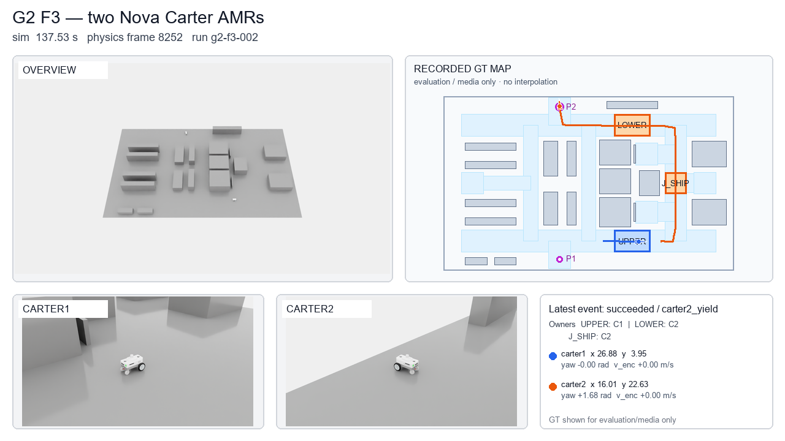

# Factory Ops Twin

두 AMR이 공장에 자재를 공급하고 완료품을 출하하는 과정을 검증하는 프로젝트입니다. 가상 산업용 센서 모듈 공장을 대상으로 주문·버퍼·공정·운반 상태를 연결하고, 배차와 공유 통로 복구를 비교합니다.

현재 **AMR 한 대의 주문 운송(G1)과 두 대의 교통·복구 시험(G2)을 Isaac Sim 6.2·ROS 2 Jazzy·Nav2에서 검증**했습니다. AWS L40S에서 독립 센서·TF, 공유 통로 대기, 30초 채널 차단, 교착 후 P2 양보와 재개를 실행하고 실제 ROS bag·휠 궤적·목표 결과·촬영 파일을 대조했습니다. G3a에서는 연속 주문 원장·전체 배치 경로·실험 입력을 준비했습니다. G3b의 ROS 어댑터와 실행기는 구현했으며, 두 대의 연속 주문 주행 검증과 생산성 비교는 아직 진행 전입니다.



위 이미지는 G2의 같은 물리 프레임에서 촬영한 조감·로봇별 주행 RGB와 기록 궤적 지도를 합친 화면입니다. 지도 위치는 평가·시각화용 GT, 속도는 휠 엔코더 기록입니다. 조향과 교통 판단에는 휠 odometry·RTX LiDAR·AMCL을 사용합니다. 현재는 40×24 m 가상 센서 모듈 공장을 설비 박스와 인계 위치로 표현한 배치 검증 단계이며, 현장 CAD와 생산 데이터를 동기화한 실공장 복제는 아닙니다. [초기 구상도](docs/images/concept-v3.png)는 계획 설명용 생성 이미지입니다.


GIF는 F3 원본에서 균등 선택한 120프레임을 10 fps로 재생한 약 25배 타임랩스입니다. 전체 605개 촬영 시점을 10 fps로 재생한 [1280×720 MP4](docs/images/g2-f3-timelapse.mp4)는 명목 5배속입니다. [미디어 출처·해시](docs/images/g2-media-provenance.json)에 원본 RGB, 물리 프레임, 선택한 궤적 표본과 시각 차이를 남겼습니다. 지도는 해당 시각까지의 기록만 표시하며 보간한 움직임을 만들지 않습니다.

## 공장에서 AMR이 하는 일

```text
S1 / S2 / S3     CI            CELL1           CO          OUT
키트 준비   →   투입 버퍼  →  조립·검사·포장  →  완료 버퍼  →  출하
       AMR 운반                  논리 공정             AMR 운반
```

S1~S3은 동일한 키트 토트를 준비하는 위치입니다. 하나의 주문은 하나의 토트를 운반하며, 토트 안의 제품 수는 모델에 넣지 않았습니다. CI에 토트를 내리면 AMR은 다음 작업으로 이동할 수 있습니다. 공정 처리가 끝나면 CO에서 OUT으로 가는 새 운반 작업을 만들고, 빈 AMR 중 하나에 배정합니다.

현재 적재·하차는 논리 상태 전이입니다. 지게차의 포크나 로봇 팔의 파지 동작은 포함하지 않습니다. 공정은 작업자 1명, CI·CO 각 2슬롯, 설정 처리 시간 20초로 표현합니다. 이 값은 현장 측정값이 아닌 실험 설정입니다.

## 구현된 기능

| 기능 | 현재 동작과 검증 범위 |
|---|---|
| 공장 배치 | 40×24 m, 6개 인계 위치, 2개 대피 포켓, 19개 설비 장애물 |
| 지도 생성 | 50 mm 격자, 물리 장애물 지도와 정책 keepout 지도 분리, ROS PGM·YAML 출력 |
| USD 생성 | 비충돌 시각용 바닥과 물리 Plane 분리, 바닥·설비·마커 USDA 생성과 Isaac Sim 파싱 통과 |
| GPU 장면 검사 | Z-up·m 단위, 활성 충돌 API 20개·설비 19개·비충돌 마커 8개 검사, 1280×720 RGB와 SHA 저장 |
| GPU 종료 판정 | 별도 worker 종료 뒤 supervisor가 실행 ID·장면·PNG·종료 코드를 대조. L40S 실행에서 최종 PASS 확인 |
| 단일 AMR 운송 | S1 pickup→CI drop→공정 20초→CO pickup→OUT drop, 실제 goal UUID·성공 결과·신선한 map pose를 확인한 뒤 인계 확정 |
| 주행 평가 | 실제 충돌 형상의 회전 외곽 약 0.637 m + 여유 0.2 m로 전체 60 Hz 궤적 검사. 계획에는 위치 추정 여유 0.3 m를 추가하고 CI·CO·OUT 접근 정책 폭을 2.6 m로 설정 |
| 주행 명령 프로파일 | 정상 가감속·곡선 감속·회전 전 제동·회전 후 출발·후진 전환과 휠 속도/가속도 제한을 60 Hz 물리 루프에 적용. L40S에서 명령 한계와 실제 차체·엔코더 응답을 별도로 검사 |
| 주행·센서 수집 | G1의 60 Hz 휠·GT 궤적, 주행·조감 RGB 쌍, ROS bag 보존. G0b에서 RGB/Depth/semantic/bbox·카메라 파라미터 3세트의 정렬도 별도 검사 |
| ROS 2 연결 | RTX `/scan`, 엔코더 `/odom`, `/clock`, `map→odom→base_link→base_scan` TF, AMCL·Nav2·action 결과를 연결 |
| 운영 원장 | 주문·운반·버퍼·공정·완료 상태, 버전 검사, 중복 이벤트 억제, 로그 재생 |
| 배차 | 공통 버퍼·가용성 조건을 통과한 작업에 FIFO 또는 이동 ETA 적용 |
| 통로 예약 | 지정된 3개 자원과 출구의 원자 예약, stale 점유 유지, release ACK 검사 |
| 두 AMR 교통·복구 | 로봇별 namespace·전후방 RTX LiDAR·TF·Nav2, 두 센서 frame을 보존한 AMCL 입력과 미관측 영역을 clear하지 않는 costmap, 짧은 주행 허가와 통로 소유권 분리. 네 시나리오의 실제 GPU 실행·원본 검증 PASS |
| 복구 결정 | 5초 지속 wait cycle의 양보 결정과 ACK 이후 재개. 60초 stall과 구분 |
| 로컬 데모 | 동일한 6개 주문·2개 논리 AMR의 두 정책 실행, CSV·JSON·HTML·SHA256 명세 생성 |
| 연속 주문 원장 · G3a | 두 AMR·시간별 주문 공개·CI/CO 역압·FIFO/ETA 연결. goal 결과와 신선한 도착 pose를 검증하는 로컬 어댑터 계약이며 ROS 실행 연결은 다음 단계 |
| 경로 후보 · G3a | 회전 외곽·설정 여유를 반영한 21개 연결 구간, 정상·폐쇄의 112개 경로 후보와 1 m 격자의 swept tile 생성 |
| 구간 예약 · G3a | 신선한 추정 점유·goal UUID·예약 세대 검사, 이전·다음 구간의 원자 전환, 거절·stale 시 기존 점유 유지. 작성된 관측으로 검사 |
| 비교 입력 · G3a | 정상·폐쇄·주문 급증 × FIFO/ETA × 10 seed의 60개 미실행 입력. 부하 보정 자료가 없으면 물리 결과 집계를 차단 |
| 준비 패키지 · G3a | 대화형 경로 보고서·정상/폐쇄 지도·USD·입력 명세 생성. 검증 시 현재 소스로 16개 파일을 재생성해 내용 대조 |
| 실제 실행 연결 · G3b | ComputePathToPose 결과의 경로를 검사한 뒤 같은 Path를 FollowPath에 전달. 요청 UUID·수락 응답·결과, 경로 SHA, 예약 세대와 짧은 주행 허가를 연결한 실행기 구현. 물리 검증은 별도 진행 |

통로 로직은 호출자가 준 추정 위치·점유·출구 상태를 입력으로 받습니다. 로컬 교통 trace는 작성된 관측을 넣어 결정 규칙을 검사합니다. CPU 운반 데모는 격자 거리와 설정 속도로 시간을 계산하며 로봇 간 간섭과 예약 대기를 반영하지 않습니다. 두 결과를 합쳐 물리 주행 성능으로 해석할 수 없습니다.

## G3a 경로·비교 실험 준비

G2에서 사용한 Carter의 측정 회전 외곽 약 0.637 m에 평가 여유 0.2 m와 계획 여유 0.3 m를 더해 약 1.137 m의 계획 반경을 적용합니다. 기존 통행 허용 영역에서는 21개 연결 구간 중 4개가 이 조건을 충족하지 못했습니다. G3a 파생 배치는 서쪽 연결부·S2 접근부·중앙 연결부의 정책 영역을 보정하고, 설비 충돌 형상 19개와 station·포켓 위치를 유지합니다. 이 반경은 G3b에서 로드한 로봇 형상으로 다시 측정해야 합니다.

6개 station과 2개 포켓 사이의 서로 다른 출발·도착 56쌍을 정상·폐쇄 상태에서 검사해 **112개 경로 후보가 로컬 여유 검사를 통과**했습니다. 폐쇄 상태는 물리 장벽 위치를 피하는 우회 경로를 사용합니다. 이는 작성한 경로 후보의 기하 검사이며, 실제 Nav2 경로 추종이나 두 AMR의 충돌 회피를 검증한 결과가 아닙니다. 3 m 통로는 두 계획 외곽을 나란히 수용하지 못하므로 예약과 대기가 필요합니다.

구간을 바꿀 때는 로봇이 점유한 타일을 이전·다음 예약에 모두 남기고, 다음 구간을 확보한 뒤 이전 예약의 나머지를 반환합니다. 거절되거나 관측이 오래되면 기존 예약을 유지합니다. CI·CO의 논리 버퍼 2슬롯과 물리 dock의 한 대 점유는 별개입니다. 작업 후에는 dock을 비우는 경로와 P1·P2의 주차 점유도 보호해야 합니다.

60개 입력은 아직 실행하지 않았습니다. 같은 조건·seed의 FIFO/ETA에는 동일한 주문·초기 상태를 주고 선실행 정책을 교대합니다. 실패·미완료도 완료 주문 수 비교에 포함하며, 완료 시간은 두 정책이 모두 완수한 쌍에서만 별도로 집계합니다. 실제 주행 연결·경로/도킹 검사·부하 보정·6개 조건/정책 파일럿을 통과한 뒤 도착 간격과 전체 실행 예산을 확정합니다.

G3b의 첫 qualification은 S1·S3에서 시작하는 두 주문을 사용합니다. 두 로봇의 초기 예약 HOLD가 물리 step에서 적용됐다는 ACK를 확인한 뒤 주문 타이머를 시작합니다. 주행 액션은 연결 구간 하나씩 보내고, 예약은 station 사이의 전체 경로를 유지해 역방향 진입을 막습니다. 이는 상태·교통 연결을 확인하는 보수적 설정이며 정책별 생산성의 근거로 사용하지 않습니다. 각 액션 종료 뒤 물리 루프의 HOLD 적용 ACK와 그 이후의 새로운 휠 odometry 표본으로 0.5초 정지를 확인하고 다음 구간으로 바꿉니다. 마지막 주문 이후에도 두 AMR이 dock을 비우고 P1·P2에 정지해야 성공으로 끝납니다.

## G2 실행 결과

네 실행의 소스는 `81befc881466f0e612465ba3987165eec2c9ca4f`입니다. worker 종료 후 CDR 메시지·실제 action UUID/status·TF·주행 허가·예약 원장·전체 60 Hz 궤적·RGB 해시를 대조했습니다. 로봇마다 전후방 라이다 frame을 보존해 AMCL에 전달하며, 각 scan 사본도 원본과 비교합니다.

| 시나리오 | 실제 검증 내용 | 물리 표본, AMR 한 대당 | 원본 PNG |
|---|---|---:|---:|
| P0 · `g2-p0-005` | 독립 센서·TF·위치추정과 상대 AMR의 raw 라이다 관측 | 781 | 84 |
| F1 · `g2-f1-004` | 대기→첫 AMR 이탈·ACK→후속 진입, goal 2개 성공 | 5,380 | 543 |
| F2 · `g2-f2-003` | 이동 중 30 sim 초 채널 차단, goal 취소 완료, 점유 유지·복구·ACK | 5,719 | 576 |
| F3 · `g2-f3-002` | 5초 지속 교착 확인, 취소 완료→P2 양보→이탈 ACK→재개 | 18,099 | 1,815 |

합계는 두 AMR의 물리 표본 59,958개와 같은 시각의 RGB 1,006세트·3,018장입니다. 주행 중 예약 소유권 위반은 0프레임이었고, 보수적 충돌 외곽과 여유를 적용한 로봇 간 중심 거리 기준 1.6742 m에 대해 관측 최소 거리는 3.1988 m였습니다. 성공 goal은 GT 기준 XY 0.35 m·yaw 0.35 rad 평가를 통과했습니다. 이 값은 반복 도킹 정확도 측정값이 아닙니다.


F2는 교통 위치·heartbeat와 주행 허가 채널을 차단합니다. 센서와 action 취소 연결은 유지합니다. 차단 중 새 허가 발급은 0건, 예약 세대 변경도 0건이었고, 허가 만료 검사 구간의 1,757개 표본에서 0 휠 목표를 확인했습니다. action 취소와 허가 만료가 함께 발생한 시험이므로 허가 만료만의 제동 효과로 해석하지 않습니다.


F3는 작성한 대기 위치와 P2 경로에서 수행한 복구 시험입니다. 공장 전체의 교착 방지나 생산성을 확정하지 않습니다. [F1 영상](docs/images/g2-f1-timelapse.mp4), [F2 영상](docs/images/g2-f2-timelapse.mp4), [실행 ID·판정·센서·위치추정·부하 수치](docs/images/g2-results.json), [설정과 실패 처리](docs/gpu-handoff.md)에서 범위와 원본 연결을 확인할 수 있습니다.

실패·교체 실행을 포함한 원본 8,120개는 C·E 드라이브의 같은 압축본에서 전체 크기·SHA 검사를 통과했습니다. 원본 아카이브는 고정해 보존하며, 사후 분석기와 README 미디어는 `g2-postprocess-supplement-v1`로 별도 보관합니다. 파생 그래프·합성 화면은 원본 strict validator의 판정과 구분하고, 두 기록의 SHA 연결을 명세에 남깁니다.

## G1 실행 결과

검증 실행은 새 주행 프로파일을 적용한 `g1-010`, 코드 SHA는 `ec06754c62854c9b6358f67007c23a3fef7ede81`입니다. 두 worker의 정상 종료 후 ROS 이미지에서 CDR 메시지와 원본 파일을 검사해 `FACTORY_OPS_G1_VALIDATION=PASS`를 확인했습니다.

[주문 운송 MP4](docs/images/g1-amr-mission.mp4), [주행 타임랩스 GIF](docs/images/g1-amr-mission.gif), [출하 종료 원본 PNG](docs/images/g1-amr-out.png), [미디어 출처·해시](docs/images/g1-media-provenance.json)에 S1→CI·공정 20초·CO→OUT의 네 goal과 촬영 시각을 보존했습니다.

| 항목 | 실제 기록과 범위 |
|---|---|
| 운송 | 주문 1건, navigation goal 4개 성공, OUT 인계 시각 194.517 sim s |
| 궤적 | 60 Hz 원본 11,597개, 이름이 결속된 휠 각도 재적분·프레임 연속성·자세·지도 여유·주행 명령 한계 검사 통과 |
| 촬영 | 1280×720 주행·조감 RGB 195쌍, 원본 PNG 390장과 시각·pose·SHA 보존 |
| 종착 위치 | 정지 후 GT 기준 OUT 중심까지 0.0414 m. 반복 도킹 정확도는 미평가 |
| 위치 추정 | AMCL 대 GT 최대 XY 오차 0.2097 m, RMS 0.1067 m, 시각이 대응된 1,685개 표본 |
| ROS bag | SQLite integrity OK, `/scan` 1,902개·`/cmd_vel` 3,035개·`/clock` 11,412개, 네 goal UUID의 성공 상태와 원장 이벤트 대조 |

평가 여유는 앞선 실패 때와 같은 0.2 m입니다. 초기 G1에서는 바닥 충돌 표현과 저속 제자리 회전 문제를 대조 시험으로 분리했고, 2 m 접근 정책 통로가 위치 추정 오차를 수용하지 못한 실행도 실패로 보존했습니다. 현재 통로 설계와 제어 설정의 근거는 [GPU 연동 안내](docs/gpu-handoff.md)에 적었습니다. 위 결과는 한 주문의 검증이며 반복 성공률·물리 접촉 수·생산성 개선율을 뜻하지 않습니다.

## 주행 동작과 계측

Nav2의 속도 요청은 60 Hz 주행 프로파일을 거쳐 좌우 휠의 속도 목표로 전달됩니다. 정상 정지는 감속하고, 전진 중 제자리 회전을 요청하면 먼저 전진을 줄입니다. 회전 후 출발과 전후진 전환도 정지 단계를 거칩니다. 곡선에서는 `|v × ω|` 명령 한계에 맞춰 속도를 낮춥니다. 통신 명령 만료나 실행 오류에는 별도의 고장 정지를 적용합니다. 물리 엔진이 에셋의 구동·접촉 조건에 따라 차체의 움직임을 계산합니다.


`motion-001`은 기본 Nova Carter와 Plane 바닥을 사용한 **별도 주행 시험**입니다. 76초 동안 4,560개 물리 표본과 10 Hz 원본 PNG 761장을 수집했습니다. 고정 시간표가 명령을 만들고 GT는 계측과 촬영에만 사용합니다. 공장 운송 결과와 구분합니다.

| 계측 항목 | 실제 차체 응답 |
|---|---|
| 직선 정상 속도 | 0.6014 m/s, 요청·적용 명령 0.6 m/s |
| 가속 10→90% 상승시간 | 1.925초, 마지막 1초의 실측 정상 속도 기준 |
| 정상 제동 | 1.733초·0.5207 m, 약 0.6 m/s 직진 뒤 정지 요청 |
| 제자리 회전 | 요청·적용 0.8 rad/s, 실측 0.7645 rad/s |
| 좌회전 곡선 | 적용 0.3162 m/s·0.6325 rad/s, 실측 0.3010 m/s·0.7475 rad/s |
| 후진 전환 | 적용 명령의 0 속도 표본 확인, 차체의 양→음 전환은 요청 후 1.213초 |

제동의 정지 기준은 전방 속도 절댓값 0.02 m/s 이하를 0.5초 유지하는 것입니다. 과도응답 계측에는 0.1초 이동 평균을 사용합니다. 곡선에서 보이듯 명령과 실제 응답은 다릅니다. 가감속·횡가속·휠 제한은 작성한 명령 한계이며, 실물 모터·적재량·바닥 조건에 맞춘 보정값은 아닙니다.


GIF는 제동·회전·재출발 구간 16초를 확대해 10 fps로 재생합니다. [전체 76초 MP4](docs/images/amr-drive-profile.mp4)는 원본 촬영 간격과 같은 10 fps이며 타임랩스가 아닙니다. [설정·계측 정의](configs/factory-v3/motion-qualification.json), [미디어 출처·해시](docs/images/motion-media-provenance.json)에 실행 ID와 원본 프레임 연결을 기록했습니다.

## 로컬 실행

Python 3.12와 [uv](https://docs.astral.sh/uv/)를 사용합니다. Python 런타임 의존 패키지는 없습니다.

PowerShell:

```powershell
cd "$HOME/factory-ops-twin"
uv sync --locked
uvx --from pyright==1.1.414 pyright
uv run python -m unittest discover -s tests -v
uv run python -m factory_ops prepare --output runs/local
uv run python -m factory_ops verify runs/local
uv run python -m factory_ops replay runs/local/fifo/events.jsonl --expected runs/local/fifo/snapshot.json
uv run python -m factory_ops prepare-g3 --output runs/g3a
uv run python -m factory_ops verify-g3 runs/g3a
uv run python -m factory_ops.g3_session --output runs/g3-qualification --profile qualification --condition normal --policy fifo --seed 0
uv run python -m factory_ops.g3_session --output runs/g3-qualification --verify --profile qualification --condition normal --policy fifo --seed 0
```

`runs/local/report.html`을 브라우저에서 열면 배치도, 정책별 완료 기록과 이벤트 원장을 볼 수 있습니다. 준비 명령은 클라우드 인스턴스를 만들거나 실물 로봇에 명령하지 않습니다.

`runs/g3a/report.html`에서는 출발·도착, 폐쇄 여부, 예약 후보 타일을 선택해 경로를 확인할 수 있습니다. G3a 준비 명령은 새 출력 폴더만 사용합니다. 기존 패키지는 `verify-g3`로 검사하거나 다른 출력 경로를 지정합니다. 검증은 입력·생성기 SHA와 파일 집합을 대조한 뒤, 경로·입력 계획·지도·USD·보고서를 현재 소스에서 다시 생성해 16개 파일의 바이트까지 비교합니다. 이 검사는 물리 실행이나 발행자 인증을 뜻하지 않습니다.

```text
runs/local/
  report.html              배치와 CPU 결과
  geometry.json            정상·폐쇄 경로와 배치 검사
  manifest.json            입력·출력 SHA256와 검증 범위
  maps/                    map.pgm, keepout.pgm, YAML, 명세
  scene/                   factory-v3.usda, 명세
  traffic-checks.json      stale 점유·wait cycle의 작성된 관측 trace
  fifo/, eta/              summary.json, snapshot.json, events.jsonl,
                           orders.csv, assignments.csv
```

CPU 운영 데모의 `physical_collisions`, `nav2_success_rate`, `rtf`, `peak_vram_gb`는 `null`로 저장하고 `primary_evaluation=false`를 붙입니다. G1의 한 주문 실행과 CPU 논리 데모, G0b의 촬영 부하 관측은 별도 기록입니다. G0b의 기존 Cube 바닥은 후속 대조 시험에서 주행 불안정을 보였으므로 당시 이동 거리와 RTF를 안정된 Nav2 성능의 근거로 사용하지 않습니다. 물리 접촉 수는 측정하지 않았습니다.

`verify`는 저장된 파일의 SHA256 일치를 확인하고, `replay`는 입력 이벤트 본문·순서·버전을 재생 결과와 대조합니다. 명세 자체의 서명이나 발행자 인증을 제공하는 기능은 아닙니다. 출력 폴더에 무관한 파일이 있으면 준비 명령이 덮어쓰기를 거절합니다.

CSV에서는 수식으로 해석될 수 있는 식별자 앞에 작은따옴표를 붙입니다. 원래 식별자는 JSON 원장과 snapshot에 보존합니다.

## 코드 구조

```text
configs/factory-v3/    배치·교통 자원·로컬 주문과 설정
factory_ops/
  layout.py           배치 검증, 격자 경로, 지도 출력
  footprint.py        실제 로봇 충돌 외곽과 지도 여유 검사
  motion.py           휠 각도 적분과 명령 watchdog
  drive_profile.py    정상 가감속·회전 전환·곡선·휠 제한, 별도 고장 정지
  motion_validation.py 기록한 명령 경계와 물리 응답의 독립 검사
  motion_authorization.py  시뮬레이션 시각으로 만료되는 주행 허가 검사
  navigation.py       goal 결과와 CI·CO 인계·공정 연결
  fleet.py            두 AMR의 시간별 주문·배차·goal 결과 연결 계약
  fleet_routing.py    전체 배치 경로 후보·회전 외곽·swept tile 검사
  route_reservation.py 점유 타일 보존과 원자 예약 전환
  experiments.py      고정 입력·paired seed·부하 보정 게이트·실패 포함 집계
  g3_prepare.py       G3a 지도·USD·보고서 생성과 소스 재계산 검증
  fleet_execution.py  실제 계산 경로의 외곽 검사와 연속 odometry 정지 판정
  g3_session.py       qualification/pilot 입력·정상/폐쇄 지도·장면 생성과 재계산 검증
  usda.py             USD 텍스트 출력
  operations/         상태 모델, 원장, 배차
  traffic.py          예약·복구 결정
  traffic_observation.py 추정 위치와 로봇 외곽의 자원·출구 투영
  traffic_fixtures.py 작성된 관측에 따른 결정 검사
  smoke.py            CPU 이벤트 실행
  report.py, cli.py   결과 보고와 명령
tests/                표준 unittest 회귀시험
scripts/isaac/        정적 장면·단일/두 AMR·RTX LiDAR·실제 RGB 수집
scripts/ros/          Jazzy Nav2 실행, mission action client, CDR·원본 증거 검사
scripts/brev/         코드 SHA를 고정한 두 컨테이너 실행·종료 supervisor
docs/                 설계 경계와 GPU 연동 순서
```

## 다음 실행 순서

G0a·G0b·G1·G2의 네 단계가 완료됐으며, 전체 여섯 단계 중 다음 두 단계가 남았습니다.

1. G3a 로컬 준비는 완료했습니다. G3b 실행기 검사를 마친 뒤 두 AMR의 연속 주문 주행, 전 구간·dock 이탈·예약 전환·장벽 관측을 물리 실행에서 확인합니다. 부하 보정과 6개 파일럿에서 RTF·데이터량을 측정한 뒤 정상·폐쇄·급증 × FIFO/ETA × 10 seed의 60회 평가 예산을 정합니다. G3 전체는 아직 완료하지 않았습니다.
2. G4: 수집 범위를 다양한 장면으로 늘리고 ROS bag·센서 정렬·라벨 품질을 검사합니다. 현재의 한 장면·인접 프레임을 독립 장면으로 세지 않으며, G0b·G1·G2 자료는 학습용으로 승인하지 않았습니다.

환경 선정과 데이터 보존 순서는 [GPU 연동 안내](docs/gpu-handoff.md), 구현 경계는 [설계 설명](docs/architecture.md)에 적었습니다.

## 데이터와 에셋

공장 설비와 마커는 자체 작성한 박스 형상이며, 로봇은 NVIDIA 제공 Nova Carter를 참조합니다. 원본 로봇 에셋은 Git에 넣지 않습니다. 제공 에셋과 향후 도입할 에셋은 각각의 이용 조건을 따릅니다. 생성한 구상도는 시뮬레이션 실측 증거로 사용하지 않습니다.

코드·설정·문서와 README용 미디어만 Git에서 관리합니다. `runs/`, 대형 USD·원본 영상·데이터, 인증 파일은 Git에서 제외합니다. GPU 환경을 중지하기 전에는 결과를 별도 저장소로 복사하고 SHA256을 대조해야 합니다.

AWS L40S 환경에서는 Stop→Start 1회 후 결과 파일 29개·코드·캐시 이미지가 보존되고 컨테이너가 GPU를 다시 인식하는 것을 확인했습니다. 이 검사는 재시작 후 주행이나 렌더 성능 검증을 뜻하지 않습니다.

## 참고

- [Isaac Sim 호환성](https://docs.isaacsim.omniverse.nvidia.com/latest/installation/compatibility.html)
- [Isaac Sim Python 설치](https://docs.isaacsim.omniverse.nvidia.com/latest/installation/install_python.html)
- [ROS 2 설치와 지원 조합](https://docs.isaacsim.omniverse.nvidia.com/latest/installation/install_ros.html)
- [Brev GPU 인스턴스](https://docs.nvidia.com/brev/concepts/gpu-instances)
