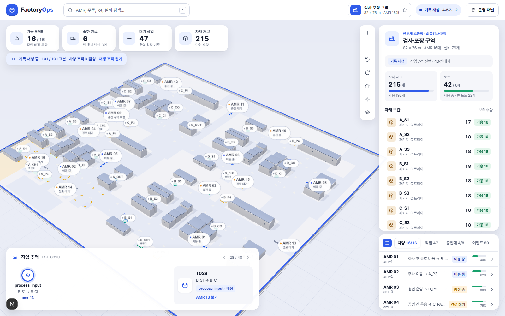
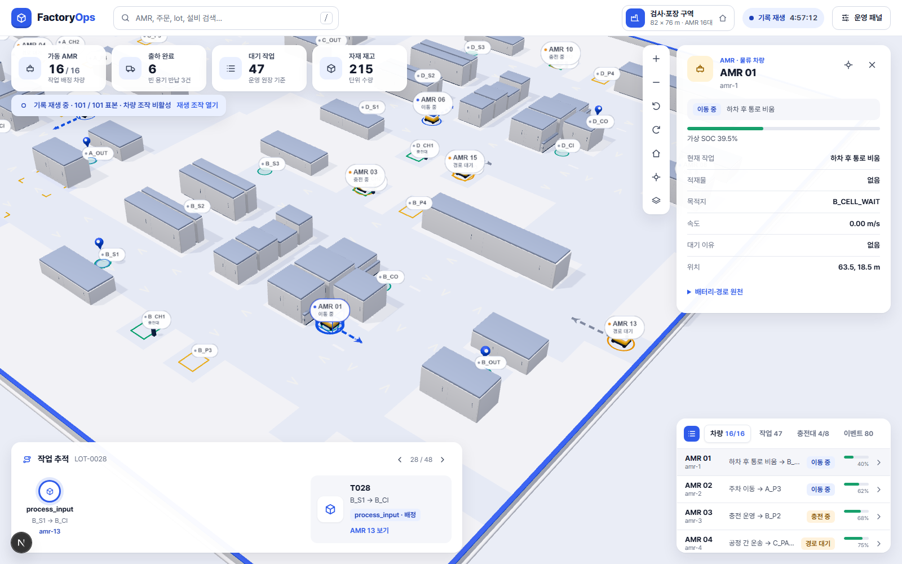
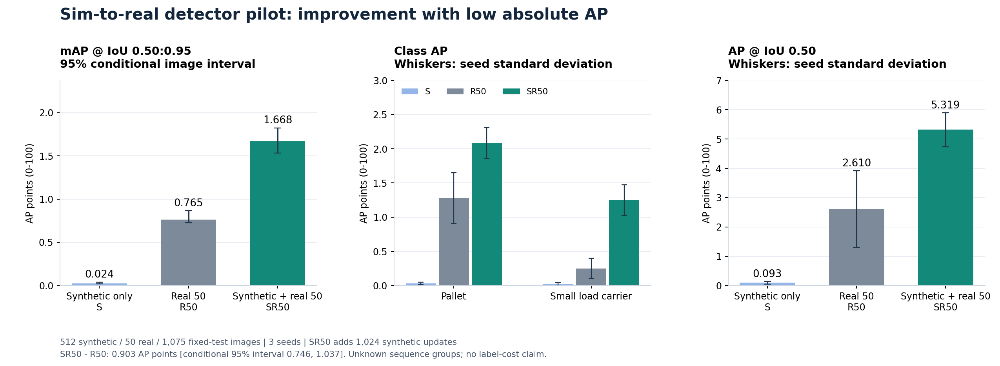
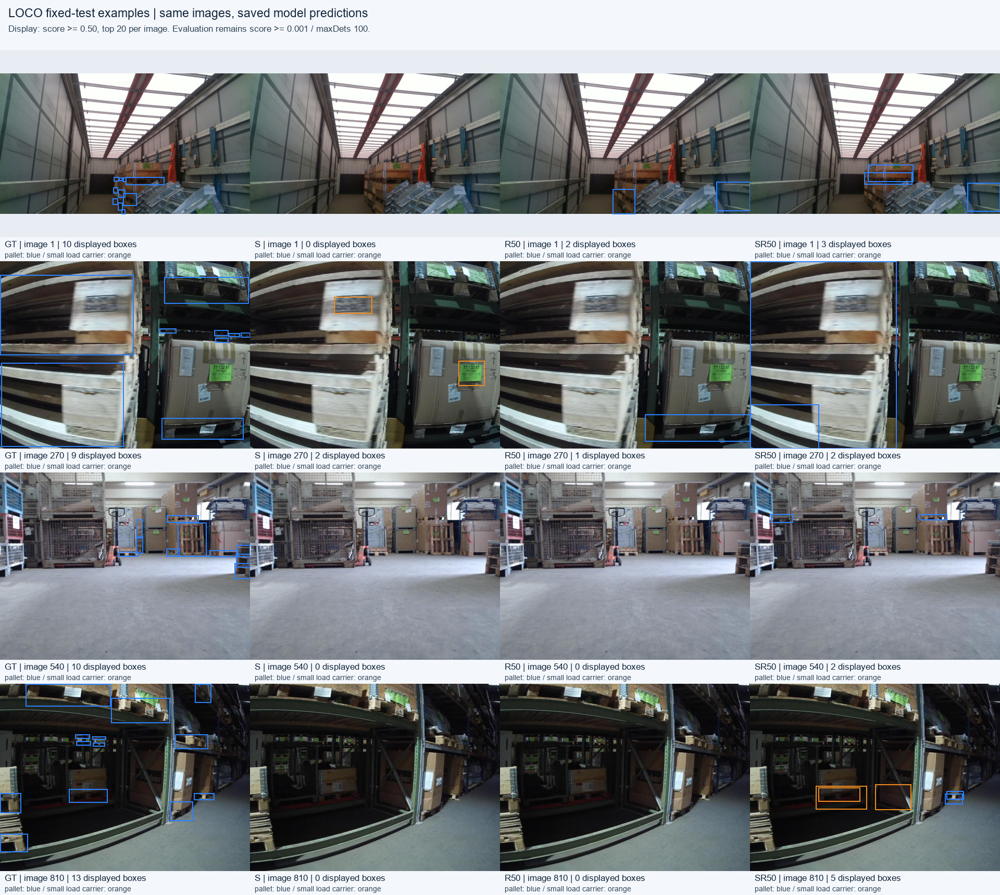
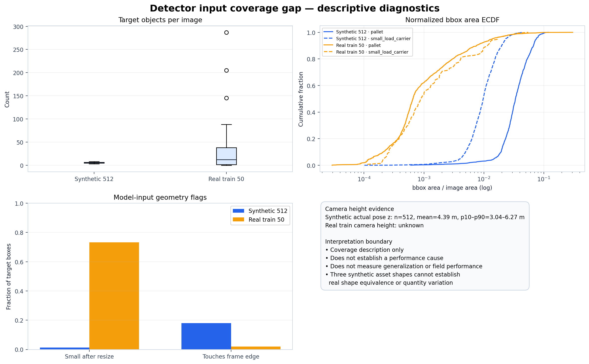
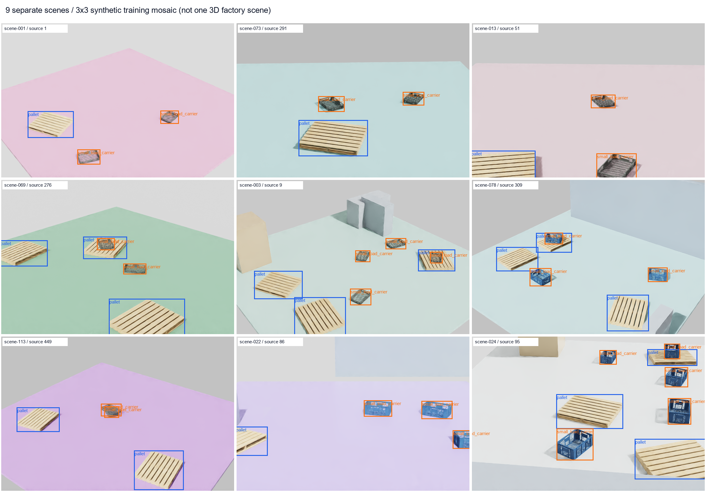
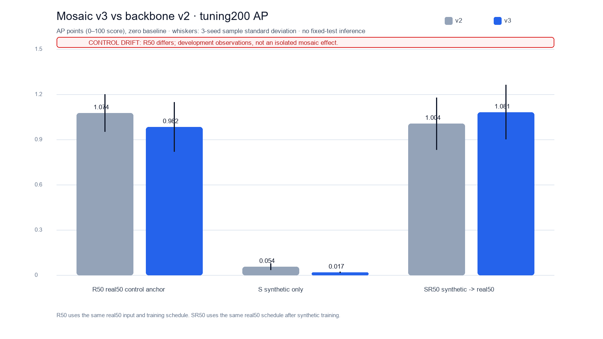
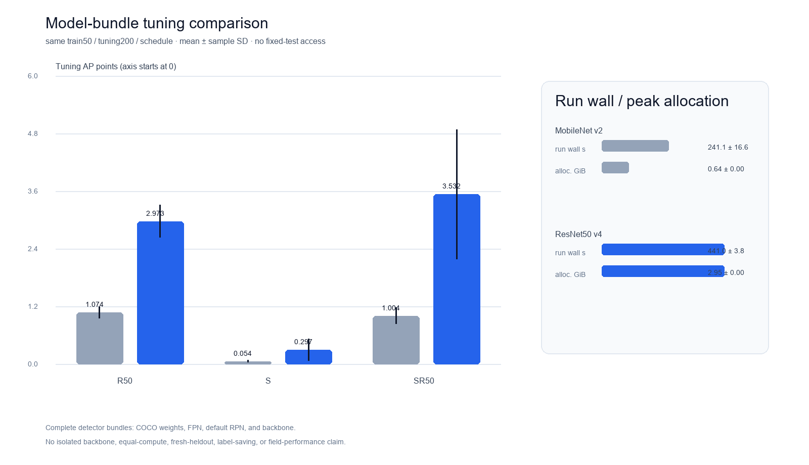

# Factory Ops Twin

반도체 후공정의 검사·포장 구역에서 AMR의 자재 공급, 완제품 출하, 빈 토트 반납, 충전을 운영 원장과 관제 화면으로 연결하는 디지털 트윈 포트폴리오입니다. 4대 운영 비교를 기준선으로 보존하고, 4개 생산 베이를 연결한16대가48개 lot의 출하·빈 용기 회수·최종 정지를 완료했습니다. CPU 운영 비교와 Isaac Sim 물리 시험, 합성 데이터의 실사 전이 실험은 각각의 실행 근거로 구분합니다.

[](docs/images/campus16-final-339/operations-replay.mp4)

같은 실행에서 **출하48·빈 용기 반납48·240회 운송·16대 최종 정지**를 완료했습니다. 각 차량은9~21회 운송했으며, 물류 임무 최고 동시 수는16개·실제 물류 이동 최고치는6대입니다.

영상은 완주335의 공정 간 이송·출하·빈 용기 회수 구간을 Isaac Sim4.5에서 재생한339입니다.30초·8배속이며, MP4는30fps·장면1920×1080+상태 패널, GIF는1280px·25fps·17.2MB입니다. 이미지를 누르면 MP4가 열립니다. 발췌 중 출하는5→6건, 반납은2→3건으로 늘어납니다. 차량 번호·작업·SOC와 물류 이동·대기·충전을 구분하고 최근12sim초의 같은 운송 작업을 색 선으로 표시합니다.

CPU의1Hz 원본 pose 사이를 표시용으로 보간했고 PhysX는 멈춰 있습니다. 영상의 궤적은 재생 위치이며 접촉 물리 운송이나 새 주행 측정값을 뜻하지 않습니다. [영상 출처·해시·구간 수치](docs/images/campus16-final-339/provenance.json) · [전체 운영 결과](docs/evidence/campus16-335.json) · [4대 기준선 영상](docs/images/operations-local45-228/operations-replay.mp4)

## 구현 범위

- **운영 모델:** 유한 재고와 WIP, 공정 처리, 출하, 빈 용기 회수, FIFO·ETA 배차, 구간 예약, 통로 폐쇄, 설비 고장·복구를 계산합니다.
- **16대 AMR:** 작성된 가감속·회전 한도와 정지 지점을 따라 움직이며, 충전 수요·대기열·패드 정렬·가상 충전·이탈을 운영 흐름에 포함합니다.
- **관제:** Next.js·React Three Fiber 화면에서 작업, 목적지, 적재물, 속도, SOC 원천, 예약 경로, 대기 이유, 재고와 사건을 함께 봅니다.
- **재현:** 같은 조건의 정책 비교, 읽기 전용 관측 재생, 명령 receipt, 원본 해시와 실행 ID를 보존합니다.
- **검증 경계:** CPU 운영, Isaac Sim 물리, ROS 관측, 웹 표시용 보간을 서로 다른 증거로 관리합니다.

[현재 범위와 완료 조건](docs/completion-plan.md) · [설계와 제어 경계](docs/architecture.md) · [공정 모델](docs/semiconductor-cell.md)

### 16대 연결 캠퍼스:48lot 운영 완료

| 4개 베이·16대의 운영 상태 | 검사 셀 근접 장면 |
|---|---|
|  |  |

왼쪽은 완주335의 **17,672초 시점**을 재생한339입니다. 그 시점의 출하5·반납2와16대의 위치·작업·SOC를 표시하며, 상단은 물류 임무·이동/회전·대기·충전을 구분합니다. 오른쪽은294의 정적 검사 셀 장면입니다.

82×76m에 시각 생산 설비76개, 제공처 SimReady 모델88개, 차량 홈16개와 가상 충전 도크8개를 구성했습니다. 서비스 대기점12개·교량 진입 대기점8개·전용 출구8개를 배치했고, 넓힌 차로에 걸린 소품 두 개를 옮겨 실제 모델 외곽의 통로·장애물·이웃 소품 검사를 통과했습니다. 생산 장비 본체는 공개 기능 자료를 참고한 절차형 모델입니다. [339 원본·화면 출처](docs/images/campus16-final-339/provenance.json) · [촬영·종료 근거](docs/evidence/campus16-final-339.json) · [배치 조건](docs/evidence/campus16-layout-292.json) · [교통 경로 배치도](docs/images/campus16-layout-292/campus-layout.png)

`factory-semiconductor-campus16`은 4개 TEST→AOI→PACK 라인을 베이 사이로 연결합니다. 유한 재고 240개와 캐리어 64개를 사용하고 출하 뒤 원래 저장소로 빈 용기를 돌려보냅니다. 입력·출력 버퍼와 설비 고장, 전역 배차, 가감속·회전, 구간 점유와 가상 충전을 같은 운영 모델에서 계산합니다. 공정 시간·배치는 작성 가정입니다. 출하 지점에서는 같은 운반구의 반납 작업을 이어받는 배차를 추가했습니다. 점유·용량·에너지 조건을 만족해야 하며,335는 이 로직을 포함해48lot을 완주했습니다. 개별 기능의 개선율은 분리해 측정하지 않았습니다. [연속 인계의 확인 범위](docs/evidence/campus16-station-handoff.json)

| 확인 범위 | 확보한 결과 | 범위·한계 |
|---|---|---|
| CPU 연속 물류335 | 출하48·반납48·총240운송·최종 정지,16대 모두9~21회 운송 | 작성 조건의 유한 배치 |
| 같은 실행의 동시성335 | 물류 임무 최고16개, 실제 물류 이동 최고6대 | 작업 배정·이동·대기·충전을 구분 |
| AB·CD 차로 확장 | 반대 방향 예약 창 비중첩·두 차량 진행·339 GPU 영상 | 차체·점유·정지 가드 유지 |
| 무적재 물리·센서307/312 | 16대 주행·정지,32개 ROS/RTX 라이다 토픽 | 7초 무적재 구성요소 시험 |
| 대표16대 미디어339 | 900 RGB·30fps MP4·25fps GIF·같은 작업의 최근 궤적 | 원본1Hz 표시용 보간·PhysX 정지 |

335는 빈 WIP와 유한 수요48lot에서 시작해 전량 출하·빈 용기 회수 후 정지했습니다. **240개 재고는192개 잔여+48개 소비로 보존됐고,64개 캐리어가 모두 가용 상태로 돌아왔습니다.**16대가 각각9~21회 실제 운송을 완료했습니다. 물류 임무가 최대16개 겹쳤으며 실제 물류 이동 최고치는6대입니다. 주차·충전·양보 이동은 물류 계수에 넣지 않았습니다. 작성한 공정 시간·배치의 CPU 유한 배치 결과로, 실공장 생산성이나16대의 동시 이동을 뜻하지 않습니다. [335 결과·마감 해시](docs/evidence/campus16-335.json) · [차량별 완료 운송](docs/data/campus16-335/completed-transports.csv)

AB·CD는 차로 중심 간격3m와 방향별 예약을 사용하며 AC·BD는 한 대씩 통과합니다. 차체 외곽·예약 충전 도크·정지 점유·안전 출구를 통행 승인에서 확인합니다. 정지 재계획은 보호 창을 원자적으로 전환하거나 불가능한 대안을 철회합니다. 전체 상태 이미지와 대표 영상339에는 소품 배치 수정을 반영했고, 운영 layout과 나머지7개 입력은335의 동결 원본과 같습니다. [차로·예약 범위](docs/evidence/campus16-wide-bridges.json)

선택 설정 `service_window`는 lot·캐리어·목적지 버퍼를 배차 때 예약하고, 물리 인계점은 접근 구간의 통행 허가 뒤 확보합니다. 임시 통로 충돌은 안전한 정지 위치에서 기다리며 허가 전 이동·적재를 차단합니다. 이전 인계점은 실제 차체가 이탈한 뒤 해제합니다.335는 이 설정으로 반복 운송·16개 물류 임무의 동시성·48개 출하/회수·최종 정지를 같은 실행에서 충족했습니다. [구현·검사](docs/evidence/campus16-service-window-admission.json) · [실행 방법](docs/operations-guide.md#16대-cpu-배치와-진단-종료)

<details>
<summary>이전16대 재생 연결 미리보기</summary>


GPU 재생에16대 모델과 적재 상태를 연결했고, 각 차량의 SOC·임무와12개 셀의 상태를 표시합니다. 위 이미지는 부분 운영279를3프레임으로 재생한284의 RGB에 같은 기록의 정보를 합성한 미리보기입니다. 물리 시간은 멈춰 있습니다. 현재 대표339는 상단의335 완주 기록을 사용합니다. [재생 근거](docs/evidence/campus-replay-284.json) · [화면 출처](docs/images/campus16-replay-285/provenance.json)

</details>

미디어 내보내기는720p부터4K까지16:9 장면 크기를 유지하고, 차량 번호·상태·최근 물류 궤적을 합성합니다.339는1920×1080 원본900프레임을 사용하며 GIF는1280px·25fps입니다. 최종 원본·운영300표본·재현 소스·종료 영수증·미디어를 선별해 별도 드라이브에 백업했고984개 파일의 크기와 해시를 대조했습니다. [촬영·미디어 근거](docs/evidence/campus16-final-339.json) · [보존 위치·백업 해시](docs/evidence/campus16-final-storage-339.json) · [영상 발췌·실행법](docs/operations-guide.md#16대-cpu-배치와-진단-종료)

<details>
<summary>16대 운영 정책·교통·충전과 재현 방법</summary>

**물리·센서 시험:** 로컬 RTX3060·Isaac Sim4.5에서 Carter16대가7초·420physics step 동안 약0.58m 이동한 뒤 정지했습니다. 차량별 바퀴 조인트와32개 ROS/RTX 라이다 토픽에서 증가하는 시각과 유효 메시지14~15개를 확인했으며, 최대 GPU 메모리는6,536/12,288MiB였습니다. 짧은 무적재 구성요소 시험으로 장시간 물류·Nav2·적재 접촉의 결과와 구분합니다. [307·312 실행 근거](docs/evidence/campus-capacity-307-312.json) · [시험 종료 시 일부 구역](docs/images/campus-capacity-312/overview.png)

**배차와 인계:** 기본 정책은 반납·출하·후단 WIP를 우선하고, 운송 배정이 적은 차량을 선택합니다.335의 `service_window` 설정은 lot·캐리어·목적지 버퍼의 예약과 물리 인계점의 접근 승인을 분리합니다. 출하 지점에서는 같은 운반구의 반납을 연속 배차할 수 있지만 용량·점유·에너지 조건을 모두 만족해야 합니다. 선택 정책 `downstream_wip_drain_eta_after_coverage`는 실제 완료 운송2회 미만의 차량을 우선한 뒤 명목 ETA를 사용합니다. 이 정책의333은48개 출하·회수와 최종 정지를 완료했으며, 동시 물류 최고치는12개입니다. 단일 실행의 결과를 정책의 통계적 우월성으로 해석하지 않습니다. [인계점 예약](docs/evidence/campus16-service-window-admission.json) · [연속 배차](docs/evidence/campus16-station-handoff.json) · [선택 배차 정책](docs/evidence/campus16-coverage-eta.json)

**통행과 충전:** 실제 차체 외곽과 정지 점유를 포함한 구간 예약, 교량 출구 확인, 가감속·회전 한도를 적용합니다. 넓힌 AB·CD 차로는 방향별로 예약하며 AC·BD는 한 대씩 통과합니다. 빈 집하·귀가 차량은 안전한 대피점으로 양보한 뒤 원래 임무를 재개합니다. 충전은 접근 경로·대기 에너지·패드 소유권·가상 충전·이탈을 계산하고, 홈 소유권을 교환하면 귀가 목적지도 갱신합니다. 주차·충전·양보 이동은 완료 물류 운송이나 물류 동시 수에 넣지 않습니다. [차로와 예약](docs/evidence/campus16-wide-bridges.json) · [대피 범위](docs/evidence/campus16-home-parking-yield.json) · [충전 에너지](docs/evidence/campus16-charge-margin-320.json)

**관측과 보존:** 상태 파일에서16대의 작업·속도·대기·SOC와12개 논리 공정 셀의 WIP를 확인합니다. `--record-best-window`는 전체 실행 중 출하·반납·물류 이동을 기준으로 최대300개 표본을 선별합니다. 고정 순환 대기를 감시하며, 종료 때 최종 상태·결과·기록 매니페스트·소스 해시를 마감합니다. 미완료 기록은 진단용으로만 보존합니다. [상태 출력·종료](docs/evidence/process-line-runner-lifecycle.json) · [구간 선별](docs/evidence/operations-clip-selection.json) · [오류와 수정 기록](docs/troubleshooting.md)

```powershell
cd "$HOME/factory-ops-twin"
uv run python scripts/demo/run_process_line.py --config configs/factory-semiconductor-campus16-wide-bridges-handoff-admission --policy fifo --lots 48 --horizon 240000 --max-wall-seconds 10800 --stall-timeout 600 --cycle-stall-timeout 600 --record-best-window --output-dir artifacts/operations/my-campus16-pilot
```

출력 폴더는 새 경로를 사용합니다. 위 값은 실행 상한이며 예상 소요 시간이 아닙니다. CPU 운영 기록으로 접촉 물리·센서를 검증하지 않습니다. [전체 실행 인자와 영상 발췌](docs/operations-guide.md#16대-cpu-배치와-진단-종료)

**Brev:** 기존 Nebius2×L40S 환경은 재사용 당시 `UNHEALTHY`여서 SDK 실행 전에 중단했고, 이후 실제 `STOPPED`를 확인했습니다. 기존 클라우드는 중지 상태로 보존하며 현재16대 CPU 운영과 위 물리·센서 시험은 로컬 결과입니다. `scripts/brev/reuse_scale.py`의 기본 동작은 사전 확인이고, 첫 클라우드 묶음 상한은6시간·$40입니다. 실제 정산 비용은 미확인입니다. [재사용 실패·중지 근거](docs/evidence/brev-scale-reuse-239.json)

</details>

## 반도체 후공정 장면

| 36×28m 전체 구역 | 검사 셀 근접 장면 |
|---|---|
|  |  |

남·북 주통로와 동쪽 연결 통로를 방향별로 나누고, 19개 시각 생산 설비와 35개 제공처 모델을 배치했습니다. 제공처 모델은 정비 캐비닛·작업대·카트 34개와 NVIDIA 포장 컨베이어 1개입니다. 생산 장비 본체와 건물 서비스 형상은 기능 자료를 참고한 절차형 모델이며 제조사 CAD나 인증 공장의 복제물이 아닙니다.

위 36×28m 기준선은 `CELL1` 한 곳에서 공정을 계산하고 나머지 18개 설비는 시각·충돌 맥락을 만듭니다. 새 캠퍼스의 12개 논리 공정 셀과 구분하며, 76개 시각 설비 모두의 생산 능력을 계산한다는 뜻은 아닙니다. [장면 합성 근거](docs/evidence/semiconductor-dual-lane-201.json) · [에셋과 라이선스](docs/asset-attribution.md)

## 운영 정책 비교


정상, 테스터 고장, 통로 폐쇄에 FIFO와 ETA를 조합한 6개 조건을 5,400초 지평에서 실행했습니다. 모든 조건에서 출하 12건, 빈 토트 반납 12건, 4대 주차가 완료됐습니다. 같은 seed는 확률 표본이 아니라 실행 조건 식별자로 사용했으며, 반복 통계나 실공장 성능을 뜻하지 않습니다.

- 정상 조건에서 ETA의 누적 교통 대기는 FIFO보다 **42.1% 적었습니다.**
- 통로 폐쇄 조건에서 ETA의 누적 출하 지연은 FIFO보다 **10.6% 많았습니다.**
- 거리 중심 ETA가 정상 흐름에는 유리했지만 통로 제약까지 포함하면 항상 우세하지 않았습니다.
- 납기 여유와 처리시간은 작성 가정이며, 최소 여유 1.73m는 원형 외곽 기반 CPU 관측값입니다.

[조건·실행 ID·원본 수치](docs/evidence/operations-comparison-223.md) · [기계 판독 결과](docs/evidence/operations-comparison-223.json)

### 캠퍼스 설비 고장·복구


같은48lot 수요와9,000초 관측 구간에서 `L2.TEST`의 정상·고장을 비교했습니다. HTTP로300초 고장·복구를 적용하자 처리 중인 `LOT-0004`의 남은 시간은29.6초로 보존됐고, 복구1초 뒤28.6초로 줄었습니다.

| 관측 항목 | 정상 | TEST 300초 고장 |
|---|---:|---:|
| 대상 lot의 TEST 완료 시각 | 224.7초 | 524.6초 |
| 구간 종료 시 출하 | 2건 | 2건 |
| 완료 운송 | 40건 | 39건 |

대상 공정은299.9초 늦어졌지만 이 구간에서 전체 출하 차이는 나타나지 않았습니다. 동결314 모델·설정의 CPU 비교이며 물리 운송·브라우저 조작·48lot 완주 결과와 구분합니다. [도표 출처](docs/evidence/campus-equipment-comparison-figure.json) · [비교 근거와 원본 해시](docs/evidence/campus-equipment-comparison.json) · [선별한 상태10행](docs/data/campus-equipment-comparison/boundaries.csv) · [재현 방법](docs/operations-guide.md#설비-고장-비교-재현)

## 물리 주행 기준선


Isaac Sim 4.5에서 무적재 Nova Carter 한 대가 2m 직선과 반지름 2m의 1/4 원호를 추종했습니다. 제어와 도착 판정에는 휠 엔코더만 사용했고, 시뮬레이터 GT는 독립 평가에만 사용했습니다.

| 지표 | 결과 |
|---|---:|
| 경로 횡오차 RMS | 4.76cm |
| 종점 위치 오차 | 7.12cm |
| 실제 최고 선속도 | 0.5915m/s |
| 정지 후 이동 | 0.01mm |

이 결과는 무적재 단일 차량의 구성요소 시험입니다. Nav2, 플릿 교통, 적재 접촉, 도킹, 공장 전체 운송 성능을 포함하지 않습니다. [실행·원본·프로세스 종료 근거](docs/evidence/local45-path-baseline-226.json) · [제어 기준선 설명](docs/motion-baseline.md)

<details>
<summary>도킹 정렬: 저속 접근·방향 정렬·1초 정지 확인</summary>

| 엔코더 제어와 독립 GT 평가 | 실제 목표 패드 정렬 장면 |
|---|---|
|  | [](docs/images/docking-alignment-local45-231/docking-alignment-4fps.mp4) |

별도 실행231에서 엔코더만으로 약1.5m를 접근하고 목표 방향에 맞춰 정지했습니다. 독립 GT의 위치 오차는 **4.19mm**, yaw 오차는 **2.00°**, 정지 수락 후 이동은 **0.58mm**였습니다. 실제 RGB66장을4fps·16.5초 MP4로 보존했으며 프레임을 보간하지 않았습니다. 작성한 패드에 대한 무적재 단일 차량 시험이고, 전기 접촉·충전 전력·실물 도킹 정확도는 검증하지 않았습니다. [조건·판정·소유 프로세스 종료](docs/evidence/local45-docking-alignment-231.json) · [미디어 출처](docs/images/docking-alignment-local45-231/provenance.json)

</details>

<details>
<summary>보조 물리 영상: 6kg 적재 주행과 교차 통로 양보</summary>

| 6kg 적재 곡선·제동·회전 | 두 AMR의 양보·통과·재개 |
|---|---|
|  |  |

[적재 주행 60fps MP4](docs/images/loaded-mobility-local45-135/loaded-motion-60fps.mp4)는 한 대의 적재 안정성·가감속·회전을 확인한 시험이며 자동 적재나 도킹 시험이 아닙니다. [결과](docs/evidence/local45-loaded-mobility-135.json)

[교차 통로 60fps MP4](docs/images/junction-hero-local45-142/logistics-yield-60fps.mp4)는 4대가 있는 장면에서 두 차량의 정지·양보·재출발을 확인한 시연입니다. 동적 우회 경로 생성이나 전체 ROS/Nav2 운송 완주를 뜻하지 않으며 화물은 비충돌 시각 표시입니다. [결과](docs/evidence/local45-junction-hero-142.json)

</details>

## 웹 관제와 운영 기록

| 16대 캠퍼스 관제 | 차량 선택과 작업 상세 |
|---|---|
|  |  |

완주335의16대 기록을 Next.js·React Three Fiber 관제 화면에서 재생합니다. 위 화면은 공개한101개 관측의 마지막 표본으로, 출하6건·빈 용기 반납3건을 표시합니다. AMR01을 고르면 하차 후 통로 비움 작업, 가상 SOC39.5%, 목적지와 속도를 확인할 수 있습니다. 이는 전체48lot 완주 기록에서 고른 구간이며, 마지막 표본의 출하6건을 전체 완주 수량으로 해석하지 않습니다.

82×76m 배치와 같은 run ID의 원본 관측을 보간 없이 선별했습니다. 재생 중 제어 권한은 비우며 차량·경로·재고·설비 WIP를 함께 표시합니다. API 처음·끝 seek와 브라우저의 재생 선택·AMR 선택을 확인했습니다. 화면은 저장된 관측을 표시하는 웹 렌더이며 Isaac RTX 렌더나 물리 재실행은 아닙니다. [화면 원본·DOM·해시](docs/images/campus16-web-374/provenance.json) · [재생 기록 백업](docs/evidence/campus16-web-storage-373.json) · [현재 화면·수정 소스 백업](docs/evidence/campus16-web-storage-375.json) · [표본·출처·제외 필드](docs/data/campus16-335-replay/manifest.json) · [운영 화면 사용법](docs/operations-guide.md)

차량·설비 라벨은 WebGL sprite로 표시합니다. 중첩 React root를 제거한 뒤 같은 개발 장면에서 root-unmount 진단이 나오지 않았고, TypeScript 검사를 통과했습니다. 운영 모드 촬영372의 브라우저 조기 종료는 별도 미확인 문제로 보존합니다. [수정 후 관측·설치 버전·로그](docs/images/campus16-web-374/diagnostic-binding.json) · [수정 전368](docs/images/campus16-web-368/provenance.json) · [운영 촬영 실패 범위](docs/evidence/campus16-web-production-372/build-metadata.json)

선별한 정상 운영 기록 120개는 작은 공개 패키지로 제공합니다. 원본 JSON을 보간하지 않고 gzip으로 보존했으며, 복원 SHA와 전체 실행·발췌 구간의 차이를 함께 기록했습니다. [데이터 내려받기와 재생 방법](docs/data/operations-normal-223/README.md) · [공개 출처](docs/data/operations-normal-223/provenance.json)

<details>
<summary>Isaac Sim 4.5 Kit 운영 패널: 실행229</summary>


네이티브 Kit 패널에서 일시정지, 재개, 주문 생성, `CELL1` 고장, `CELL1` 복구의 5개 명령을 같은 business run에 적용하고 receipt를 확인했습니다. 종료 후 Job에 남은 소유 PID는 0개였습니다. 배경은 공장 전체 장면이 아닌 빈 viewport 연결 시험이며 ROS, 접촉 물리, 하드웨어 제어의 증거가 아닙니다. [실행 요약·해시·종료 기록](docs/evidence/kit-operations-229/summary.json)

</details>

<details>
<summary>기존 40×24m 정적 장면의 합성데이터</summary>


Isaac Sim Replicator로 12개 시각 구성, 30시점, 3카메라에서 RGB 1,080장과 깊이·semantic·instance·bbox·카메라 정보를 만들었습니다. 기존 40×24m 정적 장면의 데이터이며 현재 36×28m 장면의 학습 데이터나 학습 성능 결과가 아닙니다. [데이터 검사](docs/images/g4-render-004/dataset-validation-report.json) · [데이터 계약](docs/dataset-contract.md)

</details>

## 합성 데이터가 실제 사진에서도 통하는가

팔레트·강체 적재함의 Isaac Sim 합성512장과 실제 LOCO 사진50장을 학습한 뒤, 고정한 실제 사진1,075장에서3개 seed를 비교했습니다. **합성 사전 학습 후 실제50장 조건은 모든 seed에서 개선됐지만, 절대 mAP는 낮습니다.** 현장 검출이나 실제 라벨 비용 절감을 입증한 결과로 보지 않습니다.



| 조건 | 합성 / 실제 학습 이미지 | mAP(0–100), 평균 ± seed 표준편차 | AP50(0–100) |
|---|---:|---:|---:|
| 합성만 S | 512 / 0 | 0.024 ± 0.010 | 0.093 |
| 실제50장 R50 | 0 / 50 | 0.765 ± 0.261 | 2.610 |
| 합성 후 실제50장 SR50 | 512 / 50 | 1.668 ± 0.108 | 5.319 |

SR50과 R50의 차이는 **+0.903 AP point**이며, 고정된3개 모델에 대한500회 paired image bootstrap의 조건부95% 구간은 **[+0.746, +1.037]**입니다. 촬영 시퀀스별 대응이 없어 이미지 독립성을 입증하지 못했고, SR50은 합성1,024 update의 추가 계산을 사용했습니다. 순수 사전 학습 효과나 실제 라벨 몇 장을 대체하는지는 아직 측정하지 않았습니다. [원본 수치·seed·입력](docs/evidence/detector-pilot-v1-347/report.json) · [bootstrap 범위·해시](docs/evidence/detector-pilot-v1-347/bootstrap.json)

<details>
<summary>같은 실제 사진에서 GT와 세 모델 예측 비교</summary>



첫 seed1701의 저장된 예측으로 만들었으며 추론을 반복하지 않았습니다. 표시만 score0.5 이상·최대20개이고, 평가는 score0.001·maxDets100을 유지했습니다. [이미지·예측 출처](docs/images/detector-pilot-341/provenance.json)

</details>

합성 원본512장·객체 라벨2,812개는 객체별 visible mask·tight bbox·깊이와 파일 해시 검사를 마쳤습니다. 팔레트·강체 용기 프록시의 제한 릴리스이며, 반도체 트레이·매거진을 물류 적재함으로 자동 치환하지 않습니다. [합성 예시](docs/images/perception-pilot-340/contact-sheet.png) · [촬영 근거](docs/evidence/perception-pilot-340.json) · [제한 릴리스](docs/evidence/perception-release-340.json)

COCO 백본의 normalization/freezing 구성을 유지한 후속 v2도 같은3개 seed로 완료했습니다. 같은 튜닝200장의 mAP는 실제50장 조건이 **0.726→1.074**, 합성 후 실제50장 조건이 **0.789→1.004**였습니다. v2에서는 실제50장 조건이 모든 seed에서 더 높아, 합성 데이터의 추가 이득은 이 개발 비교에서 재현되지 않았습니다. 이 수치는 위 고정 test 결과와 평가 집합이 다릅니다. [튜닝 비교·초기 가중치 근거](docs/evidence/detector-backbone-v2-353/report.json) · [백본 비교 모델 보존](docs/evidence/detector-development-storage-359.json)

<details>
<summary>입력 분포 차이와 다음 학습 증강</summary>



모델 리사이즈 후32×32px보다 작은 객체는 합성 라벨의 **1.24%**, 실제 학습50장 라벨의 **73.28%**였습니다. 사진당 대상 객체 평균도5.49개와31.36개로 달랐습니다. 실제 학습50장의 메타데이터만 사용한 입력 진단이며, 성능 저하의 원인으로 확정하지 않았습니다. [분포·출처·한계](docs/evidence/detector-input-gap-355/report.json)



v3는 기존512장을3×3 모자이크로 묶어 객체 크기와 밀도를 바꿨습니다. 위 이미지는 서로 다른9개 장면의 학습 증강입니다. 한 공장의 렌더가 아닙니다. 작은 객체 비율은3개 seed에서51.4~51.9%, 이미지당 평균 객체 수는49.4~49.6개가 됐습니다. S 학습의 원본 이미지 제시는2,048회에서18,432회로 늘어나므로 같은 계산량·노출량의 비교로 해석하지 않습니다. [미리보기 출처](docs/images/detector-mosaic-356/provenance.json)



3개 seed의 튜닝 mAP는 S **0.017**, R50 **0.982**, SR50 **1.081**이었습니다. 같은 초기284개 tensor와 실제 데이터·학습 설정을 사용했지만 R50 최종 tensor70개도 달랐습니다. 보고서는 이 대조군 차이를 `control drift`로 표시하며, 모자이크의 성능 개선을 입증한 결과로 사용하지 않습니다. 최종 고정 test는 다시 사용하지 않았습니다. [비교·입력·대조군 근거](docs/evidence/detector-mosaic-v3-366/report.json) · [모델 보존](docs/evidence/detector-mosaic-storage-367.json)

</details>

ResNet50 FPN 후보도 같은 데이터·학습 횟수로3개 seed의 튜닝 전용 비교를 마쳤습니다.



| 조건 | MobileNet v2 튜닝 mAP | ResNet50 v4 튜닝 mAP |
|---|---:|---:|
| 합성만 S | 0.054 ± 0.021 | 0.297 ± 0.226 |
| 실제50장 R50 | 1.074 ± 0.124 | 2.973 ± 0.336 |
| 합성 후 실제50장 SR50 | 1.004 ± 0.173 | 3.532 ± 1.343 |

값은0–100 단위의3seed 평균±표준편차입니다. ResNet의 절대 성능도 낮고, 합성 후 실제50장 조건은 한 seed에서 실제50장 조건보다 낮았습니다. COCO 가중치·FPN·기본 RPN·백본이 함께 바뀐 모델 묶음의 관측이며, 위1,075장 고정 test 결과와 비교할 수 없습니다. 이 실험은 운영 제어와 분리된 오프라인 검출 비교입니다. 실행당 평균441초·PyTorch 최대 할당 메모리 평균2.95GiB였고, 로컬 RTX3060에서 수행했습니다. 전체 프로세스 경과시간과 PyTorch 할당량이며 GPU kernel 시간·전체 장치 점유량은 아닙니다. [설정·seed·원본·측정 범위](docs/evidence/detector-model-v4-370/report.json) · [모델 보존](docs/evidence/detector-resnet-storage-371.json)

Cosmos3의 단일 L40S 후보와121-frame 정지 입력 smoke는 CPU에서 준비했습니다. NGC 인증과 고정2.1.0 manifest 접근을 확인했고 해당 라이선스 동의를 받았습니다. 기존234에서 GPU 한 장·정지 입력1개로 시험하며 실제 profile·메모리·Stop을 확인합니다. 변환 결과와 라벨 보존은 아직 확인하지 않았습니다. [실험·실행·보존 범위](docs/synthetic-to-real-plan.md) · [변환 시험 준비](docs/evidence/cosmos-smoke-preparation-346.json)

## 현재 진행 상태

| 구간 | 확보한 증거 | 남은 확인·확장 |
|---|---|---|
| 1. 공정·원장 | 4개 라인·12개 논리 셀,48lot 출하·반납·최종 정지와 유한 재고 보존 | 실공장 데이터에 따른 공정 시간 보정 |
| 2. CPU 운영 | 캠퍼스16대 모두9~21회·총240회 운송, 물류 임무 최고16개·이동 최고6대 | 작성 조건의 유한 배치이며 장기 생산 실적은 미확인 |
| 3. 물리 주행 기준선 | 경로 추종226, 적재135, 교차 양보142, 도킹 정렬231 | 전기 접촉 충전·실물 검증은 후속 확장 |
| 4. 운영 비교·원인 추적 | 4대6조건, 캠퍼스 TEST 고장·복구 지연, 정상48lot 완주 | 캠퍼스 정책의 반복 통계·실공장 성능은 미확인 |
| 5. 관제·재현·미디어 | 16대 영상339·101표본 웹 재생·차량 상세374, 라벨 root 수정 | 새 설비 명령 클릭·반응형·운영 브라우저 촬영은 남음 |
| 6. 포트폴리오·데이터 | 대표 GIF·MP4·별도 드라이브 백업, 합성512장과 실사3seed 파일럿·CI, 백본·모자이크·ResNet 비교 | Cosmos 소량 시험·라벨 보존, 낮은 실사 성능 개선 |

16대 반복 물류의 CPU 완주와 대표 미디어는 완료했습니다. 16대 물리·센서는7초 무적재 구성요소 시험이며 장시간 물류 접촉 시험과 구분합니다. 기존4대 운영 비교·단일 차량 물리 시험을 보존하고, 합성→실사 실험을 보조 트랙으로 진행합니다.

실패 원인과 재발 방지는 [트러블슈팅 기록](docs/troubleshooting.md)에 남깁니다. 현재 구현과 장기 완료 기준은 [완성 계획](docs/completion-plan.md), 선별 원본·별도 드라이브 백업·만료된 후보 파일은 [보존 색인](docs/evidence/operations-storage-230.json)에서 관리합니다.

## 로컬 실행

CPU 운영과 웹은 Python 3.12·uv, Node.js·npm을 사용합니다. 물리·렌더 시험 환경은 Isaac Sim 4.5와 RTX 3060이며 헤드리스로 실행했습니다. 같은 포트의 API나 웹이 이미 실행 중이면 프로세스를 중복으로 띄우지 않습니다.

```powershell
cd "$HOME/factory-ops-twin"
uv sync --locked
uv run python -m factory_ops.dashboard --config configs/factory-semiconductor-dual-lane --execution-mode operations --dispatch-policy eta --scenario-dir runs/operator-scenarios --port 8765
```

```powershell
cd "$HOME/factory-ops-twin/dashboard"
npm ci
npm run dev -- --port 3007
```

웹 주소는 `http://127.0.0.1:3007`입니다. 기존 API가 다른 옵션으로 실행 중이라면 사용 중인 작업을 마친 뒤 해당 API만 종료하고 위 설정으로 다시 시작합니다. API 주소가 같으면 웹을 다시 시작할 필요가 없습니다.

16대 캠퍼스의 공정 모델은 별도 포트의 `process-line` 모드로 관측합니다.4개 라인·12개 셀·48lot을 계산하며 기본값은 읽기 전용입니다. `--process-line-controls`를 추가하면 운영 패널에서 대상 설비를 선택해 고장·복구를 적용할 수 있습니다. 명령은 해당 로컬 CPU 실행에만 적용되고, 실행 ID·revision·명시한 설비를 확인한 receipt를 반환합니다. 차량 조종·주문 추가·통로 변경은 이 옵션으로 열리지 않습니다. 기존4대 API·웹을 유지하면서 다음 API와 웹을 각각 실행할 수 있습니다.

```powershell
cd "$HOME/factory-ops-twin"
uv run python -m factory_ops.dashboard --config configs/factory-semiconductor-campus16 --execution-mode process-line --lots 48 --port 18766
```

완주335의 선별 기록은 다음 설정으로 열고, 웹의 관측 재생 목록에서 `Campus16 run 335 representative replay`를 고릅니다.101개 원본 시각의 읽기 전용 재생이며 새48lot 실행의 완주를 기다릴 필요가 없습니다. [데이터 매니페스트](docs/data/campus16-335-replay/manifest.json)

```powershell
cd "$HOME/factory-ops-twin"
uv run python -m factory_ops.dashboard --config configs/factory-semiconductor-campus16-wide-bridges-handoff-admission --execution-mode process-line --lots 48 --scenario-dir docs/data/campus16-335-replay/scenarios --port 18766
```

설비 고장·복구와 관측 저장을 사용할 실행에서는 위 API 명령에 `--process-line-controls --scenario-dir runs/campus-scenarios`를 추가합니다. 저장한 관측에는12개 설비의 상태가 남으며 재생은 읽기 전용입니다. 이 옵션은 별도 실행 중인 배치의 상태를 바꾸지 않습니다.

```powershell
cd "$HOME/factory-ops-twin/dashboard"
$env:OPS_API_URL = "http://127.0.0.1:18766"
npm run dev -- --port 13008
```

캠퍼스 웹 주소는 `http://127.0.0.1:13008`입니다. API287의 읽기 전용 HTTP 관측을 보존하며, 후속 명령 연결은 HTTP 고장 적용, 설비 명령의 고장·복구·같은 실행의 receipt·재생 보존을 포함한9개 관련 검사를 통과했습니다. 화면의 설비 선택 변경은 TypeScript 검사를 통과했습니다.335 기록의 웹 재생·차량 선택374를 확인했으며, 설비 명령의 새 브라우저 클릭·반응형 확인은 남아 있습니다. 이 결과는48lot 완주를 뜻하지 않습니다. [읽기 전용 기준선287](docs/evidence/process-line-api-287.json) · [명령·화면 변경의 확인 범위](docs/evidence/campus-equipment-controls.json)

6개 운영 조건 비교는 다음 명령으로 재현합니다.

```powershell
cd "$HOME/factory-ops-twin"
uv run python -m factory_ops.operations_experiment --config configs/factory-semiconductor-dual-lane --output artifacts/operations/my-comparison/matrix.json --all --horizon 5400
```

## 저장소 구조와 한계

| 경로 | 역할 |
|---|---|
| `configs/` | 공장 배치, 경로, 주문, 주행, 에너지 설정 |
| `factory_ops/` | 공정 원장, 재고, 배차, 예약, 충전, 관제 API, 평가 |
| `scripts/isaac/`, `scripts/ros/` | Isaac Sim 물리 시험, 센서, ROS 2·Nav2 연결 |
| `dashboard/`, `extensions/` | 웹 3D 관제와 Kit 운영 패널 |
| `docs/images/`, `docs/evidence/`, `docs/data/` | 미디어, 실행 근거, 공개 재생 데이터 |

시뮬레이터 GT는 제어 입력이 아니라 사후 평가·라벨·미디어에 사용합니다. 현재 결과는 실물 Sim-to-Real 검증, 산업 안전 인증, 처리량 보증을 포함하지 않습니다. 로봇은 NVIDIA Nova Carter를 참조하며 원본 에셋은 저장소에 넣지 않습니다. 외부 모델의 출처와 변경 내용은 [에셋 표기](docs/asset-attribution.md), GPU 실행과 원본 보존 방식은 [GPU 안내](docs/gpu-handoff.md)에서 확인할 수 있습니다.
