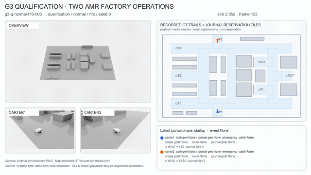
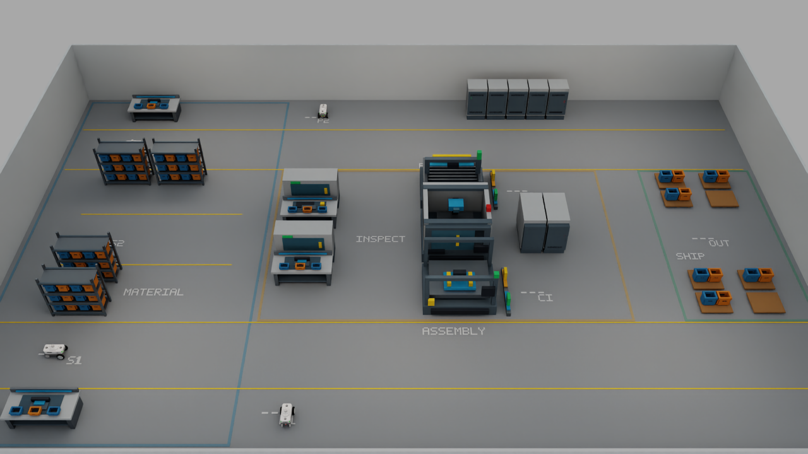
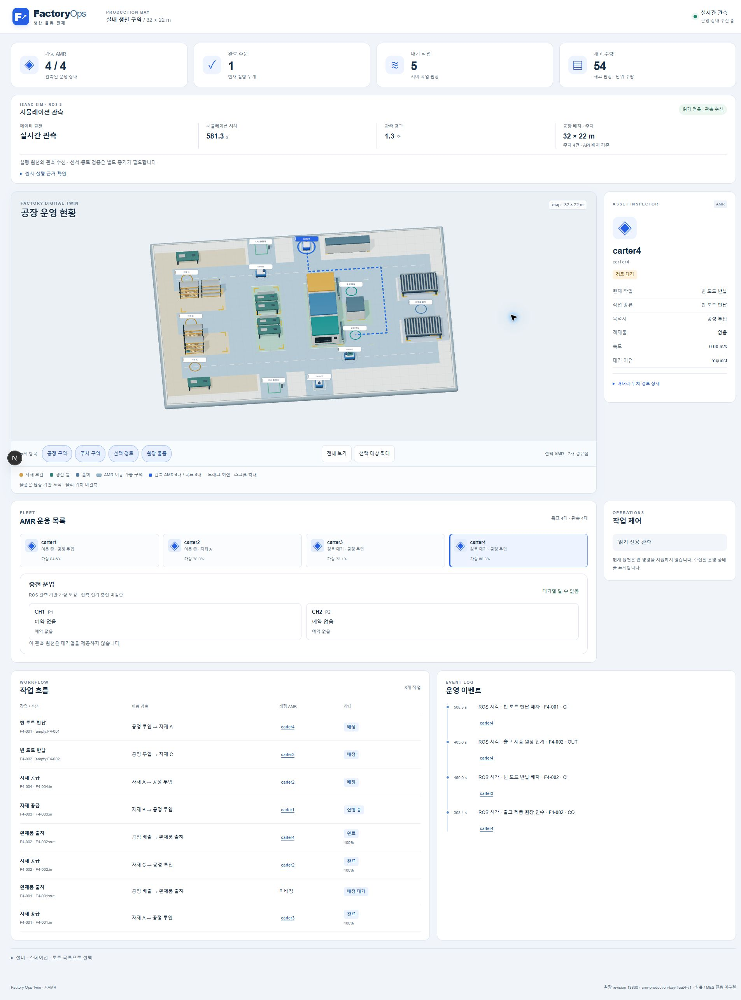
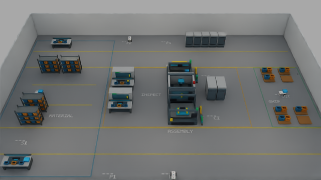
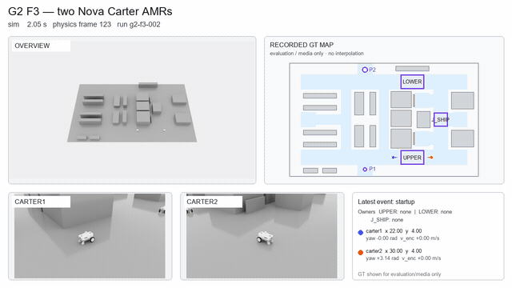
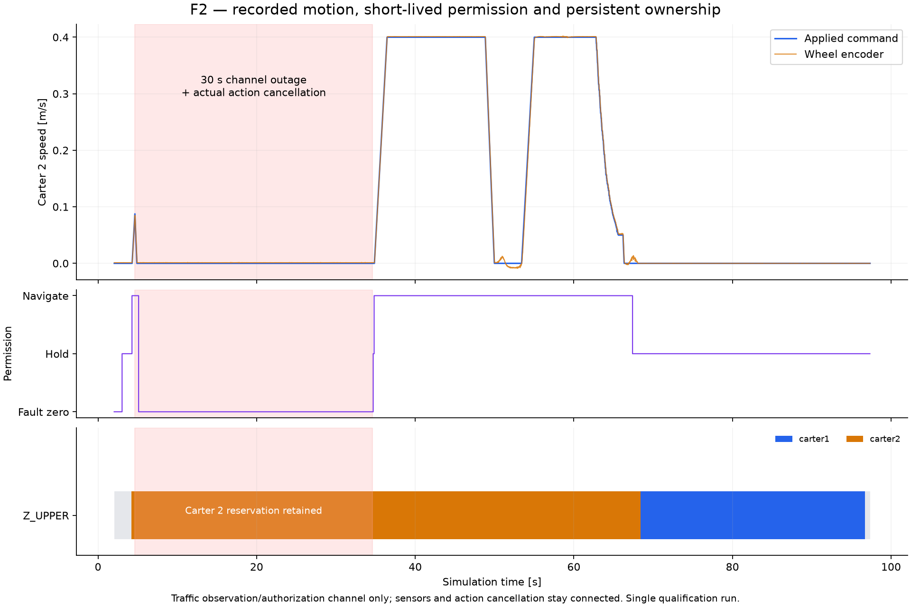
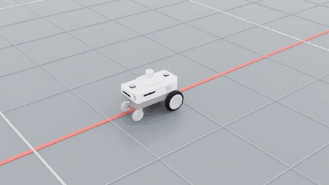

# Factory Ops Twin

AMR이 공장에 자재를 공급하고 완료품을 출하하는 과정을 검증하는 프로젝트입니다. 가상 산업용 센서 모듈 공장을 대상으로 주문·버퍼·공정·운반 상태를 연결하고, 배차와 공유 통로 복구를 비교합니다.

32×20 m 생산 구역에서 두 AMR이 주행 구간62개·정지 확인62회·자재 인계8회를 거쳐 주문2건을 출하하고 최종 주차를 마쳤습니다. [운송 실행 요약](docs/images/factory-v4-q028/mission-summary.json)에 실제 기록과 검증 범위를 담았습니다. 확인된 XY 도착 상태를 보존하면서 방향과 실제 정지 속도를 검사하고, 감속·회전·예약 점유와 순번별 공장 상태16개의 전달을 원장·궤적·촬영 파일과 대조했습니다. 전체 검증은 감속 정지 구간에도 최신 전방 추종점을 요구한 검사에서 실패했습니다. 해당 검사를 보완한 뒤 같은 원본의62개 경로에 대한 [제어·관측 사후 검사](docs/images/factory-v4-q028/observation-recheck.json)는 통과했습니다. 원래 실패 판정은 보존하며, 수정 검증기를 사용한 전체 검증과 폐쇄·복구 실행은 남아 있습니다.

출하 팔레트·토트와 제어반을 작은 모듈로 나누고, 공정·인계 위치의 바닥 표기와 지지면에 맞춘 화물 표시를 구현했습니다. 벽·설비 가림을 줄이도록 보정한 추적 카메라로 CI 인계 구간의 실제 촬영을 확인했습니다. 기존 40×24 m 정적 장면의 데이터1,080장은 수집·검사·백업을 마쳤고, 새 배치의 데이터로 해석하지 않습니다.


위 이미지는 `q020`의 시뮬레이션 4.2초에 촬영한 원본 RGB입니다. 자재 보관·키팅, 조립·검사, 출하 구역을 연결한 후보 배치를 보여주며, 운송 성공 증거로 사용하지 않습니다. [원본 프레임·소스·SHA 명세](docs/images/factory-v4-q020/provenance.json)와 기존 정적 장면의 [카메라별 원본·라벨 비교](#기존-정적-장면과-데이터-수집), [데이터 검증 보고서](docs/images/g4-render-004/dataset-validation-report.json)를 함께 제공합니다. 현장 CAD·MES와 동기화한 실공장 복제는 아니며, [초기 구상도](docs/images/concept-v3.png)는 계획 설명용 생성 이미지입니다.

이전 배치에서는 **단일 AMR 운송(G1), 두 AMR의 교통·복구(G2), 두 주문의 자재 투입부터 출하·최종 주차까지(G3b)를 Isaac Sim 6.2·ROS 2 Jazzy·Nav2에서 검증**했습니다. G3b는 62개 주행 액션·정지 확인과 8회 인계를 ROS bag·휠 궤적·예약 원장·촬영 파일과 대조했고, G2는 공유 통로 대기·30초 차단·P2 양보와 재개를 검증했습니다. 새 산업 장면의 전체 운송 임무와 FIFO/ETA 생산성 비교는 검증 중입니다.



GIF는 이전 배치의 G3 성공 원본에서 균등 선택한 120프레임을 10 fps로 재생합니다. 전체 1,122개 촬영 시점을 10 fps로 재생한 [1280×720 MP4](docs/images/g3-g3-q-normal-fifo-005-dashboard.mp4)는 명목 10배속입니다. [대표 RGB·기록 지도](docs/images/g3-g3-q-normal-fifo-005-representative.png)와 [미디어 색인](docs/images/g3-media-provenance.json)에 촬영 시각·원본 RGB·전체 명세의 해시를 남겼습니다. 상세 궤적·예약·주행 허가 자료는 C·E 사후 패키지에 보존합니다. 지도 위치는 평가·시각화용 GT이며 조향과 교통 판단에는 휠 odometry·RTX LiDAR·AMCL을 사용합니다. 지도는 해당 시각까지의 기록만 표시하고 움직임을 보간하지 않습니다. 같은 시각의 촬영과 원장 이벤트 사이의 선후 관계는 확정하지 않습니다.

## 공장에서 AMR이 하는 일

```text
S1 / S2 / S3     CI            CELL1           CO          OUT
키트 준비   →   투입 버퍼  →  조립·검사·포장  →  완료 버퍼  →  출하
       AMR 운반                  논리 공정             AMR 운반
```

S1~S3은 동일한 키트 토트를 준비하는 위치입니다. 현재 물리 임무는 주문당 토트 하나를 운반하며 토트 안의 제품 수는 표현하지 않습니다. CI에 토트를 내리면 AMR은 다음 작업으로 이동할 수 있습니다. 공정 처리가 끝나면 CO에서 OUT으로 가는 새 운반 작업을 만들고, 빈 AMR 중 하나에 배정합니다. 별도 웹 CPU 모델은 SKU 수량과 재사용 용기를 구분합니다.

현재 적재·하차는 논리 상태 전이입니다. 지게차의 포크나 로봇 팔의 파지 동작은 포함하지 않습니다. 공정은 작업자 1명, CI·CO 각 2슬롯, 설정 처리 시간 20초로 표현합니다. 이 값은 현장 측정값이 아닌 실험 설정입니다.

Isaac Sim에서 운송·교통을 검증한 구성은 Nova Carter2대입니다. 별도 정지 상태 시험에서는4대 스폰·8개 RTX LiDAR·차량별 엔코더 관측을 확인했습니다. 기존 G2/G3 운송·평가 경로는2대 구성을 유지합니다. 논리 임무 조정기는 선언된 차량 목록을 받아1·2·4대의 배차·인계 계약을 검사합니다. 별도 CPU 원장에는 SKU별 유한 재고·예약·픽업 차감·소비·재보충과 빈 토트 회수·재사용을 구현했습니다. 4대 개발 ROS 경로에는 승인된 운송 인계와 재고 차감·공정 소비·빈 토트 반납을 연결하는 코드를 추가했습니다. 가상 배터리도 엔코더 속도와 적재 상태를 받아 이동·회전·대기 소비를 계산하도록 연결했습니다. 화면에는 가상 SOC로 구분하며, 관측이 없거나 오래되면 수치를 표시하지 않습니다. [로컬4.5 실행013](docs/evidence/local45-transport-013.json)에서 자재 인수·공정 투입·소비와 추정 위치 기반 가상 충전·예약 해제를 확인했습니다. 4대 운송 완주·빈 토트 반납 완료·물리 적재 접촉·승강·도킹 센서와 전기 충전은 아직 검증하지 않았습니다. 완성품은 카트/토트를 들어 운반하는 저상 승강 AMR4대와 재고·반납·충전을 연결한 플릿을 목표로 합니다. 1대·2대는 중간 검증에 사용하고, 최종 혼합 운영·파일럿·정책 비교·대표 미디어는4대 구성을 기준으로 합니다.4대의 운송 성능은 실측이 필요합니다. [완성 계획](docs/completion-plan.md#다음-운영-확장--차량물류충전)에 완료 조건과 증설 순서를 기록했습니다.

`factory_ops.fleet_bootstrap`이 차량 ID·ROS namespace·USD 경로·스폰과8개 LiDAR의 입력을 검사하고, `scripts/isaac/fleet4_scene.py`가 기존 구동 제한·센서·렌더 경로를 재사용합니다. L40S에서 수행한 정지 시험은 차량별273개 제어·엔코더 표본,8개 센서의 ROS 메시지와 GMO 헤더 진행을 보존 원본에서 검증했습니다. 정지 시험의 RGB 기록은 두 시점×3개 카메라의6장이고, 초기 로딩 확인용2장은 별도로 보존합니다. GPU 메모리는 표본에서 최대6,539MiB를 관측했으며,4대 운송의 메모리 상한·RTF나 최대 차량 수를 뜻하지 않습니다. 이 개발 시험에서 S1·S3는 임시 시작 위치이며 최종 주차·충전 구역은 아닙니다. [실행·센서·미디어 결속 근거](docs/evidence/fleet4-stationary-smoke-002.json)에 생산자·원본 해시와 범위를 기록했습니다.



Isaac Sim에서 촬영한 정지 시험 장면입니다.4대 혼합 운송·물리 적재·충전은 후속 검증 대상입니다. 종료 결과는 SDK 밖의 별도 CPU 프로세스에서 `python -m factory_ops.fleet_bootstrap --bundle <입력 묶음> --validate-output <종료된 결과 폴더> --report <새 검증 JSON>`으로 확인합니다.

4대 운송 개발 입구는 차량 목록에서 Nav2 namespace·TF·센서·주행 허가·초기 정지와 종료 기록의 대상을 구성합니다. 기존2대 qualification 경로와 별개로 실행하며, 주차 영역4개와 공용 경로를 분리한32×22m 후보를 사용합니다. 기존32×20m 생산 설비의 크기와 간격은 유지하고 앞뒤 서비스 공간을 합계2m 늘렸습니다. 입력 묶음은 원본·파생 설정·지도·USD·차량 목록의 해시와 기하 검사를 결속하며, 이 준비 상태를4대 실제 운송 성공으로 표시하지 않습니다. 재고 연결이 켜진 개발 설정은 같은 Nav2 경로 예약·감속 정지·도착 확인을 빈 토트 회수에도 사용하며, 모든 반납과 최종 주차가 끝나야 종료합니다. 웹에는 이 원장의 재고·반납 작업과 ROS가 제공하는 센서 수신 계수·실행 단계를 표시합니다. 에너지 계수와 차량별 초기 SOC도 입력 묶음에 고정합니다. 엔코더 관측의 누락·역행·충돌은 해당 차량의 가상 SOC를 무효화하며, 관측 공백을 임의 소비량으로 채우거나 같은 실행에서 초기값으로 되돌리지 않습니다. 접촉 입력이 연결되기 전에는 충전량을 더하지 않습니다. 개발 ROS 경로에는 `--virtual-charging` 선택 기능을 추가했습니다. 빈 차량의 충전대 예약·Nav2 접근·추정 위치와 정지 확인·가상 충전·커넥터 해제·원래 주차 위치 복귀를 연결하며, `--charge-robot`으로 수동 보충을 요청할 수 있습니다. 이 모델의 접촉 원천은 추정 위치의 기하 조건이며 물리 접촉 센서나 전기 충전 측정으로 표시하지 않습니다. 관련 CPU 계약 검사를 통과했고 실제 ROS 운행 연결은 검증 중입니다. 에너지 계수는 작성된 가상 모델이며 특정 차량의 실측 배터리 사양이 아닙니다.

```powershell
cd "$HOME/factory-ops-twin"
uv run python -m factory_ops.fleet_transport --bundle runs/fleet4-transport-inputs
uv run python -m factory_ops.fleet_transport --bundle runs/fleet4-transport-inputs --verify
```

4대 개발 ROS 배차는 최근 관측으로 계산한 가상 SOC와 현재 경로를 사용해 픽업·하역·충전대 복귀, 회전·대기·예비 에너지를 계산합니다. 필요한 에너지가 부족하거나 관측이 유효하지 않은 차량에는 새 제품 운송·빈 토트 반납을 배정하지 않습니다. 이미 적재한 운송은 이 필터로 취소하지 않습니다. P1/P2는 복귀 예산의 후보이며 물리 충전기의 완료 근거는 아닙니다. 종료 검증은 수락된 제품 인계와 빈 토트 픽업·반납을 분리하고, 원장을 재생해 재고·소비·토트의 최종 상태를 대조합니다. CPU 계약 검사에 더해 [로컬4.5 실행013](docs/evidence/local45-transport-013.json)에서 제품 인수·공정 소비와 가상 충전 예약 해제를 관측했습니다. 4대 운송 완주·빈 토트 반납 완료·물리 적재 접촉과 전기 충전의 통합 검증은 남아 있습니다.

OpenUSD 자산·운영 상태와 데이터 입력을 연결하고, Kit 운영 패널과 웹에서 같은 주문·재고·차량 원장을 확인합니다. Kit의 주문 생성·전체 정지/재개와 모의 MES 입력은 CPU 운영 모델에 연결했습니다. 실제 ROS 운송의 같은 실행을 조작하는 통합과 실제 공장 MES/IoT 연결은 남아 있습니다. 차량 수에 따른 처리량과 대기 비교도 이 구분을 유지합니다.

기존 로컬 Isaac Sim4.5 설치에서도 소형 접촉 부품 시험을 실행했습니다. 물리 엔진의 센서에서 바디·패드 접촉 상대와 약196N의 힘, 분리 후0N을 관측했고 종료 코드0과 잔여 프로세스 없음을 확인했습니다. [원천·표본·이미지·한계](docs/evidence/local-contact-001.json)를 별도 기록했습니다. 작성된 수직 부품 시험으로, AMR 도킹·바퀴 제어·6.2의4대 운송·전기 충전 검증은 후속 단계입니다. 기존 SDK4.5의 NovaCarter1대를 로딩해 실제 물리 정지·RGB 렌더를 확인했고, native SDK에서 보낸 run별 ROS 메시지3건을 WSL Jazzy가 수신한 원본과 대조했습니다. [차량 준비 시험](docs/evidence/local45-asset-002.json)과 [ROS 연결 시험](docs/evidence/local45-ros-002.json)은6.2 기준선과 분리해 관리합니다. 로컬1대의17초 주행 시험에서는 전진·정상 감속·제자리 회전·곡선 주행과0.3초 watchdog 만료 후 실측 정지를 확인했습니다. 바퀴 collider에서 구동 치수를 측정하고 기존 가감속 제어·엔코더 적분을 재사용했습니다. [주행 원천·실측·이미지](docs/evidence/local45-motion-001.json)를 보존했으며, 산업용 적재 차량의 검증이나4대 자율 운송 결과로 표시하지 않습니다. [로컬 RTX→ROS 시험](docs/evidence/local45-scan-007.json)은 실제 거리3개 스캔의 전방향 관측과 시계 근접성을 확인했습니다. 원본 약10.9%의 빈 칸과 raw fill 검사 실패는 남아 있으며, 이 자료를 최종 센서 품질·Nav2 운송 성공으로 사용하지 않습니다.

로컬4.5 개발 경로에서는4대가 실제 바퀴 명령으로 각각 약0.585m 이동한 뒤 정지했고,8개 차량 LiDAR가 각각53~54개 ROS 스캔을 발행했습니다.420개 물리 스텝·7초의 진행과 입력·종료 근거를 [4대 연결 시험](docs/evidence/local45-runtime-006.json)에 보존했습니다. 이는 가감속을 사용하는 짧은 전진 시험이며 Nav2 경로 주행·교통 제어·자재 운송·센서 품질 검증과 구분합니다. 같은 개발 배치의 Nav2 C++ 플러그인은 기존 WSL Jazzy에서 빌드·클래스 로딩 시험·별도 경로 설치를 마쳤습니다. [빌드 근거](docs/evidence/local45-nav2-build-025/summary.json)는 실제 임무 실행 결과가 아닙니다.

4대 운송용 4.5 개발 진입점은 `scripts/isaac/local45_fleet4_transport_scene.py`입니다. 준비 도구의 `--runtime-profile local45_development` 옵션이 해당 소스와 설정을 Git 원본에 결속합니다. 6.2 평가 경로는 유지하며, 4.5의 FlatScan 관측 기록은 별도 형식으로 저장합니다. 공장·4개 Nav2 스택을 연결한 개발 실행에서 AMR2대가8.45m·5.93m를 주행하고3개 구간을 마쳤습니다. 공유 파일 접근을 보완한 뒤450초 개발 실행 한도까지 진행했으며, Windows·WSL 프로세스의 종료를 확인했습니다. [부분 실행 근거](docs/evidence/local45-transport-007.json)는 주문 완료0건인 개발 결과입니다. 4대의 자재 운송 완주와 재고·반납·충전의 통합 검증은 남아 있습니다. 이 개발 경로는 원본 센서·제어·TF·이벤트를 기록하고, 중복된 전처리·합류 스캔의 bag 저장은 생략합니다. 개발 운송의 RGB 기본값은640×360이며 `--capture-resolution 1280x720`로 최종 촬영 해상도를 선택할 수 있습니다. 이 개발 경로는 설치 SDK의 SimulationTime FlatScan 버퍼를 rclpy LaserScan으로 변환하고, 기존 센서 준비 구간을 마친 뒤 고유 원본 시각마다 한 번 발행합니다. 촬영 뒤 Replicator Start를 호출하는 후보는 물리 프레임 불변 검사 실패로 제외했습니다. 센서 시각과 물리60Hz는 유지합니다. 013에서 반복 촬영 후 약274초까지8개 원본 ROS 스캔의 고유 시각 증가와 역행 없음을 확인했습니다. [부분 실행 근거](docs/evidence/local45-transport-013.json)는 자재 인수·공정 투입·소비와 빈 토트 반납 작업 생성·가상 충전 예약 해제를 포함하며 전체 운송 완료나 센서 품질 합격은 아닙니다. 장시간 운송은 실행기의 `--wall-bound-s`로 상한을 지정하며, 짧은450초 실행과 구분합니다.

로컬4.5는 FlatScan의 완성 스캔 실행 출력을 SDK ScriptNode에 연결해 시각·거리 버퍼의 소유 복사본을 읽습니다. 운항 중 RGB 촬영은 World의 렌더 갱신을 사용하고, 기존 물리 시각·프레임·로봇 위치 불변 검사를 유지합니다. 두 센서의270초·13회 RGB 촬영 시험에서 새 시각2,708회씩과 시각 역행0, 이전 버퍼의 보존을 확인했습니다. [격리 시험 근거](docs/evidence/native-completion-052.json)는4대 운송 검증과 구분하며 SDK 종료 콜백의 오류 로그도 기록합니다.

역행 scan을 보정하거나 ROS로 발행하지 않는 입력 정책은 유지합니다. 거절 뒤 한 scan 기간 안에 새 scan이 오지 않거나 큰 역행·시계 reset이 발생하면 실패하고, 센서·실행당 서로 다른 거절 사건의 원본을 최대16건 보존합니다. 같은 완료 복사본의 재조회는 발행·획득 계수·보존을 늘리지 않으며 진단도 발행과 같은 소유 복사본을 읽습니다. [회복 기한 실패](docs/evidence/local45-transport-019.json)와 [후속 실행의 위치 TF 유효시간 실패](docs/evidence/local45-transport-020.json)를 구분해 남겼으며, 전체 운송과 센서 시계 정합은 아직 검증 중입니다.

로컬4.5 실행기에 `--lidar-backend physx_planar`를 지정하면 PhysX 충돌 형상에서 거리를 읽는 별도 개발 모델을 선택합니다. 720개 방위의 순간 평면 스캔을 실제 World 6프레임 간격으로 취득하고, 시각도 World 취득 시각으로 표기합니다. 원시 차체 가림과 기존 센서별 앞쪽 반평면 소비 경로를 유지합니다. ROS 시계는 같은 World 물리 시각을 지속되는 rclpy 발행자에서 제공합니다. 이 모드의 정차 제어는 바퀴의 엔코더 위치를 유지하고 이동 시 원래 속도 제어로 복귀합니다. 임무 중에는 실제 물리 스텝마다 제어와 시계를 갱신하고,6스텝마다 렌더 갱신 후 스캔을 발행합니다. RGB 촬영은 별도의 일정으로 수행합니다. 기본값인 기존 RTX와6.2 경로는 유지합니다. [센서 보정 시험과 한계](docs/evidence/physx-planar-admission-054.json)는 RTX/RPLIDAR 검증과 구분합니다. [움직인 벽에 대한 거리 갱신 비교](docs/evidence/local45-physx-cadence-067.json)는 작은 센서 장면의 결과이며 전체 공장 성능과 구분합니다. 촬영 후 재생과 [두 차량의320초 정차·재출발·회전 비교](docs/evidence/local45-parking-hold-063.json)를 확인했습니다. [4대 운송 실행](docs/evidence/local45-transport-032.json)에서는 네 차량 모두 물리 주행과 작업 인계를 수행했고, 자재4건 픽업·공정 투입3건·소비6개·완제품 출하1건을 기록했습니다. 빈 토트3건 중2건을 배정한 뒤, 정차 차량에 남은 진입 경로 예약의 상호 대기로 종료됐습니다. 4대 개발 임무는 최종 작업 지점에서 정지·도착을 확인한 뒤 정류장 주변 점유만 남기도록 수정했습니다. 관련 CPU 회귀 검사는 통과했으며, 실제 재실행과 전체 운송·빈 토트 반납 완료는 남아 있습니다.

종료된 로컬 실행의 RGB 타임랩스는 [내보내기 스크립트](scripts/media/export_local45_timeline.py)로 만듭니다. 두 실행 프로세스의 종료·실행 ID·원본 이미지 해시를 확인하고, 실패 상태도 영상에 유지합니다. 원본 촬영 시각으로 계산한 명목 배속과 정지 프레임 유지 방식을 표시하며, 연속 실시간 동작 영상으로 취급하지 않습니다. [정차 유지 비교 스크립트](scripts/isaac/probe_local45_parking_hold.py)는 두 차량의 엔코더 위치 유지·재출발·회전을 작은 장면에서 확인하는 개발 도구입니다.

Windows–WSL 인터페이스를 지정하려면 실행기에 `--windows-dds-interface`와 `--linux-dds-interface`를 함께 전달합니다. 각 운영체제의 실행별 UDP 프로필과 해시를 기록하며, 생략하면 기존 전체 인터페이스 설정을 유지합니다.

로컬 실행의 `--physics-cadence app_update`는 기존 앱 갱신 방식의 비교 경로입니다. 기본값 `owned_step6`는 렌더 주기를 줄인 물리 스텝 경로이며, 실행 결과에 요청·실제 선택 모드를 기록합니다. 앱 갱신 경로에는 물리 한 스텝 진행 보장을 주장하지 않습니다.

로컬 PhysX 모드는 SDK ROS 노드마다 고정 executor를 두고 콜백을 처리합니다. 최신 명령 진단은 수신·거절 계수와 그래프 발행자 수를 구분합니다. 그래프 정보는 DDS 데이터 전달 성공을 뜻하지 않으며, 설치 SDK가 지원하지 않는 연결 계수는 미확인으로 표시합니다.

로컬 실행기는 SDK의 최초 오류를 정리 전에 파일로 남깁니다. 호스트는 같은 실행 ID의 오류 기록을 감지하면 해당 Windows Job과 Linux 단위를 종료하고, 두 환경의 종료 결과를 따로 확인합니다. SDK 정리 단계가 멈춰도 전체 실행 제한까지 계속 기다리지 않도록 합니다.

4대 ROS 운행용 로컬 실행기는 실행별 UDP 통신 설정을 Windows·WSL에 적용하고 실제 ROS context와 기동 수신 계수를 기록합니다. 센서·odometry·TF의 기록 QoS도 발행자에 맞춰 명시합니다. 실제 네 차량의 ROS 기동 조건과 같은 실행의 운반·공정 소비를 확인했으며, 전체 운송·빈 토트 반납 완료는 남아 있습니다.

로컬 실행기는 PowerShell7에서 구성요소 시험에 사용합니다. `-SdkPath`는 기존4.5 설치 폴더입니다. 대기 중인 worker를 Windows Job Object에 배정한 뒤 source/config/dependency를 실행 직전에 대조합니다. 정상 종료와 시간 초과 뒤에는 소유 Job 전체의 잔여 PID를 확인합니다. 실제 SDK 실행과 손자 프로세스·시간 초과 검사를 통과했으며, [종료 근거](docs/evidence/local45-job-guard-006/host.json)를 제공합니다. 실행 중 담당 소스는 동결해야 합니다.WSL Nav2는 소유한 systemd 단위와 foreground 실행 클라이언트를 함께 유지하며, 종료할 때 unit·자식 프로세스·클라이언트를 모두 확인합니다. [수명·종료 근거](docs/evidence/wsl-lifetime-037.json)는 실제70초 WSL 단위 실행을 다룹니다. 4대 자율 임무의 장시간 운영 검증은 남아 있습니다.

```powershell
cd "$HOME/factory-ops-twin"
$probeRunId = [guid]::NewGuid().ToString("N")
& ./scripts/isaac/run-local-contact-probe.ps1 `
  -SdkPath "E:/IsaacSim/isaac-sim-4.5.0" `
  -Config "$PWD/configs/local-motion-probe.json" `
  -EntryPoint local_asset_probe.py `
  -SourceDependency @('factory_ops/__init__.py','factory_ops/motion.py','factory_ops/drive_profile.py') `
  -OutputDirectory "$PWD/artifacts/local45/motion-$probeRunId" `
  -RunId $probeRunId -TimeoutSec 180
```

## 3D 웹 운영 대시보드

G3의 다음 예약은 정지 확인을 마친 경유점에서 목적지까지의 남은 경로를 사용합니다. 이전 점유는 successor 예약이 승인될 때까지 유지합니다. CPU 경계 검사와 실제 ROS 실행015에서 정지 후 예약이60타일에서48타일로 줄어드는 경계를 확인했습니다. [해당 관측](docs/evidence/remaining-reservation-native-015.json)은 지나온12타일의 해제를 보여주며, 전체 대기 시간·처리량 개선은 아직 측정하지 않았습니다. 아래013 미디어는 기존 전체 경로 예약으로 실행한 원본입니다.

`dashboard/`의 Next.js·React Three Fiber 화면은 공장 배치, AMR 선택 상세, 작업·적재물·경로·재고와 운영 이벤트를 보여줍니다. Python 운영 API가 상태를 제공하고 주문 생성·일시정지·재개의 결과를 확정합니다. 기본 실행은 기존 운영 원장·유한 재고·작성된 경로를 사용하는4대 CPU 모델입니다. 공급·출하와 빈 토트 회수를 공용 차량에 시간순으로 배정합니다. 투입 자재를 소비하면 빈 토트를 CI에서 원래 자재 위치로 반납하며, 도착 후 다음 주문에 재사용합니다. 제품 LOT와 토트 ID를 분리해 같은 용기로 여러 주문을 처리합니다. 이 화면의 이동은 경로 보간이며 Isaac Sim 물리·센서 검증 결과와 구분합니다. SOC 원천이 연결되지 않은 차량은 배터리를 미연결로 표시합니다.



위 화면은4.5 개발 임무032의 실행 중 관측입니다. AMR을 선택하면 추정 위치·엔코더 속도·작업·적재물·가상 SOC를 확인할 수 있습니다. 첫 주문 출하와 빈 토트2건의 배정이 같은 원장에 반영돼 있습니다. 웹3D와 물품은 운영 표시용 도식이며, 가상 SOC·기하 도킹은 보정 전 모델입니다. 이 실행은 이후 경로 예약 교착으로 종료됐고, 빈 토트 반납은 완료되지 않았습니다. [실행 결과](docs/evidence/local45-transport-032.json)와 [이미지·영상 출처 명세](docs/images/fleet4-local45-032/provenance.json)에 범위와 해시를 남겼습니다.

대기 원인 표시는 같은 주행 구간에 결속된 신선한 예약 거절에서 점유 차량을 읽습니다. 이 표시 추가는 CPU 검사를 마쳤으며, 위032 화면에는 적용되지 않았습니다.

[CPU 운영 모델의 물류·가상 충전 관제 화면](dashboard/evidence/charging-operation-desktop.jpg)도 별도로 제공합니다.



[24.7초 RGB 타임랩스](docs/images/fleet4-local45-032/operations-partial.mp4)는 동일 실행의 실제 촬영54시점·3개 카메라를 재사용한 명목28배속 기록입니다. 촬영 사이에는 이전 프레임을 유지하며 보간하지 않습니다. 실패 종료를 표시하고, 연속 실시간 주행이나 전체 임무 완료의 근거로 쓰지 않습니다. 원본과 파생 미디어350파일을 D·E에 보존해 해시를 대조했습니다.

실행 중인 웹 화면을 캡처한 미리보기입니다. 물류 작업과 빈 토트 반납, CH1/CH2 충전대 점유·대기열·가상 SOC를 같은 원장에서 확인합니다. 관측 패널은 실행 ID·시뮬레이션 시계·데이터 지연·공장 배치와 주차면을 보여줍니다. 원천에 없는 LiDAR·Nav2·물리 적재·종료 검증·Stop은 미연결로 표시합니다. 재고 박스와 빈 토트는 원장 수량을 보여주는 도식이며, 이 화면은 Isaac Sim 렌더나 물리 접촉 검증 자료가 아닙니다.

촬영 시 실행 ID·원천 파일·미디어 해시는 [촬영 명세](dashboard/evidence/charging-operation-manifest.json)에 보관합니다.

PowerShell 터미널 두 개에서 실행합니다.

```powershell
cd "$HOME/factory-ops-twin"
uv run python -m factory_ops.dashboard
```

가상 배터리와 충전 운영을 함께 보려면 API를 다음 옵션으로 실행합니다. 저전력 차량은 작업+충전대 귀환 예비량을 확인한 뒤 충전대 예약·접근·정렬·기하 접촉 대기·충전·이탈을 거쳐 업무로 돌아옵니다. 두 충전대의 점유와 대기열, 차량별 가상 SOC를 웹에서 확인할 수 있습니다. 이 옵션은 CPU 모델용이며 물리 접촉 센서나 Isaac Sim 충전 검증 결과가 아닙니다. 기본 모델과 외부 live/replay 원천에 자동으로 적용하지 않습니다.

```powershell
cd "$HOME/factory-ops-twin"
uv run python -m factory_ops.dashboard --web-charging-profile configs/web-charging-model.json
```

```powershell
cd "$HOME/factory-ops-twin/dashboard"
npm ci
npm run dev -- --port 3007
```

브라우저 주소는 `http://127.0.0.1:3007`입니다. G3 ROS 임무의 선택형 `--dashboard` 발행기가 `map→base_link` 추정 위치·엔코더 속도·작업 원장을 `dashboard-state.json`으로 발행하며, 웹 API의 `--source <파일>`로 읽습니다. 가상 충전 원천을 함께 표시하려면 같은 실행의 `charging-state.json`을 `--charging-source <파일>`로 지정합니다. 임무013에서 API·웹의 실행 ID 일치와4대 상태·AMR 선택·적재물·재고·충전대 표시를 확인했습니다. 이 경로는 읽기 전용이며 웹에서 차량 주행·일시정지·주문을 명령하지 않습니다. 제공되지 않는 충전 대기열은 알 수 없음으로 표시합니다. 전체 운송·반납·충전 완료 판정은 임무 종료 결과에 따릅니다.

운영 사건은 같은 실행의 `actions.jsonl`을 `--events-source <파일>`로 지정해 연결합니다. 원본에서 승인된 자재·제품 인계, 빈 토트 배차·반납과 가상 충전 이정표를 표시하며, 한 번에 최대256KiB를 읽고 최근100건을 유지합니다. 사건의 ROS 원본 시각과 관제의 임무 경과 시각은 구분합니다. 사건을 읽어도 종료되거나 오래된 차량 관측이 실시간 상태로 바뀌지 않습니다. [원본 사건 표시 화면](docs/images/fleet4-live-018/business-events.jpg)과 [연결 근거](docs/evidence/fleet4-events-018.json)는 종료된018의 픽업·하역·가상 충전10건을 보여줍니다. 완료되지 않은 주문·반납이나 원본에 없는 자재 소비 사건을 만들어 표시하지 않습니다.

합성 데이터는 Isaac Sim Replicator가 생성합니다. 웹3D는 경량 운영 화면이며, 향후 촬영 요청·진행 상태·RGB/라벨·품질 결과를 연결할 대상입니다. 현재 웹에서 GPU 촬영을 실행하는 기능은 없습니다.

화면 구성과 지도 선택 상호작용은 [Dilum Sanjaya의 창고 운영 데모](https://x.com/DilumSanjaya/status/2106426962738880879)를 참고했습니다. 작성자는 [구현 설명](https://x.com/DilumSanjaya/status/2106573531018674489)에서 React·React Three Fiber 사용과 Next.js 권장을 구분합니다. 이 프로젝트는 같은 공장 배치 설정과 운영 API로 경량 웹 장면을 구성합니다.

### Kit 운영 패널과 모의 MES 입력

`extensions/factory.ops.console`은 Isaac Sim 안에서 같은 운영 API를 사용하는 Kit 확장입니다. 관측된 AMR 목록과 선택 차량의 작업·목적지·속도·SOC 원천·적재물을 표시하고, 전체 일시정지·재개와 운반 주문 생성을 지원합니다. 실행 ID와 revision을 명령에 함께 보내고 서버의 처리 결과를 확인합니다. 연결 지연이나 실행 변경이 감지되면 조작을 비활성화합니다.


실제 SDK4.5에서 AMR 선택, 일시정지·재개·주문 생성이 같은 CPU 원장에 반영되고, 확장을 끄면 창이 사라지는 것까지 확인했습니다. 화면 속 SOC와 작업은 CPU 운영 모델의 관측값입니다. 패널 뒤의 빈 뷰포트는 관제 연결 시험 환경이며 공장 렌더나4대 물리 운송 성공 자료가 아닙니다. [명령·촬영·종료 근거](docs/evidence/kit-console-004/summary.json)에 검증 범위를 담았습니다.

기존 SDK의 Kit 확장 검색 경로에 저장소의 `extensions/`를 추가하고 `factory.ops.console`을 활성화합니다. API 기본 주소는 `http://127.0.0.1:8765`이며, 실행 전 `FACTORY_OPS_API_URL`로 다른 loopback 주소를 지정할 수 있습니다. 클라이언트는 외부 HTTP 주소·리다이렉트·프록시를 허용하지 않습니다.

로컬 CPU API의 `POST /api/mes/events`는 모의 주문 발행·재고 입고·설비 관측·heartbeat를 받습니다. 주문과 입고는 기존 재고·토트·운반 원장을 갱신하고, 설비 관측은 정보로만 표시합니다. 같은 이벤트의 재전송은 재고나 주문을 다시 만들지 않으며, 다른 실행·오래된 시각·역행한 순번의 입력은 거절합니다. 실제 공장의 MES나 설비 제어에 연결한 상태는 아닙니다. 작은 HTTP 예제는 다음 명령으로 실행하며 기존 CPU 모델에 입고6개와 수량2인 주문 한 건을 추가합니다.

```powershell
cd "$HOME/factory-ops-twin"
uv run python scripts/demo/mock_mes_flow.py --output artifacts/mes-flow-example.json
```

파일이 이미 있으면 새 출력 경로를 사용합니다. live/replay 원천에는 모의 MES 입력을 적용하지 않습니다.

[HTTP 입력 기록](docs/evidence/mock-mes-024/http-flow.json)은 재고 증가·신규 주문·재전송 처리를 보존합니다. 웹의 일시정지·재개도 실제 브라우저에서 `applied`를 확인했으며, 다른 실행 ID의 명령은 작업·재고를 바꾸지 않고 거절했습니다. [웹 명령·촬영 명세](docs/evidence/mock-mes-024/web-control.json)와 [촬영 화면](docs/evidence/mock-mes-024/web-control.jpg)은 같은 CPU 원장의 관측입니다.

## 구현된 기능

| 기능 | 현재 동작과 검증 범위 |
|---|---|
| 공장 배치 | 기존 40×24 m 실행 배치와 신규 32×20 m 후보. 각각 인계 위치 6개·대피 포켓 2개·설비 장애물 19개. 신규 배치에서 정상 임무62개 구간·두 주문 출하와 조감 렌더 확인, 최종 증거 검사 수정 중 |
| 지도 생성 | 50 mm 격자, 물리 장애물 지도와 정책 keepout 지도 분리, ROS PGM·YAML 출력 |
| USD 생성 | 비충돌 시각용 바닥과 물리 Plane 분리, 바닥·설비·마커 USDA 생성과 Isaac Sim 파싱 통과 |
| 산업 공장 시각 층 | 설비 외곽 안의 랙·작업대·공정 장비·토트·팔레트, 안전 표시·재질·조명과 원장 기반 화물 표시 구현. 기존40×24 m 정적 RGB·라벨 QA 통과. 신규32×20 m 전체 운송·LiDAR·지도 정합의 통합 검증은 미완료 |
| 렌더 데이터 수집기 | 기존40×24 m 배치의 RGB1,080장과 대응 modality 검사·대표 AI 검수 완료. 신규32×20 m의 배치·주차 위치·카메라·설정 해시를 연결한 수집·검사·미디어 경로는 CPU 검증 완료, 실제 촬영·데이터 QA는 남음 |
| GPU 장면 검사 | Z-up·m 단위, 활성 충돌 API 20개·설비 19개·비충돌 마커 8개 검사, 1280×720 RGB와 SHA 저장 |
| GPU 종료 판정 | 별도 worker 종료 뒤 supervisor가 실행 ID·장면·PNG·종료 코드를 대조. L40S 실행에서 최종 PASS 확인 |
| 단일 AMR 운송 | S1 pickup→CI drop→공정 20초→CO pickup→OUT drop, 실제 goal UUID·성공 결과·신선한 map pose를 확인한 뒤 인계 확정 |
| 주행 평가 | 실제 충돌 형상의 회전 외곽 약 0.637 m + 여유 0.2 m로 전체 60 Hz 궤적 검사. 계획에는 위치 추정 여유 0.3 m를 추가하고 CI·CO·OUT 접근 정책 폭을 2.6 m로 설정 |
| 주행 명령 프로파일 | 정상 가감속·곡선 감속·회전 전 제동·회전 후 출발·후진 전환과 휠 속도/가속도 제한을 60 Hz 물리 루프에 적용. L40S에서 명령 한계와 실제 차체·엔코더 응답을 별도로 검사 |
| 주행·센서 수집 | G1·G2·G3의 60 Hz 휠·GT 궤적, RGB와 ROS bag 보존. G0b에서 RGB/Depth/semantic/bbox·카메라 파라미터 3세트의 정렬도 별도 검사 |
| ROS 2 연결 | RTX `/scan`, 엔코더 `/odom`, `/clock`, `map→odom→base_link→base_scan` TF, AMCL·Nav2·action 결과를 연결 |
| 운영 원장 | 주문·운반·버퍼·공정·완료 상태, 버전 검사, 중복 이벤트 억제, 로그 재생 |
| 재고·토트 원장 | 별도 CPU 모델에서 유한 SKU 재고·예약/취소·픽업 차감·소비·재보충과 빈 토트 회수/반납/재사용, 차량별 단일 적재와 수량 보존을 검사. Isaac Sim 임무·물리 적재와 미연결 |
| 배차 | 공통 버퍼·가용성 조건을 통과한 작업에 FIFO 또는 이동 ETA 적용 |
| 통로 예약 | 지정된 3개 자원과 출구의 원자 예약, stale 점유 유지, release ACK 검사 |
| 두 AMR 교통·복구 | 로봇별 namespace·전후방 RTX LiDAR·TF·Nav2, 두 센서 frame을 보존한 AMCL 입력과 미관측 영역을 clear하지 않는 costmap, 짧은 주행 허가와 통로 소유권 분리. 네 시나리오의 실제 GPU 실행·원본 검증 PASS |
| 복구 결정 | 5초 지속 wait cycle의 양보 결정과 ACK 이후 재개. 60초 stall과 구분 |
| 로컬 데모 | 동일한 6개 주문·2개 논리 AMR의 두 정책 실행, CSV·JSON·HTML·SHA256 명세 생성 |
| 연속 주문 원장 · G3a | 두 AMR·시간별 주문 공개·CI/CO 역압·FIFO/ETA 연결. goal 결과와 신선한 도착 pose를 확인하며 G3b에서 실제 두 주문의 ROS 실행과 연결 |
| 경로 후보 · G3a | 회전 외곽·설정 여유를 반영한 21개 연결 구간, 정상·폐쇄의 112개 경로 후보와 1 m 격자의 swept tile 생성 |
| 구간 예약 · G3a | 신선한 추정 점유·goal UUID·예약 세대 검사, 이전·다음 구간의 원자 전환, 거절·stale 시 기존 점유 유지. 작성된 관측으로 검사 |
| 비교 입력 · G3a | 정상·폐쇄·주문 급증 × FIFO/ETA × 10 seed의 60개 미실행 입력. 부하 보정 자료가 없으면 물리 결과 집계를 차단 |
| 준비 패키지 · G3a | 대화형 경로 보고서·정상/폐쇄 지도·USD·입력 명세 생성. 검증 시 현재 소스로 16개 파일을 재생성해 내용 대조 |
| 실제 실행 연결 · G3b | 이전 배치의 통합 검증 PASS 보존. 신규32×20 m에서도62개 액션·두 주문 출하·최종P1·P2 주차 완료. planner 원본과 정규화한 FollowPath 요청을 보존하며 신규 실행의 최종 증거 검사 수정 중 |

통로 로직은 호출자가 준 추정 위치·점유·출구 상태를 입력으로 받습니다. 로컬 교통 trace는 작성된 관측을 넣어 결정 규칙을 검사합니다. CPU 운반 데모는 격자 거리와 설정 속도로 시간을 계산하며 로봇 간 간섭과 예약 대기를 반영하지 않습니다. 두 결과를 합쳐 물리 주행 성능으로 해석할 수 없습니다.

## 기존 정적 장면과 데이터 수집


같은 물리 프레임의 조감·통로·AMR 근접 화면을 행으로, RGB·미터 단위 깊이·semantic·instance/bbox를 열로 배치했습니다. [조감](docs/images/g4-render-004/rgb-overhead.png)·[통로](docs/images/g4-render-004/rgb-aisle.png)·[AMR 근접](docs/images/g4-render-004/rgb-amr_follow.png) RGB는 1280×720 원본 바이트를 보존합니다. 도판은 원본 라벨에서 만든 파생 이미지이며, 예약된 배경 ID와 미라벨 영역도 원형 renderer ID·semantic 픽셀에 결속했습니다. [출처 명세](docs/images/g4-render-004/g4-media-provenance.json)에 원본·카메라·라벨·실행 소스·후처리 소스와 출력 해시를 연결했습니다.

산업 장면은 기존 물리 USD 위에 별도 시각 층을 합성합니다. 원본 충돌 형상·지도·인계 위치를 유지하고, 논리 화물의 소유권과 버퍼·공정 상태를 운영 원장의 이벤트 해시와 연결합니다. CI·CO 슬롯은 청록색, 공정 진행은 주황색, 완료는 초록색으로 표시합니다. 화물의 표시 위치는 논리 적재 상태를 표현하며 물리 파지·적재 하중은 검증 범위에 넣지 않습니다.

`g4-render-004`는 기존40×24 m 배치의12개 시각 구성에서 구성마다30개 시점·3개 카메라를 기록했습니다. RGB1,080장에 깊이·의미 및 인스턴스 라벨·bbox·카메라 정보를 연결했고, 전체 자동 데이터 검사에서 오류0건을 확인했습니다. [보고서](docs/images/g4-render-004/dataset-validation-report.json)는 `deterministic_data_passed=true`, `portfolio_qa_passed=true`입니다. 대표 RGB36장에 대한48항목의 [AI 시각 검수](docs/images/g4-render-004/qa/portfolio-ai-review-002.json)를 원본 해시와 연결했습니다. 이 판정은 신규32×20 m 배치에 적용하지 않습니다. 사람의 릴리스 승인과 생산용 승인은 `false`로 유지하며, AI 검수를 물리 접촉·적재 검증으로 해석하지 않습니다.

[수집 프로필](configs/factory-v3/dataset-profile.json)과 [데이터 계약](docs/dataset-contract.md)에 촬영 수·클래스·분할·원본 출처·카메라 좌표·파일 해시·시각 검수 조건을 정의했습니다. 8개 구성은 train, 2개는 validation, 2개는 test로 나눕니다. 같은 공장 배치의 시각 구성이므로 다른 공장에 대한 일반화나 학습 성능을 뜻하지 않습니다. 데이터 촬영은 초기 물리 안정화 후 정지한 AMR와 달라지는 카메라 구도를 사용하며, 운송 동작은 별도 운영 실행에서 기록합니다. 이전 수집 실패도 실행별 원본과 실패 상태를 유지합니다.

촬영기는 커밋에서 추출한 읽기 전용 소스를 사용하고, 보존한 Git commit·tree·blob 객체를 재계산해 실행 파일의 출처를 검사합니다. 종료 시 같은 파일을 다시 해시하고, 데이터셋에 소스 묶음과 검증 기록을 보존합니다. 데이터 분할의 중복 검사는 파일 압축 방식과 촬영 순서가 달라도 같은 픽셀·배열 내용을 검출하며, 검증 보고서에는 진단용 프로필과 최종 수집 프로필의 판정을 구분해 남깁니다.

G3 운영 실행기도 고정 커밋의 소스 묶음·세션·원본 자료를 함께 보존하도록 구성했습니다. 보정·결과 변환·집계 코드는 닫힌 ROS bag 검사기와 실행 영수증을 재검증해 원본과 대조하며, 테스트용 자료는 실제 실험의 실행 자격을 열 수 없습니다. 본실험의 입력 경로·SHA와 trial·workload 식별자를 세션·원본 환경·결과 보고서에 연결하고, 각 결과를 재검증할 때 해당 입력을 명시하도록 구성했습니다. 파일럿은 seed 100, 본실험은 seed 0~9로 구분합니다. 이 경로의 실제 파일럿과 본실험 연결은 아직 검증 전입니다.

본실험 집계에는 실행 하나씩 압축본을 원래 경로에 복원해 원시 자료를 재검증하는 경로도 구성했습니다. 실행·세션·입력·파일럿·자원 기록을 연결하고, 기존 결과 변환기로 다시 계산한 결과와 제출된 수치가 같아야 합니다. 원본 소스 묶음과 회차 순서를 검사할 때는 검증한 세션의 v3/v4 프로필을 사용합니다. 성공과 오류 종료 모두 입력을 다시 해시하고, 집계기가 만든 작업 복사본만 정리합니다. 이 경로의 CPU 회귀검사와 기존 소스 검수는 통과했으며 실제 본실험의 실행·보존·복원 연결은 검증 전입니다.

60회 평가의 원본 보존·용량 계산 경로는 CPU 회귀검사와 독립 소스 검수를 통과했습니다. D/E 각각에 원본 패키지 60개와 공통 파일럿 자료·한 번의 복원 작업 공간·20GB 여유를 확보하도록 계산합니다. 보존 CLI는 승인된 디스크 ID와 이전 모든 회차의 패키지·원본 명세·재생 결과를 다시 대조합니다. 임시 복원 공간은 의미 검증을 마친 뒤 정리하고 원본 패키지는 보존하도록 구성했습니다. 실제 6개 파일럿의 측정, 60회 평가와 완료된 본실험 CDR의 재생 연결은 아직 검증 전입니다. 프로젝트 예산과 계정 잔액은 별도로 확인하며, 용량 판정은 기존 원본 삭제를 승인하지 않습니다.

평가 시간 제한에 도달하면 지표용 원장을 고정하고 새 배차·주행·인계를 차단합니다. 이미 보낸 주행 구간은 유지 중인 예약 안에서 마무리하며, 두 AMR의 HOLD 적용과 새로운 연속 정지 표본을 확인한 뒤 기록을 닫도록 구성했습니다. 미완료 작업과 종료 정리를 구분하는 이 경로는 CPU 검사를 통과했으며 실제 ROS·GPU 검증은 남아 있습니다.

클라우드 실행기는 GPU 자원 표본의 원시 응답·UTC 시각·종료 상태를 함께 보존하고, 검증과 원본 압축·압축 내용 대조까지 포함한 실행 시간을 기록합니다. 수집 실패도 별도 실행 기록으로 남깁니다. 이 경로는 CPU 검수와 실제 GPU 자원 수집기 단독 시험을 통과했으며, 파일럿 전체 실행의 자원 측정은 남아 있습니다.

현재 개발 우선순위는 두 AMR의 임무 완주와 공정 흐름이 보이는 장면입니다. 반복 RGB 촬영은 60개 물리 스텝마다 하던 방식에서 600개 스텝마다 하는 방식으로 줄였습니다. 60Hz 물리 시계에서 10초 간격이며, 시작·종료와 운반물/버퍼 상태 변화는 별도로 촬영합니다. 원인 분석용 센서·주행·예약 로그는 유지하고, 이미 확보한 합성 데이터 1,080장은 추가 생산하지 않습니다.

`factory-v4`의 진단 실행에서는24초 연속 촬영을 껐습니다. 정상 임무가 안정된 뒤 최종 미디어 실행에서만 한 구간을 활성화합니다. 물리6프레임마다 촬영하는240개 표본은 물리 프레임·시뮬레이션 시각·설정 해시·원본 궤적과 일치해야 합니다. 원속도 미디어 생성기는 이 구간과 전체 임무 검증을 모두 통과한 실행을 받아들입니다. 기존 산업 장면의240시점·720장 RGB는 시각·해시·디코딩 검사를 통과했으나 전체 임무 검증은 실패했습니다. 연속 촬영을 끈 실행은 원속도 영상의 입력으로 사용하지 않습니다. pilot·본실험에서는 연속 촬영 구간을 만들지 않습니다.

G3 촬영은 물리 시간을 전진시키지 않는 zero-delta 렌더를 수행한 뒤 재생을 재개해 연속 ROS 센서 출력을 다시 시작합니다. 촬영 전후의 시각·물리 프레임·로봇 자세가 달라지면 실패 처리합니다. LiDAR의 프레임 번호·시각·요소 수를1초 간격과 촬영 전후에 기록하며, 포인트 배열은 추가 저장하지 않습니다. 실행 중에는 ROS 토픽 구독과 상태 저널로 관찰하고, SQLite bag의 분석은 기록기 종료 후 수행합니다. 촬영 뒤 writer 상태 전환을 포함한 CPU 검사와 GPU의 초기 센서 연속 수신은 확인했으며 전체 임무 검증은 남아 있습니다. 확인된 문제·미확정 원인·수정·재발 방지 검사는 [문제 기록](docs/troubleshooting.md)에 구분해 남깁니다.

v4의 도착 판정기는 Nav2의 stateful 위치 확인과 방향·실제 정지를 연결합니다. XY6cm 안에 도착한 사실을 유지하며 목표 방향을 맞추므로, 이후 위치 추정값이 경계를 오가도 최종 회전과 경로 재접근을 반복하지 않습니다. 기본 자세 판정이 통과한 상태에서 움직이는 동안에는 속도 명령0을 보내 감속하고, 실제 정지한 뒤 성공을 반환합니다. 이후 물리 HOLD ACK·신선한 연속 정지·별도 station 도착 검사를 통과해야 인계를 확정합니다. 경계 이탈·방향·정지·reset·trace 결속의 회귀시험은 통과했으며 수정 후 전체 GPU 검증은 남아 있습니다. yaw0.15rad·선속도0.02m/s·각속도0.02rad/s와 station0.25m/0.25rad·연속 정지0.5초를 유지합니다. [허용치 선정 기록](configs/factory-v3/g3-goal-acceptance-provenance.json)과 실패 원본을 보존하고, 가감속·충돌 여유·예약 조건도 유지합니다. 공장 상태 전달에는 순번·해시·미래 시각 검사를 적용합니다.

실행 중에는 로봇마다 두 플러그인의 클래스·stateful·XY·yaw 허용치 여섯 값을 조회해 ROS 타입·ACTIVE 상태·선언된 모드·소스·생성 YAML 해시와 대조합니다. 목표점·회전 상태의 원형 CDR과 ROS·저장 시각도 보존하며, 서로 다른 시계를 섞거나 오래된 표본을 재사용하면 검증을 차단합니다. 새 산업 장면의 전체 운송 성공과 정책 비교는 검증 전입니다.

도착 판정과 RPP 내부 상태를 관찰하는 Nav2 1.3.13 호환 플러그인을 포함합니다. 기본 계산을 한 번 호출하며 입력 자세·판정 상태·출력 명령과 공용 이벤트 순서를 기록합니다. CPU에서는 기존 플러그인과 정상 출력·상태·오류가 같은지, 로그 생성 실패가 제어 결과를 바꾸지 않는지 검사했습니다. 고정 소스의 빌드 영수증·이미지 ID·설치 라이브러리와 실행 전 측정값을 원본 압축본에 함께 보존하고, 복원본만으로 출처를 재검증하도록 구성했습니다. 시뮬레이터 시작 전에도 보존 파일 집합과 빌드 manifest·SHA를 대조합니다. 플러그인은 실제 VM 빌드를 통과했으며, 새 산업 장면의 전체 운송 검증은 남아 있습니다. [빌드·실행 절차](docs/gpu-handoff.md#g3b-qualification-실행기)에 Docker builder 호환 조건을 명시했습니다. 공용 이벤트 순서는 제어 주기 ID나 TF cache revision을 뜻하지 않습니다.

세 RGB Render Product는 세션 동안 활성 상태로 유지합니다. 촬영마다 갱신을 켰다 끄던 실행에서 발생한 RTX `Out of resource descriptors` 오류의 원본은 별도로 보존합니다. 갱신 토글을 제거한 현재 경로로 q013의 693개 촬영 시점과 24초·10Hz 연속 촬영 구간을 수집했습니다. 전체 임무 검증은 실패했으므로 이 자료를 성공 운영 영상으로 게시하지 않습니다. zero-delta 렌더 flush와 촬영 앞뒤의 물리 프레임·시각·두 AMR 자세 검사, 촬영 단계별 저널을 유지합니다.

세 카메라의 RGB·깊이·마스크·원형 bbox와 metadata를 모두 저장한 뒤 정규화합니다. 한 카메라의 라벨 처리에 실패해도 해당 시점의 다른 카메라 원본을 재검사할 수 있습니다. 검사기는 정규화된 값과 원본 파일의 내용·해시를 다시 대조합니다. 가림 데이터는 같은 프레임의 renderer ID·원형 경로·SDK URI를 전수 대조하고, 측정된 조각별 가림률과 복합 물체 전체의 미측정 상태를 구분합니다. 승인에는 유효한 측정 범위와 대표 화면 검수가 필요합니다. 실패한 수집 자료도 실행 ID별로 남기며, 포트폴리오용 파생 미디어를 원본과 연결합니다.

가시 마스크에 instance가 있지만 개별 SDK bbox 행이 없는 경우도 구분합니다. 원본 경로·클래스·에셋 해시·객체 식별자와 전체 가시 픽셀의 semantic 라벨을 대조하고, 상위 aggregate 행이 있으면 그 전체 하위 ID도 검증합니다. 상위 행이 없는 상태는 별도 형식으로 기록합니다. 두 경우 모두 마스크에서 얻은 bbox·픽셀 수·가장자리 접촉 여부를 보존하고 SDK bbox와 가림률은 미측정 상태로 남깁니다. 검사기와 미디어 생성기는 원본 마스크를 다시 읽어 이 값을 대조합니다. 픽셀 수로 누락을 허용하는 임계값을 두거나 보이는 ID를 지우지 않으며, 마스크에서 계산한 값을 SDK 측정값에 포함하지 않습니다.

QA 보고서는 데이터셋 ID·실행 ID·검사한 명세의 크기와 SHA256·검사 코드의 SHA256을 함께 기록합니다. 자동 데이터 검사(`deterministic_data_passed`), AI 포트폴리오 시각 검수(`portfolio_qa_passed`), 사람의 릴리스 승인(`human_release_approved`), 생산용 승인(`production_passed`)을 구분합니다. RGB 1,080장 전체와 대응 자료는 자동 데이터 검사를 통과했고, 대표 RGB 36장·48항목은 AI 포트폴리오 검수를 통과했습니다. 사람의 릴리스 승인과 생산용 승인은 `false`입니다. 미디어의 배경·미라벨 영역도 예약 renderer ID와 원형 정보·semantic 픽셀을 대조하며, 알 수 없는 ID를 임의 색상으로 채우지 않습니다.

보고서·검수 기록·파생 미디어는 닫힌 원본 밖의 새 경로에 저장합니다. 원본 파일 집합을 명세와 대조하고, 검사와 미디어 생성에서 사용한 입력의 경로·크기·해시를 다시 확인합니다. 입력이 달라지면 공개용 결과를 만들지 않습니다. 원본 데이터와 실행 소스는 서로 다른 물리 디스크에 복사한 뒤 전체 복원·SHA 검사를 거칩니다. 작은 대표 이미지와 영상만 Git에 넣고, 전체 원본과 파생 명세는 별도 저장소에 보관합니다.

`scripts/brev/g3_storage_probe.py`는 소스 Git bundle을 비공개 draft Release로 나눠 전송하고 다시 받아 전체 바이트·SHA를 대조합니다. Linux/WSL에서 prepare·upload·readback·verify를 분리하고, 저장소의 비공개 상태와 ID, Release와 asset의 정확한 집합을 각 단계에서 확인합니다. 코드 리뷰·로컬 회귀검사와 함께 48,012,125B 소스 bundle의 3개 조각 업로드·재다운로드·재조립·Git 복원 및 fsck를 통과했습니다. 이 도구의 범위는 소스 전송이며 대형 원본 자료의 보관·의미 검증이나 최종 백업 승인을 대신하지 않습니다. Draft는 변경 가능하므로 후속 사용 시 원격 상태와 바이트를 다시 확인해야 합니다.

`scripts/brev/g3_raw_storage_probe.py`는 Linux/WSL에서 G3 원본 압축본·명세·실행 기록·세션·소스 bundle을 별도 묶음으로 준비하는 로컬 PREPARE 도구입니다. 원본 압축본을 그대로 담고, 묶음 내부와 외부의 식별자·파일 집합·크기·SHA를 대조합니다. 준비 중 파일 교체나 세션 변경이 생기면 결과 확정을 거부하고 실패 기록을 남깁니다. `python scripts/brev/g3_raw_storage_probe.py --help`에서 입력 경로를 확인할 수 있습니다. 이 도구로 준비한 묶음의 원격 업로드·재다운로드와 물리·의미 재검증은 아직 수행하지 않았습니다.

`scripts/brev/g3_local_preservation.py`는 Linux/WSL에서 `prepare-run → preserve-run → finalize-store → finalize-plan` 순서로 파일럿 원본을 보관하는 도구입니다. 원본 패키지 생성·복사·전체 복원·Git bundle 검사·기존 의미 검증을 수행하고 단계별 시간을 측정합니다. D/E의 봉인된 물리 디스크 식별 자료와 실제 여유 공간을 확인하며, 실행 ID·소스·명세·복원 위치가 맞아야 보존 기록을 만듭니다. 상대 참조로 묶은 증거는 VM에서 다른 경로로 옮겨 검사할 수 있습니다. 두 저장소의 실제 6개 실행 기록이 갖춰지면 같은 용량·비용 계산식으로 다음 실행의 자원 계획을 검증합니다. `python scripts/brev/g3_local_preservation.py --help`에서 네 단계의 입력을 확인할 수 있습니다. CPU 통합 검증을 진행했으며 실제 파일럿 자료의 보존·복원은 새 실행 뒤 수행합니다. 이 도구는 VM 원본 삭제 권한을 부여하지 않습니다.

실험 준비에는 `scripts/brev/g3_campaign.py`의 `actual-six`·`freeze-primary`, Windows의 `scripts/brev/g3_qualification_gate.py`, WSL의 `scripts/brev/g3_live_recheck.py`를 사용합니다. 각각 실제 여섯 실행의 입력과 60회 평가 입력 고정, 디스크 복원·ROS 재검증 근거 확인, 실행 전 최신 비용·저장 공간·이전 원본 보존 확인을 담당합니다. v4 실험의 spec에는 `campaign_protocol_path`로 [고정 프로토콜](configs/calibrations/g3-v4-campaign-protocol.json)의 절대 경로를 지정합니다. 실행 소스는 이 파일의 `producer_source_commit`이며 후처리 호스트의 HEAD와 다를 수 있습니다. [빌드·실행 명령](docs/gpu-handoff.md#g3b-qualification-실행기)은 두 소스를 구분합니다. 프로토콜과 설정은 깨끗한 호스트 저장소의 커밋 바이트와 같아야 하며, 실행 자료의 생산자 소스·설정 해시도 일치해야 합니다. 이 연결의 CPU 검증은 마쳤지만 실제 6개 파일럿과 60회 평가는 아직 실행하지 않았습니다. 프로토콜 파일이나 미실행 입력만으로 실행을 승인하지 않습니다. 이전 q013 자료의 실패 판정도 유지합니다.

`scripts/media/export_g3_media.py`는 검증된 qualification의 복원본에서 24초 원속도 영상, 전체 운영 영상, GIF와 대표 이미지를 생성합니다. 전체 운영 영상의 배속은 원본 시뮬레이션 시각으로 계산합니다. 10초 간격의 원본을 10 fps로 재생하면 100배속이며, 촬영 간격이 일정하지 않으면 고정 배속으로 내보내지 않습니다. 세 카메라 화면과 해당 시각까지 기록된 주문·운반물·버퍼·주행 허가·예약 이유를 표시합니다. 기록에 없는 원인이나 같은 시각 이벤트의 선후 관계는 추정하지 않습니다. `--source-commit`은 원본 생산자, `--postprocessor-commit`은 깨끗한 내보내기 코드의 커밋입니다. 후처리 인자를 생략하면 두 커밋이 같아야 합니다. 실행에는 기존 Pillow·FFmpeg·FFprobe 환경, 원본 manifest·백업·복원 검증서와 물리 디스크 색인이 필요합니다. 생성 전후 입력을 다시 해시하고 MP4·GIF 전체를 디코딩한 뒤 출력을 새 폴더로 확정합니다.

`scripts/media/export_g4_media.py`는 최종 프로필의 자동 데이터 검사와 AI 포트폴리오 검수를 통과한 복원본에서 원본 RGB와 깊이·semantic·instance/bbox 비교 이미지를 만듭니다. 신규 배치에는 `--factory-profile factory-v4`를 지정하고, 기존 자료는 기본값 `factory-v3`로 처리합니다. 선택한 프로필의 배치·카메라·설정 해시와 촬영 환경을 대조하며, 전체 복원·두 물리 디스크의 백업·라벨·검수·후처리 소스 및 출력 해시도 검사합니다. 위 G4 미디어와 보고서는 기존 v3 자료에서 생성했습니다. 신규 v4 촬영·AI 검수·미디어 승인은 아직 남아 있습니다. 사람의 릴리스 승인과 생산용 승인 상태는 별도로 기록합니다.

GPU 진단은 `scripts/brev/run-g4.sh <workspace-root> <g4-probe-NNN> <source-sha> [factory-v4|factory-v3]`로 시작합니다. 네 번째 인자의 기본값은 신규 배치인 `factory-v4`이며, 기존 배치는 `factory-v3`를 지정합니다. 진단 자료는 미검수 상태로 보존하고, 새 실행은 별도 ID와 새 디렉터리를 사용합니다. 최종 화면과 대응 데이터가 검증된 뒤 대표 이미지와 영상을 갱신합니다. [전체 완료 조건](docs/completion-plan.md)에 운영 시나리오·비교 실험·미디어·복원 검증 범위를 기록했습니다.

## G3 두 주문 운송·비교 실험 준비

`g3-q-normal-fifo-005`는 정상 조건·FIFO·seed 0의 두 주문 qualification입니다. S1·S3에서 자재를 가져와 CI에 투입하고, 논리 공정 후 CO에서 완제품을 가져와 OUT에 출하했습니다. 각 운송 뒤에는 dock을 비우고 P1·P2로 복귀했습니다.

| 실제 실행의 검증 항목 | 결과 |
|---|---:|
| 완료 주문 · 확정 인계 | 2개 · 8회 |
| FollowPath 요청·수락·결과와 정지 확인 | 각각 62개 |
| 전체 궤적의 위치 추정·예약 점유 대조 | 134,152개 표본, 로봇 간 점유 중첩 0프레임 |
| 최종 정지 | P1·P2, 마지막 물리 프레임 67,325 |
| 실제 RGB | 같은 시각의 3개 시점, 1,122세트·3,366장 |

물리 실행 소스는 `1e50a704bcb0f0d921ec8640ac93d7dc141c748a`, 사후 검증 소스는 `e9cd44eba373ec7def0c38d2b06d92de9a55a835`입니다. 마지막 TF 조회의 시각 표현을 발행기와 같게 수정한 뒤 동일 원본 전체를 재검증했습니다. 이전 실패 보고서와 모든 원본 바이트를 보존했습니다. [실행·검증 경계](docs/gpu-handoff.md#g3b-qualification-실행기)에 두 버전과 판정 근거를 기록합니다. 이 결과의 범위는 두 주문의 기본 운송 연결이며, 정책별 비교와 반복 실험은 다음 단계입니다.

G2에서 사용한 Carter의 측정 회전 외곽 약 0.637 m에 평가 여유 0.2 m와 계획 여유 0.3 m를 더해 약 1.137 m의 계획 반경을 적용합니다. 기존 통행 허용 영역에서는 21개 연결 구간 중 4개가 이 조건을 충족하지 못했습니다. G3a 파생 배치는 서쪽 연결부·S2 접근부·중앙 연결부의 정책 영역을 보정하고, 설비 충돌 형상 19개와 station·포켓 위치를 유지합니다. G3b 실행에서도 로드한 로봇의 충돌 형상을 재측정해 검사합니다.

6개 station과 2개 포켓 사이의 서로 다른 출발·도착 56쌍을 정상·폐쇄 상태에서 검사해 **112개 경로 후보가 로컬 여유 검사를 통과**했습니다. 폐쇄 상태는 물리 장벽 위치를 피하는 우회 경로를 사용합니다. 이는 작성한 경로 후보의 기하 검사이며, 실제 Nav2 경로 추종이나 두 AMR의 충돌 회피를 검증한 결과가 아닙니다. 3 m 통로는 두 계획 외곽을 나란히 수용하지 못하므로 예약과 대기가 필요합니다.

구간을 바꿀 때는 로봇이 점유한 타일을 이전·다음 예약에 모두 남기고, 다음 구간을 확보한 뒤 이전 예약의 나머지를 반환합니다. 거절되거나 관측이 오래되면 기존 예약을 유지합니다. CI·CO의 논리 버퍼 2슬롯과 물리 dock의 한 대 점유는 별개입니다. 작업 후에는 dock을 비우는 경로와 P1·P2의 주차 점유도 보호해야 합니다.

60개 입력은 아직 실행하지 않았습니다. 같은 조건·seed의 FIFO/ETA에는 동일한 주문·초기 상태를 주고 선실행 정책을 교대합니다. 실패·미완료도 전체 60회와 조건별 10쌍에 남깁니다. 수집 검증이 실패한 실행의 완료 주문 수는 미측정과 가능 범위로 기록하며, 실제 0건 완료와 구분합니다. 두 정책의 완료 건수를 모두 알 수 있는 쌍의 관측 평균과 전체 쌍의 가능한 평균 범위를 따로 계산합니다. 완료 시간은 두 정책이 모두 완수한 쌍에서 별도로 집계합니다. 배차 전에는 후보 로봇의 현재 위치→픽업→드롭 전체 경로가 다른 로봇의 유지 중인 주차 점유와 겹치는지 검사하고, 겹치는 조합을 제외합니다. 정상·폐쇄와 FIFO/ETA 네 조합의 작성된 관측 재생에서 대체 배차·두 주문·8회 인계·최종 주차를 확인했으며, 새 배차 필터의 실제 GPU 검증은 남아 있습니다. 이후 부하 보정·6개 조건/정책 파일럿에서 도착 간격과 전체 실행 예산을 확정합니다.

G3b의 첫 qualification은 S1·S3에서 시작하는 두 주문을 사용합니다. 두 로봇의 초기 예약 HOLD가 물리 step에서 적용됐다는 ACK를 확인한 뒤 주문 타이머를 시작합니다. 계획기와 운영기의 시계 갱신이 엇갈리면 HOLD를 유지하고 운영 시계가 경로 시각에 도달한 뒤 경로를 검사합니다. 정지 확인용 odometry도 로봇별 수신 노드의 시계가 원래 표본 시각에 도달할 때까지 수신 순서대로 보류하며, 대기 표본이 있거나 표본이 오래되면 정지를 승인하지 않습니다. 운영 시계에서도 같은 표본의 시각·신선도가 확인돼야 예약 전환과 인계 대기를 시작합니다. 주행 액션은 연결 구간 하나씩 보내고, 예약은 station 사이의 전체 경로를 유지해 역방향 진입을 막습니다. 이는 상태·교통 연결을 확인하는 보수적 설정이며 정책별 생산성의 근거로 사용하지 않습니다. 각 액션 종료 뒤 물리 루프의 HOLD 적용 ACK와 그 이후의 새로운 휠 odometry 표본으로 0.5초 정지를 확인하고 다음 구간으로 바꿉니다. 마지막 주문 이후에도 두 AMR이 dock을 비우고 P1·P2에 정지해야 합니다. 마지막 물리 프레임의 궤적·RGB와 두 로봇의 odometry 수신을 확인한 뒤 녹화를 닫으며, 최종 성공 여부는 닫힌 bag과 원본을 대조해 판정합니다.

## G2 실행 결과

네 실행의 소스는 `81befc881466f0e612465ba3987165eec2c9ca4f`입니다. worker 종료 후 CDR 메시지·실제 action UUID/status·TF·주행 허가·예약 원장·전체 60 Hz 궤적·RGB 해시를 대조했습니다. 로봇마다 전후방 라이다 frame을 보존해 AMCL에 전달하며, 각 scan 사본도 원본과 비교합니다.



GIF는 F3 원본에서 균등 선택한 120프레임을 10 fps로 재생한 약 25배 타임랩스입니다. 전체 605개 촬영 시점을 10 fps로 재생한 [1280×720 MP4](docs/images/g2-f3-timelapse.mp4)는 명목 5배속입니다. [대표 화면](docs/images/g2-f3-representative.png)과 [미디어 출처·해시](docs/images/g2-media-provenance.json)에 원본 RGB·물리 프레임·선택한 궤적 표본과 시각 차이를 남겼습니다.

| 시나리오 | 실제 검증 내용 | 물리 표본, AMR 한 대당 | 원본 PNG |
|---|---|---:|---:|
| P0 · `g2-p0-005` | 독립 센서·TF·위치추정과 상대 AMR의 raw 라이다 관측 | 781 | 84 |
| F1 · `g2-f1-004` | 대기→첫 AMR 이탈·ACK→후속 진입, goal 2개 성공 | 5,380 | 543 |
| F2 · `g2-f2-003` | 이동 중 30 sim 초 채널 차단, goal 취소 완료, 점유 유지·복구·ACK | 5,719 | 576 |
| F3 · `g2-f3-002` | 5초 지속 교착 확인, 취소 완료→P2 양보→이탈 ACK→재개 | 18,099 | 1,815 |

합계는 두 AMR의 물리 표본 59,958개와 같은 시각의 RGB 1,006세트·3,018장입니다. 주행 중 예약 소유권 위반은 0프레임이었고, 보수적 충돌 외곽과 여유를 적용한 로봇 간 중심 거리 기준 1.6742 m에 대해 관측 최소 거리는 3.1988 m였습니다. 성공 goal은 GT 기준 XY 0.35 m·yaw 0.35 rad 평가를 통과했습니다. 이 값은 반복 도킹 정확도 측정값이 아닙니다.



F2는 교통 위치·heartbeat와 주행 허가 채널을 차단합니다. 센서와 action 취소 연결은 유지합니다. 차단 중 새 허가 발급은 0건, 예약 세대 변경도 0건이었고, 허가 만료 검사 구간의 1,757개 표본에서 0 휠 목표를 확인했습니다. action 취소와 허가 만료가 함께 발생한 시험이므로 허가 만료만의 제동 효과로 해석하지 않습니다.


F3는 작성한 대기 위치와 P2 경로에서 수행한 복구 시험입니다. 공장 전체의 교착 방지나 생산성을 확정하지 않습니다. [F1 영상](docs/images/g2-f1-timelapse.mp4), [F2 영상](docs/images/g2-f2-timelapse.mp4), [실행 ID·판정·센서·위치추정·부하 수치](docs/images/g2-results.json), [설정과 실패 처리](docs/gpu-handoff.md)에서 범위와 원본 연결을 확인할 수 있습니다.

실패·교체 실행을 포함한 원본 8,120개는 C·E 드라이브의 같은 압축본에서 전체 크기·SHA 검사를 통과했습니다. 원본 아카이브는 고정해 보존하며, 사후 분석기와 README 미디어는 `g2-postprocess-supplement-v1`로 별도 보관합니다. 파생 그래프·합성 화면은 원본 strict validator의 판정과 구분하고, 두 기록의 SHA 연결을 명세에 남깁니다.

## G1 실행 결과

검증 실행은 새 주행 프로파일을 적용한 `g1-010`, 코드 SHA는 `ec06754c62854c9b6358f67007c23a3fef7ede81`입니다. 두 worker의 정상 종료 후 ROS 이미지에서 CDR 메시지와 원본 파일을 검사해 `FACTORY_OPS_G1_VALIDATION=PASS`를 확인했습니다.

[주문 운송 MP4](docs/images/g1-amr-mission.mp4), [주행 타임랩스 GIF](docs/images/g1-amr-mission.gif), [출하 종료 원본 PNG](docs/images/g1-amr-out.png), [미디어 출처·해시](docs/images/g1-media-provenance.json)에 S1→CI·공정 20초·CO→OUT의 네 goal과 촬영 시각을 보존했습니다.

| 항목 | 실제 기록과 범위 |
|---|---|
| 운송 | 주문 1건, navigation goal 4개 성공, OUT 인계 시각 194.517 sim s |
| 궤적 | 60 Hz 원본 11,597개, 이름이 결속된 휠 각도 재적분·프레임 연속성·자세·지도 여유·주행 명령 한계 검사 통과 |
| 촬영 | 1280×720 주행·조감 RGB 195쌍, 원본 PNG 390장과 시각·pose·SHA 보존 |
| 종착 위치 | 정지 후 GT 기준 OUT 중심까지 0.0414 m. 반복 도킹 정확도는 미평가 |
| 위치 추정 | AMCL 대 GT 최대 XY 오차 0.2097 m, RMS 0.1067 m, 시각이 대응된 1,685개 표본 |
| ROS bag | SQLite integrity OK, `/scan` 1,902개·`/cmd_vel` 3,035개·`/clock` 11,412개, 네 goal UUID의 성공 상태와 원장 이벤트 대조 |

평가 여유는 앞선 실패 때와 같은 0.2 m입니다. 초기 G1에서는 바닥 충돌 표현과 저속 제자리 회전 문제를 대조 시험으로 분리했고, 2 m 접근 정책 통로가 위치 추정 오차를 수용하지 못한 실행도 실패로 보존했습니다. 현재 통로 설계와 제어 설정의 근거는 [GPU 연동 안내](docs/gpu-handoff.md)에 적었습니다. 위 결과는 한 주문의 검증이며 반복 성공률·물리 접촉 수·생산성 개선율을 뜻하지 않습니다.

## 주행 동작과 계측

Nav2의 속도 요청은 60 Hz 주행 프로파일을 거쳐 좌우 휠의 속도 목표로 전달됩니다. 정상 정지는 감속하고, 전진 중 제자리 회전을 요청하면 먼저 전진을 줄입니다. 회전 후 출발과 전후진 전환도 정지 단계를 거칩니다. 곡선에서는 `|v × ω|` 명령 한계에 맞춰 속도를 낮춥니다. 통신 명령 만료나 실행 오류에는 별도의 고장 정지를 적용합니다. 물리 엔진이 에셋의 구동·접촉 조건에 따라 차체의 움직임을 계산합니다.


`motion-001`은 기본 Nova Carter와 Plane 바닥을 사용한 **별도 주행 시험**입니다. 76초 동안 4,560개 물리 표본과 10 Hz 원본 PNG 761장을 수집했습니다. 고정 시간표가 명령을 만들고 GT는 계측과 촬영에만 사용합니다. 공장 운송 결과와 구분합니다.

| 계측 항목 | 실제 차체 응답 |
|---|---|
| 직선 정상 속도 | 0.6014 m/s, 요청·적용 명령 0.6 m/s |
| 가속 10→90% 상승시간 | 1.925초, 마지막 1초의 실측 정상 속도 기준 |
| 정상 제동 | 1.733초·0.5207 m, 약 0.6 m/s 직진 뒤 정지 요청 |
| 제자리 회전 | 요청·적용 0.8 rad/s, 실측 0.7645 rad/s |
| 좌회전 곡선 | 적용 0.3162 m/s·0.6325 rad/s, 실측 0.3010 m/s·0.7475 rad/s |
| 후진 전환 | 적용 명령의 0 속도 표본 확인, 차체의 양→음 전환은 요청 후 1.213초 |

제동의 정지 기준은 전방 속도 절댓값 0.02 m/s 이하를 0.5초 유지하는 것입니다. 과도응답 계측에는 0.1초 이동 평균을 사용합니다. 곡선에서 보이듯 명령과 실제 응답은 다릅니다. 가감속·횡가속·휠 제한은 작성한 명령 한계이며, 실물 모터·적재량·바닥 조건에 맞춘 보정값은 아닙니다.



GIF는 제동·회전·재출발 구간 16초를 확대해 10 fps로 재생합니다. [전체 76초 MP4](docs/images/amr-drive-profile.mp4)는 원본 촬영 간격과 같은 10 fps이며 타임랩스가 아닙니다. [설정·계측 정의](configs/factory-v3/motion-qualification.json), [미디어 출처·해시](docs/images/motion-media-provenance.json)에 실행 ID와 원본 프레임 연결을 기록했습니다.

## 로컬 실행

Python 3.12와 [uv](https://docs.astral.sh/uv/)를 사용합니다. Python 런타임 의존 패키지는 없습니다.

PowerShell:

```powershell
cd "$HOME/factory-ops-twin"
uv sync --locked
uvx --from pyright==1.1.414 pyright
uv run python -m unittest discover -s tests -v
uv run python -m factory_ops prepare --output runs/local
uv run python -m factory_ops verify runs/local
uv run python -m factory_ops replay runs/local/fifo/events.jsonl --expected runs/local/fifo/snapshot.json
uv run python -m factory_ops prepare-g3 --output runs/g3a
uv run python -m factory_ops verify-g3 runs/g3a
uv run python -m factory_ops.g3_session --output runs/g3-qualification --profile qualification --condition normal --policy fifo --seed 0
uv run python -m factory_ops.g3_session --output runs/g3-qualification --verify --profile qualification --condition normal --policy fifo --seed 0
```

`runs/local/report.html`을 브라우저에서 열면 배치도, 정책별 완료 기록과 이벤트 원장을 볼 수 있습니다. 준비 명령은 클라우드 인스턴스를 만들거나 실물 로봇에 명령하지 않습니다.

`runs/g3a/report.html`에서는 출발·도착, 폐쇄 여부, 예약 후보 타일을 선택해 경로를 확인할 수 있습니다. G3a 준비 명령은 새 출력 폴더만 사용합니다. 기존 패키지는 `verify-g3`로 검사하거나 다른 출력 경로를 지정합니다. 검증은 입력·생성기 SHA와 파일 집합을 대조한 뒤, 경로·입력 계획·지도·USD·보고서를 현재 소스에서 다시 생성해 16개 파일의 바이트까지 비교합니다. 이 검사는 물리 실행이나 발행자 인증을 뜻하지 않습니다.

```text
runs/local/
  report.html              배치와 CPU 결과
  geometry.json            정상·폐쇄 경로와 배치 검사
  manifest.json            입력·출력 SHA256와 검증 범위
  maps/                    map.pgm, keepout.pgm, YAML, 명세
  scene/                   factory-v3.usda, 명세
  traffic-checks.json      stale 점유·wait cycle의 작성된 관측 trace
  fifo/, eta/              summary.json, snapshot.json, events.jsonl,
                           orders.csv, assignments.csv
```

CPU 운영 데모의 `physical_collisions`, `nav2_success_rate`, `rtf`, `peak_vram_gb`는 `null`로 저장하고 `primary_evaluation=false`를 붙입니다. G1의 한 주문 실행과 CPU 논리 데모, G0b의 촬영 부하 관측은 별도 기록입니다. G0b의 기존 Cube 바닥은 후속 대조 시험에서 주행 불안정을 보였으므로 당시 이동 거리와 RTF를 안정된 Nav2 성능의 근거로 사용하지 않습니다. 물리 접촉 수는 측정하지 않았습니다.

`verify`는 저장된 파일의 SHA256 일치를 확인하고, `replay`는 입력 이벤트 본문·순서·버전을 재생 결과와 대조합니다. 명세 자체의 서명이나 발행자 인증을 제공하는 기능은 아닙니다. 출력 폴더에 무관한 파일이 있으면 준비 명령이 덮어쓰기를 거절합니다.

CSV에서는 수식으로 해석될 수 있는 식별자 앞에 작은따옴표를 붙입니다. 원래 식별자는 JSON 원장과 snapshot에 보존합니다.

## 코드 구조

```text
configs/factory-v3/    배치·교통 자원·로컬 주문과 설정
factory_ops/
  layout.py           배치 검증, 격자 경로, 지도 출력
  footprint.py        실제 로봇 충돌 외곽과 지도 여유 검사
  motion.py           휠 각도 적분과 명령 watchdog
  drive_profile.py    정상 가감속·회전 전환·곡선·휠 제한, 별도 고장 정지
  motion_validation.py 기록한 명령 경계와 물리 응답의 독립 검사
  motion_authorization.py  시뮬레이션 시각으로 만료되는 주행 허가 검사
  navigation.py       goal 결과와 CI·CO 인계·공정 연결
  fleet.py            두 AMR의 시간별 주문·배차·goal 결과 연결 계약
  fleet_routing.py    전체 배치 경로 후보·회전 외곽·swept tile 검사
  route_reservation.py 점유 타일 보존과 원자 예약 전환
  experiments.py      고정 입력·paired seed·부하 보정 게이트·실패 포함 집계
  g3_prepare.py       G3a 지도·USD·보고서 생성과 소스 재계산 검증
  fleet_execution.py  실제 계산 경로의 외곽 검사와 연속 odometry 정지 판정
  callback_drain.py    노드별 executor의 순환 처리와 유한 callback 처리 예산
  g3_session.py       qualification/pilot/primary 입력·지도·장면 생성과 재계산 검증
  g3_supervisor.py    실행·자원 원본·종료 상태·아카이브의 결속 검증
  g3_calibration.py   실제 6개 파일럿 재검증과 60회 평가의 자원 예산 판정
  g3_local_preservation.py  원본 패키지·두 저장소 복원·의미 검증과 자원 계획 연결
  g3_media.py         전체 임무·복원·촬영 시각과 연결된 미디어 입력 검사
  g3_media_operations.py 촬영 시점의 원장·시각 상태·주행 허가와 HUD 연결
  g4_media.py         최종 데이터·검수·복원본과 연결된 RGB·라벨 비교 이미지
  dataset_evidence.py RGB·깊이·마스크·bbox·좌표·분할·원본 해시 QA
  dataset_review.py   외부 AI 시각 검수의 원본 결속과 승인 범위 검사
  usda.py             USD 텍스트 출력
  operations/         상태 모델, 원장, 배차
  traffic.py          예약·복구 결정
  traffic_observation.py 추정 위치와 로봇 외곽의 자원·출구 투영
  traffic_fixtures.py 작성된 관측에 따른 결정 검사
  smoke.py            CPU 이벤트 실행
  report.py, cli.py   결과 보고와 명령
tests/                표준 unittest 회귀시험
scripts/isaac/        정적 장면·단일/두 AMR·RTX LiDAR·실제 RGB 수집
scripts/ros/          Jazzy Nav2 실행, mission action client, CDR·원본 증거 검사
scripts/brev/         코드 SHA를 고정한 두 컨테이너 실행·종료 supervisor
scripts/media/        검증된 원본에서 영상·GIF·이미지와 출처 명세 생성
docs/                 설계 경계와 GPU 연동 순서
```

## 다음 실행 순서

기반 검증인 G0a·G0b·G1·G2와 이전 배치의 G3 두 주문 운송을 마쳤습니다. 기존40×24 m 장면의 G4 데이터 검사·대표 AI 검수·README 미디어도 보존합니다. 신규32×20 m 정상 운송은 완주했고 최종 증거 검사 수정과 폐쇄·복구 검증이 남아 있습니다. 전체 완성 판정은 [8개 완료 요건](docs/completion-plan.md)으로 관리합니다.

한 공장 배치의 12개 시각 구성·구성당 30시점·3카메라에서 RGB 1,080장과 대응 깊이·semantic·instance·bbox·카메라 정보를 확보했습니다. 같은 구성의 인접 프레임을 독립 장면으로 세지 않으며, G0b·G1·G2·G3 운영 자료는 학습용으로 승인하지 않았습니다.

1. 정상 임무 원본의 증거 검사 불일치를 수정하고, 신규 배치의 공유 통로 대기·폐쇄 우회·복구·종료 상태와 보정 카메라를 검증합니다. 전체 임무 검증을 통과한 원본에서 원속도·운영 영상을 만듭니다.
2. 정상·폐쇄·급증 × FIFO/ETA의 실제 6개 파일럿으로 RTF·데이터량·복사/복원 시간·비용을 측정하고 평가 입력과 예산을 고정합니다.
3. 같은 3조건 × 2정책 × 10 seed의 60회 평가를 실행하고 실패·미완료를 포함해 비교합니다.
4. 대표 운영 미디어와 결과 설명을 반영하고, 전체 원본·소스·미디어의 백업·복원·독립 검수와 Brev `STOPPED` 확인을 마칩니다. 이후 장면을 바꾸면 새 실행 ID의 원본·QA를 보존하고 대표 미디어를 갱신합니다.

환경 선정과 데이터 보존 순서는 [GPU 연동 안내](docs/gpu-handoff.md), 구현 경계는 [설계 설명](docs/architecture.md)에 적었습니다.

## 데이터와 에셋

공장 설비와 마커는 자체 작성한 박스 형상이며, 로봇은 NVIDIA 제공 Nova Carter를 참조합니다. 원본 로봇 에셋은 Git에 넣지 않습니다. 제공 에셋과 향후 도입할 에셋은 각각의 이용 조건을 따릅니다. 생성한 구상도는 시뮬레이션 실측 증거로 사용하지 않습니다.

코드·설정·문서와 README용 미디어만 Git에서 관리합니다. `runs/`, 대형 USD·원본 영상·데이터, 인증 파일은 Git에서 제외합니다. GPU 환경을 중지하기 전에는 결과를 별도 저장소로 복사하고 SHA256을 대조해야 합니다.

AWS L40S 환경에서는 Stop→Start 1회 후 결과 파일 29개·코드·캐시 이미지가 보존되고 컨테이너가 GPU를 다시 인식하는 것을 확인했습니다. 이 검사는 재시작 후 주행이나 렌더 성능 검증을 뜻하지 않습니다.

## 참고

- [Isaac Sim 호환성](https://docs.isaacsim.omniverse.nvidia.com/latest/installation/compatibility.html)
- [Isaac Sim Python 설치](https://docs.isaacsim.omniverse.nvidia.com/latest/installation/install_python.html)
- [ROS 2 설치와 지원 조합](https://docs.isaacsim.omniverse.nvidia.com/latest/installation/install_ros.html)
- [Brev GPU 인스턴스](https://docs.nvidia.com/brev/concepts/gpu-instances)
