# Factory Ops Twin

반도체 후공정의 최종검사·포장 구역에서 **4대 AMR의 트레이 공급·완제품 출하·빈 캐리어 회수**를 Isaac Sim·ROS 2와 웹 관제로 연결하는 프로젝트입니다.

[새 반도체 구역 설정](configs/factory-semiconductor)은 트레이 저장소·테스트 핸들러·ATE·AOI·ESD 포장대의 용도와 배치를 구분합니다. 새 배치의 실제 Isaac Sim 조감·설비 근접 촬영을 마쳤습니다. 로트12건의 순차 투입·연속 배차·재고 보존과 제품/반납 캐리어 표시를 CPU에서 함께 확인했습니다. 최신 [물리 운송064](docs/evidence/local45-transport-064.json)은12건 투입·2건 출하 후3시간 실행 상한으로 종료됐습니다. 장기 운송·예약 대기의 원인 분석, 전체 물류 완주와 새 대표 GIF는 남아 있습니다. [공정·설비·운영 범위](docs/semiconductor-cell.md)

[이중 차로 배치](configs/factory-semiconductor-dual-lane)는36×28m 구역의 남·북 주통로와 동쪽 통로를 방향별로 나눕니다. 기존19개 생산 설비의 크기를 유지하고, 정비 소품34개와 상태등·트레이 표시를 이동한 설비에 맞췄습니다. CPU 검사에서180개 정상/폐쇄 경로, 맞은편 차로의 예약 분리와 교차 경로의 대기를 확인했습니다. **새 배치의 실제4대 운송은 아직 검증 전입니다.** [설계도 · 실제 렌더 아님](docs/images/semiconductor-dual-lane-plan/layout.svg)

배차는 현재 배정된 제품 운송과 빈 캐리어 반납을 함께 확인해, 같은 두 지점을 역방향으로 오갈 작업의 동시 배정을 유예합니다. 실제 경로 예약과 정지 확인은 유지합니다. 동일 tick의 선택을 반영하는 CPU 회귀는 통과했으며 수정 후 물리 운송 완주는 확인 중입니다.

운영 목표는4대가 요청 큐의 자재 공급·출하·빈 캐리어 회수·충전을 반복하고, 하차 후 다음 작업을 이어받는 흐름입니다. 차량별 대기 원인과 플릿의 누적 출하·재고 변화를 함께 보여줍니다. 현재는 [같은 예약 요구의 장기 대기](docs/evidence/local45-transport-064-waits.json)가 관측돼, 교통·배차 병목 해결과12lot 완주를 우선합니다. 지원 가능한 최대 대수는 측정 전입니다.

[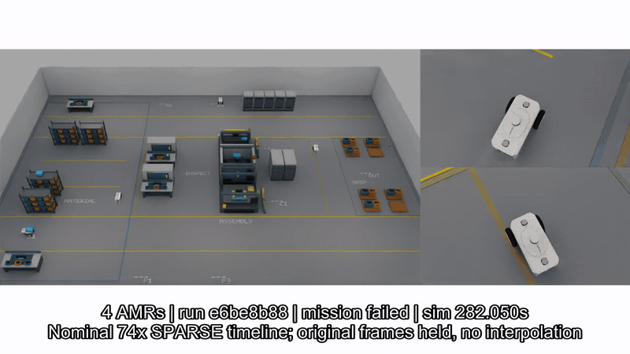](docs/images/fleet4-local45-036/operations-business-complete.mp4)

첫 화면은 **이전 센서 모듈 구역 실행**의 전체 업무 영상에서 고른12초 반복 GIF입니다. 새 반도체 구역의 영상과 구분합니다. 원본 영상의10fps·명목74배속 요약이며, 이미지를 누르면 전체 MP4로 이동합니다. [GIF 출처·변환 기록](docs/images/fleet4-local45-036/readme-smooth-preview-provenance.json)

| 현재 반도체 구역 · 실제 Isaac Sim 조감 | 테스트 핸들러·ATE·검사 설비 근접 |
|---|---|
| 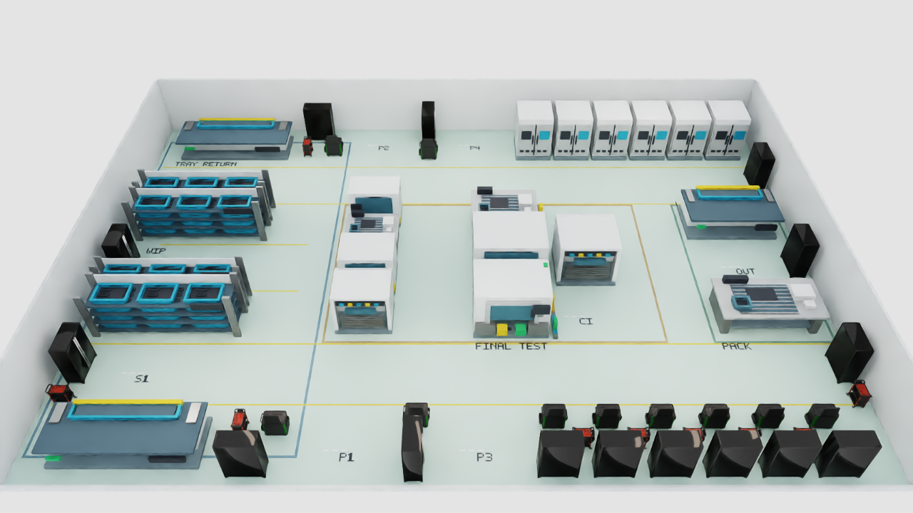 | 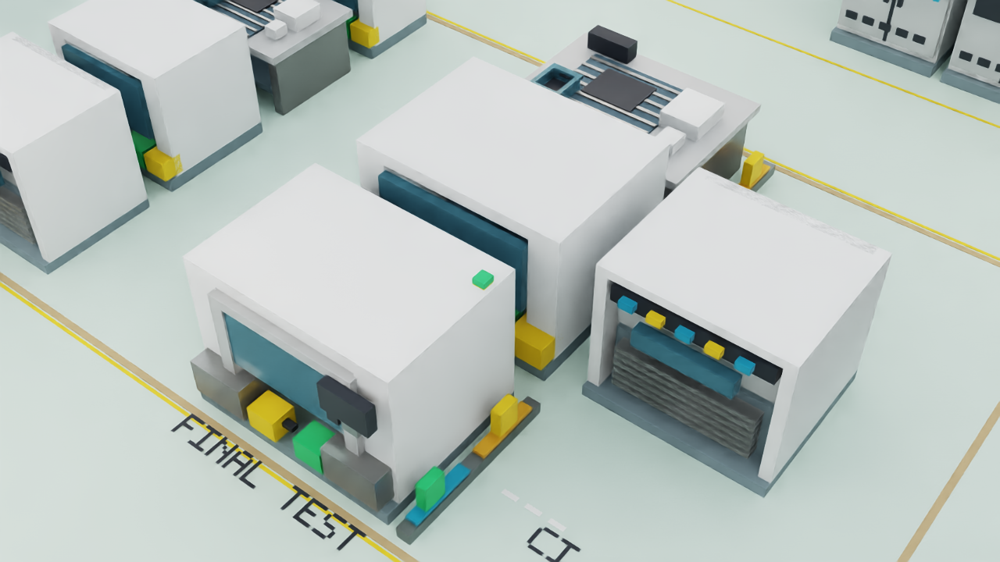 |

위 두 장은 **Isaac Sim4.5에서 촬영한 정지 RGB**입니다. 공개 기능 자료를 참고한 비브랜드 절차형 생산 설비와 NVIDIA SimReady 정비·지원 소품34개를 함께 렌더링했습니다. 제공처 원본 모델과 프로젝트의 절차형 장비를 구분하며 AMR 반복 운송이나 공장 처리량의 근거로 사용하지 않습니다. 같은 물리 시점에서 촬영했고 렌더 오류0건·소유 프로세스 종료를 확인했습니다. [촬영 소스·시점·카메라·원본 해시·종료 기록](docs/images/semiconductor-layout-local45-196/provenance.json)

<details>
<summary>지원 구역의 NVIDIA SimReady 모델 · 제공처 원본 미리보기</summary>

| 공구 보관 캐비닛 · 15개 | 이동식 정비 작업대 · 10개 | 정비 부품 카트 · 9개 |
|---|---|---|
| 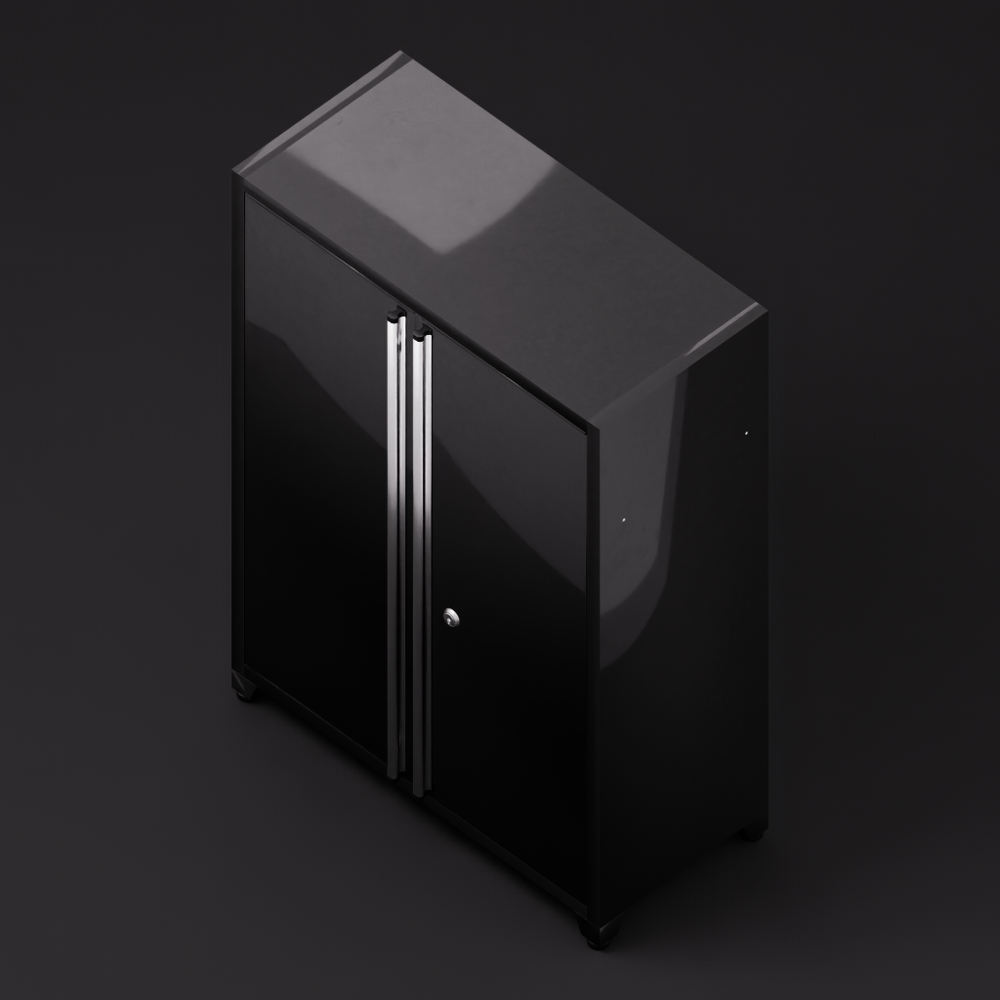 | 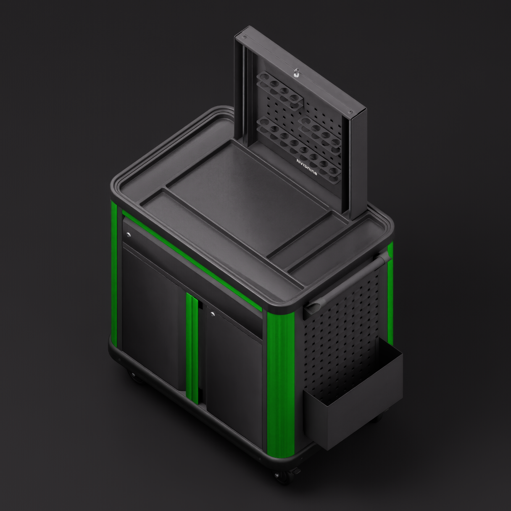 | 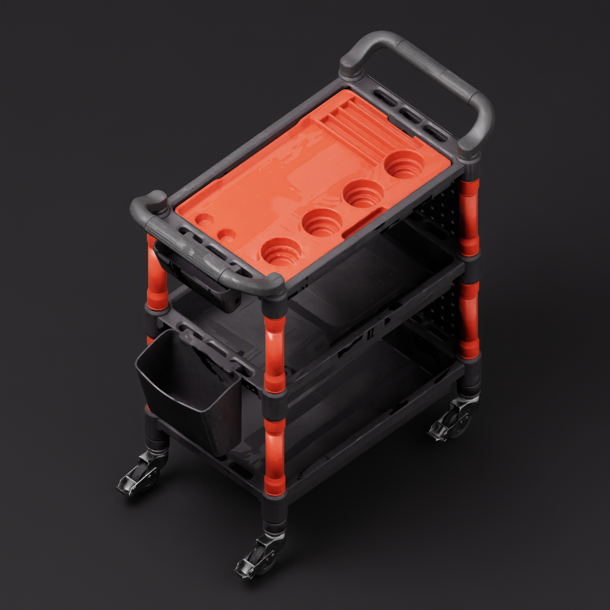 |

이 표는 NVIDIA 제공 모델 미리보기입니다. 재질·텍스처가 포함된3종을 정비·입고 지원·외곽 서비스 공간에34개 배치했고, 위196 공장 RGB에서 함께 촬영했습니다. 실제 USD 합성에서 모델 크기·위치와 AMR 구역의10cm 이격을 확인했습니다. 실패한 이전 운송063에는 새 소품이 포함되지 않습니다. 제작자 NVIDIA, CC BY 4.0. [원본·라이선스·변경 내용·캐시 준비법](docs/asset-attribution.md) · [합성 근거](docs/evidence/factory-context-196.json)

</details>

**자재 공급 → 공정 처리 → 완제품 이송 → 출하 → 빈 용기 반납**의 전체 운영과 같은 실행의 관제 상태를 보여줍니다. [현재 보존된 전체 업무 영상](docs/images/fleet4-local45-036/operations-business-complete.mp4)은 명목74배속 요약입니다. 해당 실행은 출하3건·빈 토트 반납3건을 기록했으나 최종 기록 종료 검사에 실패했습니다.

여섯 운영 단계의 원속도 촬영과 상태 패널을 묶는 내보내기 도구를 준비했습니다. 후속 수집 설정은 영상에 사용하는 각3초·180프레임에 맞춰 최대1,080장으로 제한합니다. 전체 공장1280×720 원본에 차량 ID를 표시하고, 재고·출하·반납 집계와4대의 작업·목적지·속도·가상 SOC를 같은 촬영 시점으로 붙입니다. 운송 구간은 해당 화물의 운반 차량이 실제로 이동하거나 회전한 원본만 사용합니다. 새 정상 완료 실행의 촬영·인코딩은 남아 있으며, 전체 디지털 트윈 완성을 주장하지 않습니다.

로컬4.5의 새 개발 실행에서는 `--capture-views overview`로 전체 공장 시점만 촬영할 수 있습니다. 추적 시점의 렌더 제품과 RGB 수집을 생략하는 옵션이며, 실제 속도 개선 측정은 남아 있습니다. 기본3시점 촬영과 합성 데이터 수집은 유지합니다. [촬영 범위 안내](docs/operations-guide.md#공장-운영-미디어-촬영)

출하 이후에는 두 차량이 움직이는 병행 물류 구간을 선택합니다. 재생할 원본에서 두 차량의 움직임을 확인하고, 같은6개 촬영 구간 안에 자재 공급과 빈 토트 반납이 겹치는 공장 흐름을 담습니다. 새 조건의 실제 촬영은 남아 있습니다.

<details>
<summary>보조 시연: 교차 통로 양보·통과·재개</summary>

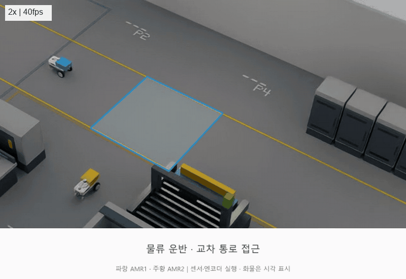

[원속도 전체 영상 · 60fps MP4](docs/images/junction-hero-local45-142/logistics-yield-60fps.mp4) · [촬영·변환 출처](docs/images/junction-hero-local45-142/provenance.json) · [실제 실행 결과](docs/evidence/local45-junction-hero-142.json)

파란 AMR1이 자재를 운반하는 동안 주황 AMR2가 교차 통로 앞에서 정지·양보합니다. AMR1의 차체가 교차 구간을 벗어나면 AMR2가 재출발하고 회전해 복귀 경로를 이어갑니다. GIF는 이 흐름을 **2배속·40fps**로 보여주며, 파란 사각형은 예약 구간을 표시한 주석입니다.

같은 공장에서4대의 실제 바퀴·엔코더·PhysX 거리 센서를 사용한 SDK 시연입니다.56.65초 동안4대 모두 목적지에 도착했고,60fps 원본3,399장을 촬영했습니다. 주행에는 기존 가감속·회전 제한을 적용했습니다. **교차로 양보·통과·재개를 확인한 범위**이며 동적 우회 경로 생성과 ROS/Nav2 전체 완주를 뜻하지 않습니다. 화물은 비충돌 시각 표시입니다. [시연 제어](factory_ops/junction_demo.py) · [실행 진입점](scripts/isaac/probe_junction_hero.py)

</details>

<details>
<summary>공장 조감과 별도 적재 주행 시험</summary>

| 공장 조감 · 실제5초·10fps | 별도6kg 적재 주행 · 40fps |
|---|---|
| 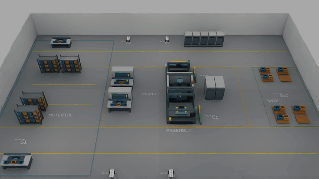 | 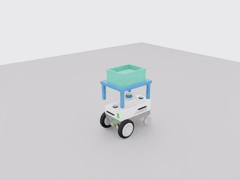 |

[공장 조감 MP4](docs/images/fleet4-local45-042/overview-realtime.mp4) · [조감 출처](docs/images/fleet4-local45-042/provenance.json) · [적재 주행60fps MP4](docs/images/loaded-mobility-local45-135/loaded-motion-60fps.mp4) · [적재 시험 출처](docs/images/loaded-mobility-local45-135/provenance.json)

</details>

[전체 업무 흐름 · 이전 실행의25.4초 요약](docs/images/fleet4-local45-036/operations-business-complete.mp4)은 명목74배속 타임라인입니다. 그 실행은 출하3건·빈 토트 반납3건·4대 주차를 마쳤으나 최종 기록 종료 검사에 실패했습니다. 아래 업무 결과와 관제 화면은 해당 실행의 보존 자료입니다.

## AMR을 클릭하면 보이는 운영 상태

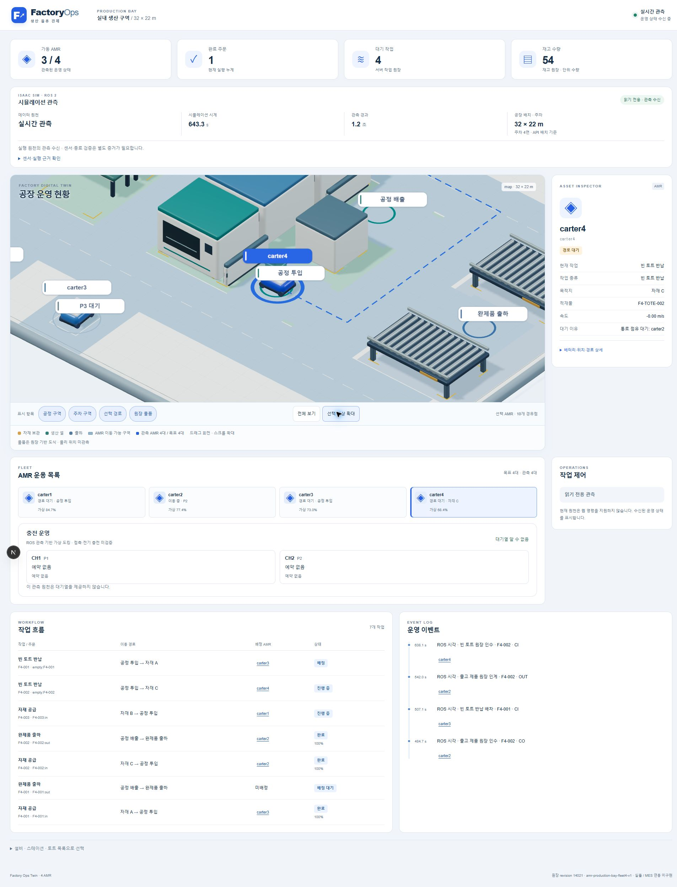

차량을 선택하면 현재 작업, 목적지, 적재물 ID, 엔코더 속도, 가상 SOC와 통로 대기 원인을 확인합니다. 위 화면의 `carter4`는 빈 토트 `F4-TOTE-002`를 자재 위치로 반납하며 다른 차량의 통로 점유 해제를 기다립니다. [출하 3건·재고 54개를 확인하는 전체 화면](docs/images/fleet4-local45-036/dashboard-all-orders.jpg)도 같은 실행에서 촬영했습니다.

웹은 **Next.js·React Three Fiber·Python 운영 API**로 구성했습니다. 실제 ROS 실행은 기본으로 관측 전용입니다. 로컬4.5 개발 옵션에서는 네 차량의 **다음 예약 지점 정지·운행 재개를 실제 실행에서 확인**했습니다. 같은 Kit 클라이언트와 Linux API를 사용한 [네 차량의 정지·재개 기록](docs/evidence/local45-native-control-054.json)입니다. 주문 생성·전체 일시정지·재개와 가상 충전 조작은 별도 CPU 운영 모델에서도 지원합니다. 웹의 차량·물품 형상은 원장 기반 도식입니다. [관제 이미지의 원본·해시](docs/images/fleet4-local45-036/provenance.json)

정지 요청은 네 차량의 새 HOLD 응답과 연속 정지 관측이 모인 뒤 적용됩니다. 재개 전에도 관측 신선도를 확인하며, 물리·ROS·가상 충전 시계는 계속 흐릅니다. [실행 도구](scripts/demo/native_anchor_flow.py)는 같은 요청의 적용 기록을 확인해 재개만 복구하는 모드도 제공합니다. 실제 브라우저·Kit 패널의 클릭 연결과 전체 물류 완주는 남아 있습니다. [사용 절차](docs/operations-guide.md#다음-예약-지점에서-정지재개)

웹의 **운영 기록 저장·재생**은 필요한 구간의 차량·작업·재고 상태를 다시 보여줍니다. 저장 버튼을 눌렀을 때 최근 관측 최대120개만 파일로 보존하고, 재생 중에도 실시간 수신은 유지합니다. 재생 화면에서는 차량 명령을 비활성화합니다. 원래 실행·시각·내용 해시와 공장 배치를 대조하며, 다른 배치나 변조된 기록은 거부합니다. [실제4대 관측의 웹 프록시 저장·재생](docs/evidence/scenario-replay-198.json)과 CPU HTTP 검사·웹 타입·빌드는 통과했습니다. 브라우저 클릭 확인과 전체 운송 완주는 남아 있습니다. [기록 사용법](docs/operations-guide.md#운영-기록-저장재생)

## 공장과 물류 흐름

| 실제 공장 RGB | 차량 위 화물 표시 |
|---|---|
| 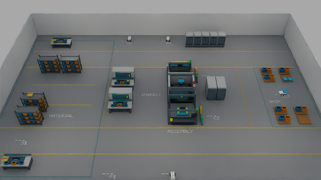 | 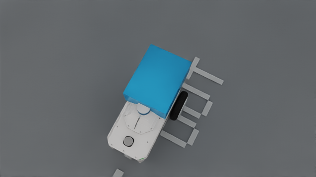 |

**자재 보관·키팅 → 공정 투입 → 조립·검사 → 완제품 출하**, 소비 후 **빈 토트 회수·재사용**을 연결합니다. 32×22 m의 가상 생산 구역이며 현장 CAD·MES와 동기화한 실공장 복제는 아닙니다.

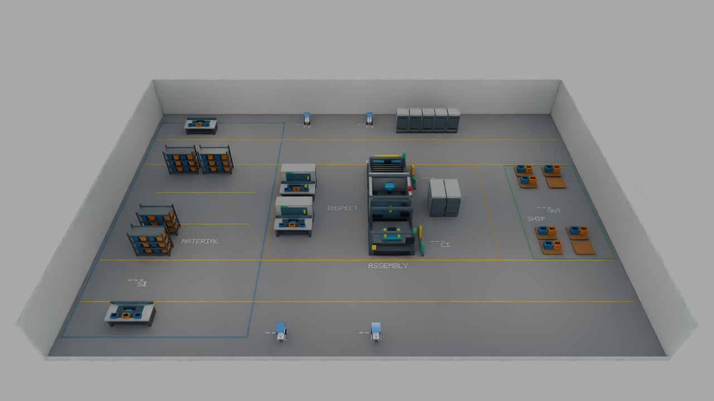

17mm 조감으로 공장과 외벽 전체를 담고 네 차량에5.4kg 물리 캐리어를 장착했습니다. 위 이미지는 운송 시작 전의 실제 렌더입니다. 해당 실행은 AMR2의 Nav2 기동 오류로 종료됐으며, 앞의036 업무 영상과 다른 실행입니다. [촬영 시각·카메라·원본 해시](docs/images/fleet4-layout-local45-057/provenance.json) · [기동 결과와 남은 통신 문제](docs/evidence/local45-startup-057.json)

| 실행에서 확인한 결과 | 범위 |
|---|---|
| 4대 모두 실제 운송 인계 참여 | 제품 인계 12회 + 빈 토트 인계 6회 |
| 주문 3건 출하·빈 토트 3건 반납 | 마지막에 4대 모두 주차 |
| 유한 재고와 공정 소비 | 초기 60개 = 잔량 54개 + 소비 6개 |
| 가상 충전 예약·도착·해제 | 추정 위치·오도메트리의 원래 시각과 정지 확인, 작성된 에너지 모델 사용 |
| 같은 실행의 웹 관제 | 작업·화물·재고·속도·가상 SOC 관측 |

위 결과는 [로컬 Isaac Sim 4.5·PhysX 실행036](docs/evidence/local45-transport-036.json)의 업무 기록입니다. 산업용 저상 차량의 접촉·승강·하중 운반, 충전 접촉 센서와 전기 충전, 최종 6.2·RTX 구성은 남아 있습니다. 현재 화물은 원장과 연결한 비충돌 시각 표현입니다.

개발 소스는 지연된 오도메트리를 신선한 과거 추정 위치와 결합하고, 충전 단계가 같아도 SOC 관측 파일을 갱신합니다. 새4대 SDK 실행에서도 **충전 위치 도착 → 정지·기하 정렬 확인 → 가상 SOC 증가 → 충전 예약 해제·배차 대기 복귀**를 확인했습니다. 웹도 같은 실행의4대 상태를 표시합니다. [충전·웹 관측 근거](docs/evidence/local45-charging-058.json)는 실행 중의 부분 결과이며 전체 물류 완주나 접촉 센서·전기 충전의 검증을 뜻하지 않습니다.

<details>
<summary>운반 모듈의 접촉·분리 시험 보기</summary>

| 네 지지점 접촉·정지 | 토트 분리 |
|---|---|
| 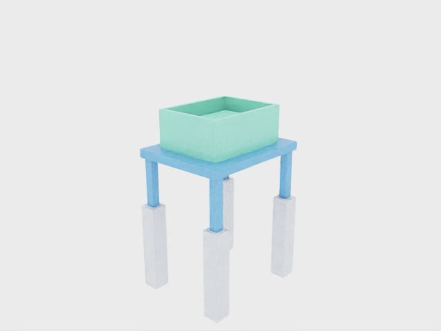 | 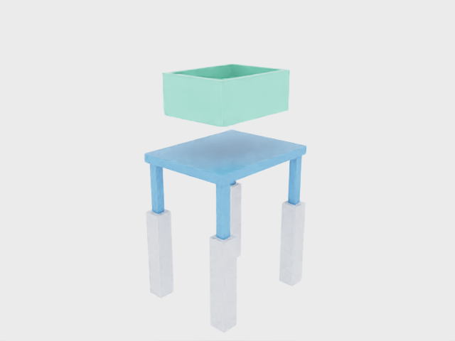 |

헤드리스 Isaac Sim 4.5에서 캐리어 5.4kg·적재 토트 6kg의 접촉을 시험했습니다. 네 지지대의 접촉·힘·센서 시각과 정지·정렬을 확인한 뒤, 토트에 상향 속도를 주어 분리 상태와 RGB 두 장을 기록했습니다. 위 자료는 고정 지지대 시험입니다. [실제 물리 결과](docs/evidence/local45-tote-contact-114.json) · [이미지 출처](docs/images/tote-contact-local45-114/provenance.json)

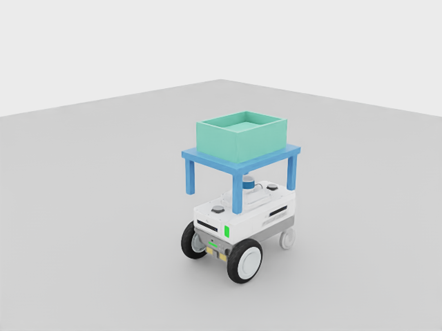

Nova Carter의 차체 형상·센서 간섭·기존 반경을 확인한 뒤 캐리어를 고정 조인트로 장착했습니다. 자유 동적 토트의 실제 접촉과 정지를 확인했습니다. 위 이미지는 정적 장착 시험이며, 이어지는 영상은 같은 구성의 적재 주행 시험입니다. [정적 장착 결과](docs/evidence/local45-loaded-carrier-124.json) · [이미지 출처](docs/images/loaded-carrier-local45-124/provenance.json)


같은 장착 구성으로6kg 토트를 싣고 전진·곡선 주행·제자리 회전 후 감속 정지를 확인했습니다. 원본은 실제 물리 프레임에서 촬영한60fps·9.4초이며, GIF는 회전 전후5초를40fps로 보여줍니다. 보간 프레임은 사용하지 않았습니다. 적재 접촉과 상대 위치, 바퀴 응답을 기록했습니다. 자동 적재·도킹·재고 인계의 차량 통합과 하중 정격은 남아 있습니다. [60fps MP4로 보기](docs/images/loaded-mobility-local45-135/loaded-motion-60fps.mp4) · [실제 주행 결과](docs/evidence/local45-loaded-mobility-135.json) · [촬영 출처](docs/images/loaded-mobility-local45-135/provenance.json)

4대 운송 씬에는 [물리 캐리어 연결 옵션](scripts/isaac/carrier_native.py)이 있습니다. 실제 SDK에서 네 차량의 장착 허용과 차량별5.4kg 모듈·고정 조인트 작성을 확인했고, 물품 표시는 각 상판 높이에 맞춥니다. 변환 속성을 수정한 후68초의 물리 기동 구간에서 이전 렌더 경고가 사라졌습니다. [네 차량의 장착·센서와 기동 결과](docs/evidence/local45-startup-057.json)를 보존했으며, 이 구성의 운송 완주와 토트의 적재·하역 통합은 남아 있습니다. [실행 범위와 사용법](docs/operations-guide.md#4대-물리-캐리어-개발-옵션)

| 롤러 적재 완료 | 같은 토트의 반납 완료 |
|---|---|
| 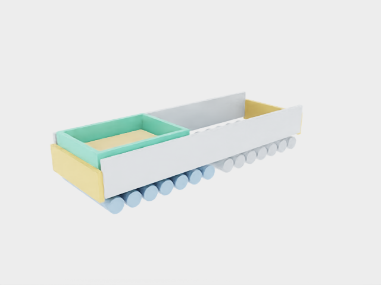 | 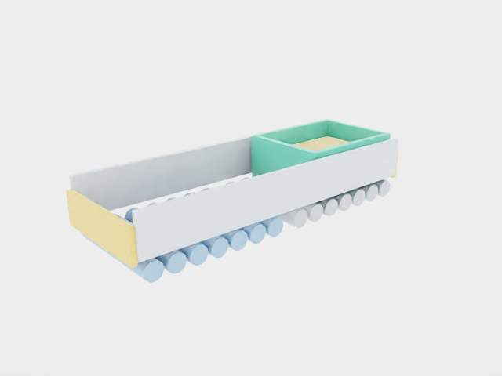 |

[롤러 적재·반납 시험](scripts/isaac/probe_roller_transfer.py)은 실제 물리 실행에서 통과했습니다. 회전 조인트로 롤러를 구동하고 접촉 센서와 모터 정지를 확인해 같은 6kg 토트를 싣고 돌려보냈습니다. World 9.69초 동안 왕복을 확인했고 RGB 두 장과 접촉·모터 기록을 보존했습니다. **고정 시험대 결과이며 AMR 장착·도킹·재고 인계 연결은 남아 있습니다.** [실제 결과](docs/evidence/local45-roller-transfer-119.json) · [이미지 출처](docs/images/roller-transfer-local45-119/provenance.json)

</details>

## 가감속·회전·정지

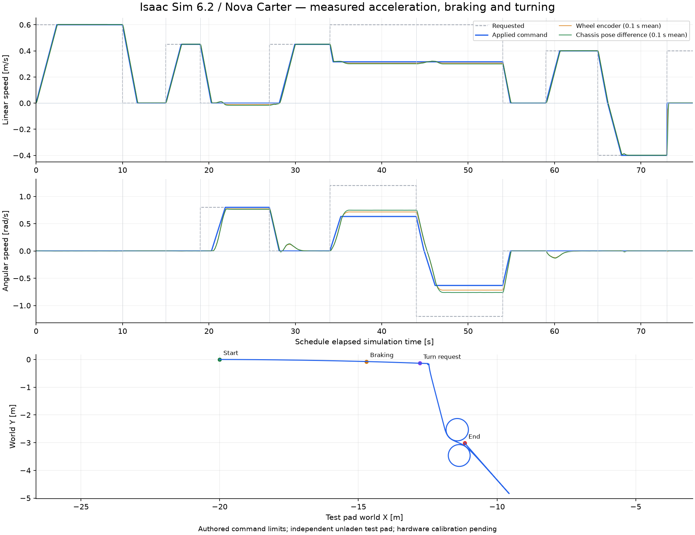

[원속도 주행 영상 · 76초 MP4](docs/images/amr-drive-profile.mp4) · [명령·엔코더·차체 응답 그래프](docs/images/amr-drive-response.png) · [촬영·계측 출처](docs/images/motion-media-provenance.json)

정상 가감속, 곡선 감속, 회전 전 제동과 회전 후 출발, 휠 속도·가속도 제한을 물리 주행 루프에 적용했습니다. 주행 명령과 실제 차체·엔코더 응답을 구분해 기록하며, 명령이 끊기면 watchdog이 정지시킵니다. 위 영상은 별도 주행 시험이며 현재 4대 운송 실행과 같은 촬영으로 합치지 않습니다.

## 공유 통로 대기와 복구

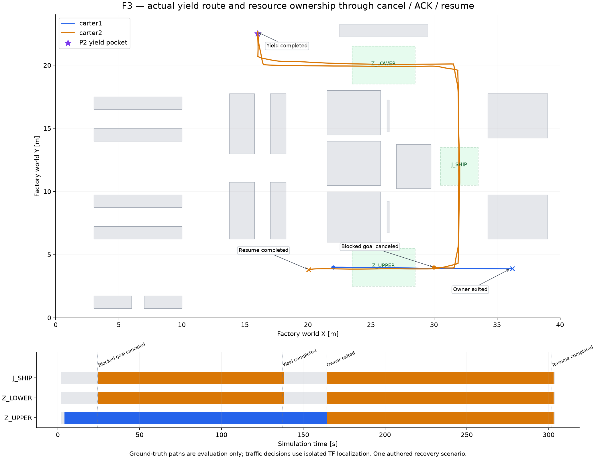

[복구 전체 영상](docs/images/g2-f3-timelapse.mp4) · [복구 경로와 소유권 변화](docs/images/g2-f3-recovery-path.png) · [통로 차단 시 명령·정지 기록](docs/images/g2-f2-fault-timeline.png) · [실행 결과](docs/images/g2-results.json)

이전 2대 배치의 실제 복구 시험입니다. 대기 관계 감지, 주행 취소, 양보 위치 이동, 이탈 확인, 대기 차량 재개의 순서를 기록했습니다. 관측이 오래되면 점유를 유지하며, 다음 예약이 승인되기 전에 기존 점유를 해제하지 않습니다. 최종 4대 구성의 폐쇄·복구 검증은 남아 있습니다.

## 합성데이터: RGB와 라벨을 함께 확인

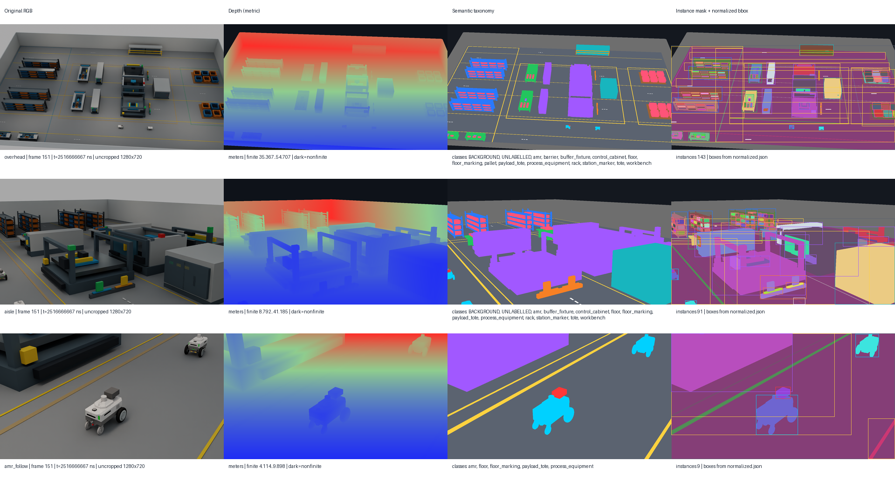

[조감 RGB](docs/images/g4-render-004/rgb-overhead.png) · [통로 RGB](docs/images/g4-render-004/rgb-aisle.png) · [차량 근접 RGB](docs/images/g4-render-004/rgb-amr_follow.png) · [데이터 검사 결과](docs/images/g4-render-004/dataset-validation-report.json) · [출처 명세](docs/images/g4-render-004/g4-media-provenance.json)

Isaac Sim Replicator로 기존 40×24 m 장면의 **12개 시각 구성 × 30시점 × 3카메라, RGB 1,080장**과 대응 깊이·semantic·instance·bbox·카메라 정보를 수집했습니다. 프레임·좌표·분할·파일 해시 검사와 대표 자료의 별도 AI 시각 검수를 기록했습니다.

이 자료는 기존 정적 장면의 데이터입니다. 현재 4대 운송 장면의 학습 데이터나 실제 로봇 학습 성능으로 해석하지 않습니다. 최종 공장·차량을 고정한 뒤 새 장면에서 수집하며, 웹에서 GPU 촬영을 실행하는 기능은 아직 없습니다. [데이터 계약](docs/dataset-contract.md)

## Kit 운영 패널과 모의 MES

<details>
<summary>Isaac Sim 안의 운영 패널 보기</summary>

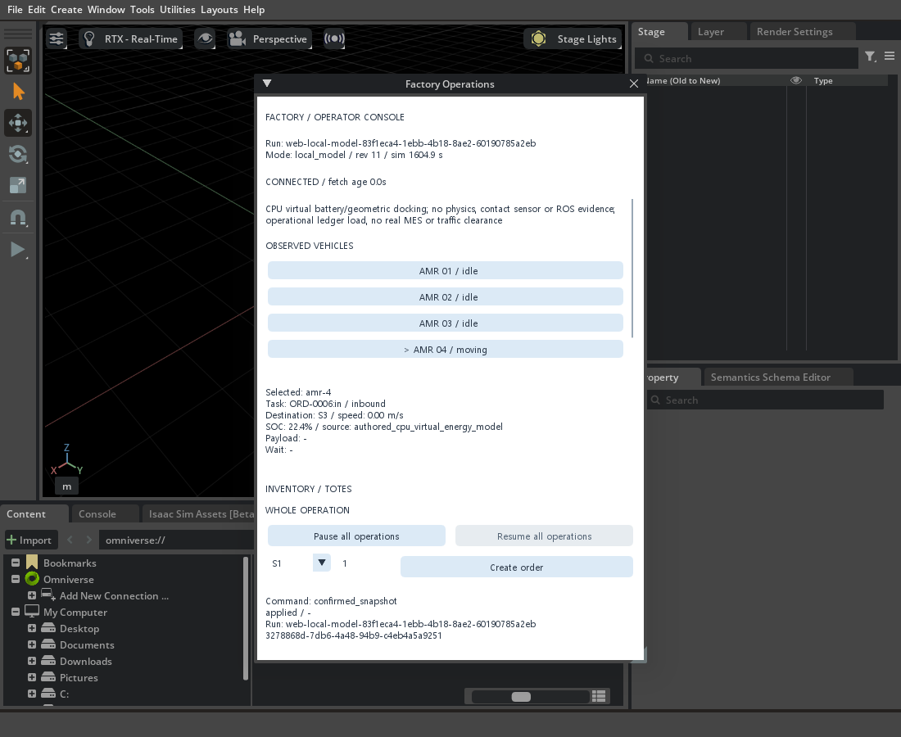

Kit 확장 `factory.ops.console`에서 AMR 선택 상세, 주문 생성, 전체 일시정지·재개를 같은 CPU 운영 API에 연결했습니다. 실제 SDK에서 명령 적용과 확장 창 종료를 확인했습니다. 이 화면의 배경은 연결 시험용 빈 뷰포트이며 공장 렌더 결과가 아닙니다. [명령·촬영 근거](docs/evidence/kit-console-004/summary.json)

</details>

모의 MES의 주문·재고 입고·설비 관측·heartbeat를 운영 원장에 연결합니다. 실행 ID·시각·순번과 중복 입력을 검사합니다. Kit 클라이언트는 같은 실행의 정지·재개 요청과 원천 응답을 구분하며, 지원하지 않는 조작은 비활성화합니다. 실제4대 실행을 조작하는 Kit 화면 확인과 실제 공장 설비 연결은 남아 있습니다. [HTTP 입력 기록](docs/evidence/mock-mes-024/http-flow.json) · [실행 안내](docs/operations-guide.md)

## 현재 진행 구간

| 구간 | 현재 상태 |
|---|---|
| 1. 4대 운영 안정화 | 업무 운송 관측. 전체 정상 완주·기록 종료 확인 중 |
| 2. 공장·차량·적재 | 공장 시각 층·지지대/롤러·차량 장착·6kg 적재 주행 시험 통과. 도킹·재고 인계 통합은 남음 |
| 3. 웹·Kit·운영 입력 | 실제 웹 관측과4대 네이티브 API 정지·재개 확인. Kit 화면·운영 입력 통합은 남음 |
| 4. 혼합 운영·예외 처리 | 최종 구성의 폐쇄/복구·급증·재보충·충전 접촉 확인은 남음 |
| 5. 병목·정책 비교 | 최종 구성 고정 후 6개 파일럿·60회 비교 예정 |
| 6. 최종 장면 데이터 | 기존 자료 보존. 최종 장면의 수집·검사는 남음 |
| 7. 포트폴리오 미디어 | 실제 실행 미디어 공개. 최종 렌더·운영 결과에 맞춰 갱신 |
| 8. 보존·정리 | 대표 원본·최종 데이터 선별 보존, 중복·실패 대용량 자료 정리. 최종 완성본의 복원·종료 확인은 남음 |

[완료 조건과 구간별 계획](docs/completion-plan.md) · [오류와 재발 방지 기록](docs/troubleshooting.md)

현재4대 통합 경로는 Windows Humble·WSL Jazzy의 DDS를 OS 안에 격리하고 센서·시계·주행 토픽을 연결합니다. 중계 상태 파일의 공유 충돌은 추가 기록 방식으로 바꿨으며, 파일을 열어 둔 조건의 [양 OS 통신 시험](docs/evidence/local45-relay-heartbeat-156.json)을 통과했습니다. 수정 후 [실행051](docs/evidence/local45-transport-051.json)은 자재 공급·공정 처리·출하·빈 토트 회수까지 진행했지만 제한 시간 안에 완주하지 못했습니다. 출하와 반납의 일부가 남았고, 중계 Job이 시간 초과로 종료됐습니다. 소유 프로세스는 모두 정리했습니다. 후속 실행은 조감 카메라만 사용하고 운반 중인 차량의 실제 움직임에 맞춰 촬영합니다. 공장 전체 완주와 여섯 운영 단계를 묶은 대표 미디어 생성은 남아 있습니다.

앞선040의 재접근 반복을 고친 [C++·기록 검사](docs/evidence/local45-terminal-reapproach-109.json)와 [동결 소스 빌드](docs/evidence/local45-goal-canonical-112.json)는 유지합니다. 운반 모듈은 지지대 접촉·롤러 왕복·실제 차체 장착과6kg 적재 주행을 통과했습니다. 자동 적재·도킹·재고 인계의 통합은 남아 있습니다. 대표 물리 시험과 최신 실행 원본을 선별 보존하며, 공장 대표 미디어는 보존된 실행036의 자료입니다.

## 로컬에서 보기

Isaac Sim 물리 실행은 창 없이 헤드리스로 돌리며, GPU 렌더링으로 카메라 RGB를 저장합니다. 현재 로컬 개발 환경은 Isaac Sim 4.5·RTX 3060입니다. 실시간 작업 상태는 웹3D 관제에서 보고, 공장 렌더 결과는 별도 이미지·영상으로 확인합니다.

로컬 실행기는 지정한 wall 시간 한도에서 마지막30초를 SDK·ROS·중계 종료에 예약합니다. 작업 기한과 종료 결과는 실행에 사용한 소스·시간 정책과 함께 기록합니다.

준비된4대 로컬 실행기의 OS 격리 옵션은 `--isolated-topic-relay --relay-windows-address <Windows의 WSL NIC 주소> --relay-linux-address <WSL 주소>`입니다. `--startup-service-match-wait`는 이 경로에서 Linux의 시작 서비스 응답 프로필만 사용합니다. 환경과 소스를 고정한 새 실행에 적용하며, 기존 실행의 설정·원본은 바꾸지 않습니다. [실행기](scripts/isaac/run_local45_fleet_pair.py)

CPU 운영 데모는 Python 3.12·uv, 웹은 Node.js·npm을 사용합니다. GPU 시뮬레이션과 별도로 실행합니다. PowerShell 터미널 두 개를 사용합니다.

정지·재개 개발 옵션은 새 소스로 준비한4대 실행기와 관제 API 양쪽에서 `--live-anchor-controls`를 켜고, API의 `--commands-dir`를 해당 실행의 `results/run/commands`에 연결합니다. ROS가 WSL에서 실행될 때 조작 API도 같은 WSL에서 실행해 같은 OS 시계로 요청을 큐에 넣습니다. 웹은 `OPS_API_URL`로 이 API를 선택합니다. [실제4대 정지·재개 결과](docs/evidence/local45-native-control-054.json)는 전체 운송 완료와 구분합니다.

```powershell
cd "$HOME/factory-ops-twin"
uv sync --locked
uv run python -m factory_ops.dashboard --web-charging-profile configs/web-charging-model.json
```

```powershell
cd "$HOME/factory-ops-twin/dashboard"
npm ci
npm run dev -- --port 3007
```

`http://127.0.0.1:3007`에서 CPU 모델의 주문·차량·재고·가상 충전을 볼 수 있습니다. 이미 같은 포트의 관제 서버가 실행 중이면 기존 서버를 사용합니다. 실제 ROS 관측 연결, Kit 활성화, 모의 MES와 재현용 CPU 보고서는 [운영·실행 안내](docs/operations-guide.md), GPU 실행은 [GPU 연동 안내](docs/gpu-handoff.md)를 참고합니다.

같은 웹에 실제 실행을 연결하면4대의 추정 위치·작업·적재물·목적지와 원천이 명시된 가상 SOC를 표시합니다. 실행과 같은 공장 배치를 `--config`로 선택하고, 같은 실행 폴더의 관측·충전·사건 파일을 함께 연결합니다. [실행051의 API·웹 프록시 연결 근거](docs/evidence/local45-live-web-158.json)는 실행 중 관측이며 정상 운송 완료나 웹 정지·재개 검증을 뜻하지 않습니다.

## 구성과 증거의 경계

| 구성 | 역할 |
|---|---|
| `configs/` | 공장 배치·지도·주문·주행·에너지·촬영 설정 |
| `factory_ops/` | 재고·운영 원장·배차·예약·관제 API·평가와 원본 검사 |
| `scripts/isaac/`, `scripts/ros/` | 물리 주행·센서·Nav2·action과 운송 확정 연결 |
| `dashboard/`, `extensions/` | 웹3D 관제와 Kit 운영 패널 |
| `scripts/media/`, `docs/images/` | 실제 원본 기반 미디어와 출처 |

Nav2·배차·예약은 추정 위치와 센서·현재 상태를 사용합니다. 시뮬레이터 GT는 사후 평가·라벨·미디어에만 사용합니다. CPU 논리 모델·웹 도식·실제 물리 실행의 결과를 구분하며, 실물 Sim-to-Real 검증이나 공장 전체의 안전 인증을 주장하지 않습니다. [설계와 제어 경계](docs/architecture.md)

공장 설비의 시각 층은 자체 작성했으며 로봇은 NVIDIA 제공 Nova Carter를 참조합니다. 원본 로봇 에셋은 Git에 포함하지 않고 제공처 이용 조건을 따릅니다. 코드·설정·문서·대표 미디어는 Git으로 관리합니다. 대형 원본과 최종 데이터셋은 로컬에 선별 보관하고, 최종 합성데이터 압축본은 해시를 확인한 뒤 별도 드라이브에도 남깁니다.

반복 미리보기·압축 해제본·종료된 실패 실행의 대형 중복 자료는 정리했습니다. 오류·종료 기록과 공개 미디어는 유지하며, 예전 출처 문서에 적힌 일부 로컬 원본 경로는 만료됐습니다. 최종 합성데이터는 보존한 압축본에서 복원할 수 있습니다. [현재 보존 위치·만료 경로·정리 결과](docs/evidence/local45-storage-155.json)

웹 화면 구성은 [Dilum Sanjaya의 창고 운영 데모](https://x.com/DilumSanjaya/status/2106426962738880879)를 참고했습니다. 구현과 운영 원장은 이 저장소에서 관리합니다.
