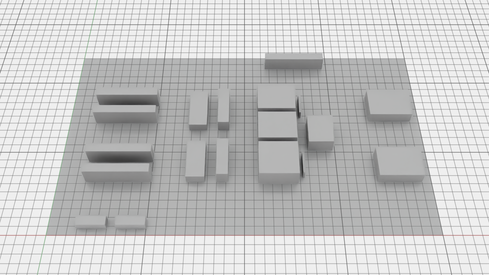
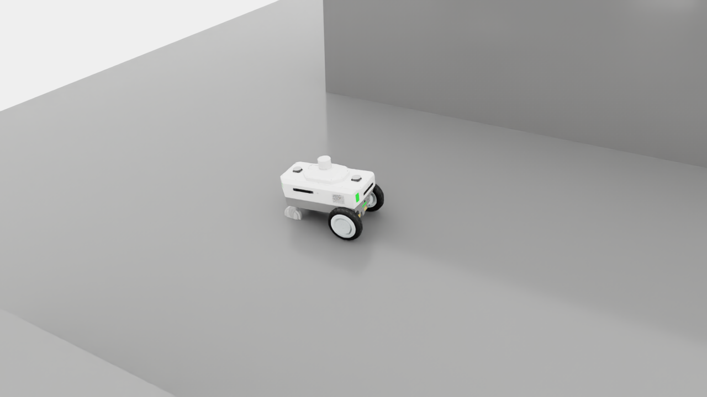

# Factory Ops Twin

두 AMR이 공장에 자재를 공급하고 완료품을 출하하는 과정을 검증하는 프로젝트입니다. 가상 산업용 센서 모듈 공장을 대상으로 주문·버퍼·공정·운반 상태를 연결하고, 배차와 공유 통로 복구를 비교합니다.

현재 구현 범위는 **CPU 운영 모델과 Isaac Sim 6.2의 단일 AMR 기초 검증**입니다. AWS L40S에서 공장 USD 검사, Nova Carter의 짧은 개방 루프 주행, 카메라·라벨·영상 저장과 ROS 2 시계 수신을 통과했습니다. Nav2 운반과 생산성 비교는 후속 단계입니다.



위 이미지는 생성한 USD를 Isaac Sim에서 연 실제 정적 렌더입니다. 설비와 통로 크기를 확인하는 박스 배치 단계이며, 로봇·물리 주행 장면은 포함하지 않습니다. [초기 구상도](docs/images/concept-v3.png)는 계획을 설명하기 위해 생성한 이미지입니다. 로컬 `runs/local/report.html`은 CPU 논리 실행 결과를 보여 줍니다.



위 장면은 G0b GPU 실행의 실제 종료 프레임입니다. 시뮬레이션 10초 동안 순변위 0.627 m를 기록하고, 주행 PNG 100장과 센서 데이터 3세트를 저장했습니다. 목표 위치로 이동하는 자율 주행은 아직 연결하지 않았습니다.

## 공장에서 AMR이 하는 일

```text
S1 / S2 / S3     CI            CELL1           CO          OUT
키트 준비   →   투입 버퍼  →  조립·검사·포장  →  완료 버퍼  →  출하
       AMR 운반                  논리 공정             AMR 운반
```

S1~S3은 동일한 키트 토트를 준비하는 위치입니다. 하나의 주문은 하나의 토트를 운반하며, 토트 안의 제품 수는 모델에 넣지 않았습니다. CI에 토트를 내리면 AMR은 다음 작업으로 이동할 수 있습니다. 공정 처리가 끝나면 CO에서 OUT으로 가는 새 운반 작업을 만들고, 빈 AMR 중 하나에 배정합니다.

현재 적재·하차는 논리 상태 전이입니다. 지게차의 포크나 로봇 팔의 파지 동작은 포함하지 않습니다. 공정은 작업자 1명, CI·CO 각 2슬롯, 설정 처리 시간 20초로 표현합니다. 이 값은 현장 측정값이 아닌 실험 설정입니다.

## 구현된 기능

| 기능 | 현재 동작과 검증 범위 |
|---|---|
| 공장 배치 | 40×24 m, 6개 인계 위치, 2개 대피 포켓, 19개 설비 장애물 |
| 지도 생성 | 50 mm 격자, 물리 장애물 지도와 정책 keepout 지도 분리, ROS PGM·YAML 출력 |
| USD 생성 | 바닥·설비·마커 USDA 생성과 Isaac Sim 파싱 통과. 실제 물리 충돌 동작은 미검증 |
| GPU 장면 검사 | Z-up·m 단위, 활성 충돌 API 20개·설비 19개·비충돌 마커 8개 검사, 1280×720 RGB와 SHA 저장 |
| GPU 종료 판정 | 별도 worker 종료 뒤 supervisor가 실행 ID·장면·PNG·종료 코드를 대조. L40S 실행에서 최종 PASS 확인 |
| 단일 AMR 검증 | Nova Carter 충돌 형상 외곽 약 0.727×0.493 m, 여유 0.2 m를 더한 원형 범위로 정차 위치 8곳과 실제 궤적의 지도 여유 검사 통과 |
| 주행·센서 수집 | 601개 pose·시각 기록, 1280×720 PNG 100장·100프레임 GIF, 가상 카메라의 RGB/Depth/semantic/bbox·내부/외부 파라미터 3세트 저장·대조 |
| ROS 2 연결 | Jazzy `/clock` 358개 수신·시간 진행 확인. 센서 토픽·TF·LiDAR·Nav2는 후속 단계 |
| 운영 원장 | 주문·운반·버퍼·공정·완료 상태, 버전 검사, 중복 이벤트 억제, 로그 재생 |
| 배차 | 공통 버퍼·가용성 조건을 통과한 작업에 FIFO 또는 이동 ETA 적용 |
| 통로 예약 | 지정된 3개 자원과 출구의 원자 예약, stale 점유 유지, release ACK 검사 |
| 복구 결정 | 5초 지속 wait cycle의 양보 결정과 ACK 이후 재개. 60초 stall과 구분 |
| 로컬 데모 | 동일한 6개 주문·2개 논리 AMR의 두 정책 실행, CSV·JSON·HTML·SHA256 명세 생성 |

통로 로직은 호출자가 준 추정 위치·점유·출구 상태를 입력으로 받습니다. 로컬 교통 trace는 작성된 관측을 넣어 결정 규칙을 검사합니다. CPU 운반 데모는 격자 거리와 설정 속도로 시간을 계산하며 로봇 간 간섭과 예약 대기를 반영하지 않습니다. 두 결과를 합쳐 물리 주행 성능으로 해석할 수 없습니다.

## 로컬 실행

Python 3.12와 [uv](https://docs.astral.sh/uv/)를 사용합니다. Python 런타임 의존 패키지는 없습니다.

PowerShell:

```powershell
cd "$HOME/factory-ops-twin"
uv sync --locked
uvx --from pyright==1.1.414 pyright factory_ops tests scripts/isaac
uv run python -m unittest discover -s tests -v
uv run python -m factory_ops prepare --output runs/local
uv run python -m factory_ops verify runs/local
uv run python -m factory_ops replay runs/local/fifo/events.jsonl --expected runs/local/fifo/snapshot.json
```

`runs/local/report.html`을 브라우저에서 열면 배치도, 정책별 완료 기록과 이벤트 원장을 볼 수 있습니다. 준비 명령은 클라우드 인스턴스를 만들거나 실물 로봇에 명령하지 않습니다.

```text
runs/local/
  report.html              배치와 CPU 결과
  geometry.json            정상·폐쇄 경로와 배치 검사
  manifest.json            입력·출력 SHA256와 검증 범위
  maps/                    map.pgm, keepout.pgm, YAML, 명세
  scene/                   factory-v3.usda, 명세
  traffic-checks.json      stale 점유·wait cycle의 작성된 관측 trace
  fifo/, eta/              summary.json, snapshot.json, events.jsonl,
                           orders.csv, assignments.csv
```

CPU 운영 데모의 `physical_collisions`, `nav2_success_rate`, `rtf`, `peak_vram_gb`는 `null`로 저장하고 `primary_evaluation=false`를 붙입니다. G0b에는 별도 촬영 부하 관측이 있습니다. 시뮬레이션 10초에 wall time 44.273초, RTF 0.226으로, 렌더링과 PNG·센서 파일 저장을 포함하고 warmup·GIF 인코딩은 제외한 값입니다. Nav2 성능이나 60회 정책 비교 결과를 뜻하지 않습니다. 물리 접촉 수는 측정하지 않았습니다.

`verify`는 저장된 파일의 SHA256 일치를 확인하고, `replay`는 입력 이벤트 본문·순서·버전을 재생 결과와 대조합니다. 명세 자체의 서명이나 발행자 인증을 제공하는 기능은 아닙니다. 출력 폴더에 무관한 파일이 있으면 준비 명령이 덮어쓰기를 거절합니다.

CSV에서는 수식으로 해석될 수 있는 식별자 앞에 작은따옴표를 붙입니다. 원래 식별자는 JSON 원장과 snapshot에 보존합니다.

## 코드 구조

```text
configs/factory-v3/    배치·교통 자원·로컬 주문과 설정
factory_ops/
  layout.py           배치 검증, 격자 경로, 지도 출력
  footprint.py        실제 로봇 충돌 외곽과 지도 여유 검사
  usda.py             USD 텍스트 출력
  operations/         상태 모델, 원장, 배차
  traffic.py          예약·복구 결정
  traffic_fixtures.py 작성된 관측에 따른 결정 검사
  smoke.py            CPU 이벤트 실행
  report.py, cli.py   결과 보고와 명령
tests/                표준 unittest 회귀시험
scripts/isaac/        정적 장면·단일 AMR 검사, 센서·GIF 증거 검증
docs/                 설계 경계와 GPU 연동 순서
```

## 다음 실행 순서

1. G1: 센서 토픽·TF·LiDAR를 준비하고, 한 Carter의 S→CI 운반, 공정 처리, CO→OUT 흐름을 ROS 2/Nav2에 연결합니다.
2. G2: 두 Carter에 예약·양보·stale 점유 유지와 복구 절차를 연결합니다.
3. G3: 같은 주문·장애 입력으로 FIFO/ETA를 정상·폐쇄·급증 조건에서 비교합니다. 부하 보정 후 10개 seed로 총 60회를 평가할 계획입니다.
4. G4: 수집 범위를 다양한 장면으로 늘리고 ROS bag·센서 정렬·라벨 품질을 검사합니다. 현재의 한 장면·인접 프레임을 독립 장면으로 세지 않으며, G0b 자료는 학습용으로 승인하지 않았습니다.

환경 선정과 데이터 보존 순서는 [GPU 연동 안내](docs/gpu-handoff.md), 구현 경계는 [설계 설명](docs/architecture.md)에 적었습니다.

## 데이터와 에셋

공장 설비와 마커는 자체 작성한 박스 형상이며, 로봇은 NVIDIA 제공 Nova Carter를 참조합니다. 원본 로봇 에셋은 Git에 넣지 않습니다. 제공 에셋과 향후 도입할 에셋은 각각의 이용 조건을 따릅니다. 생성한 구상도는 시뮬레이션 실측 증거로 사용하지 않습니다.

코드·설정·문서는 Git에서 관리합니다. `runs/`, 대형 USD·영상·데이터, 인증 파일은 Git에서 제외합니다. GPU 환경을 중지하거나 삭제하기 전에는 결과를 별도 저장소로 복사하고 SHA256을 대조해야 합니다.

AWS L40S 환경에서는 Stop→Start 1회 후 결과 파일 29개·코드·캐시 이미지가 보존되고 컨테이너가 GPU를 다시 인식하는 것을 확인했습니다. 이 검사는 재시작 후 주행이나 렌더 성능 검증을 뜻하지 않습니다.

## 참고

- [Isaac Sim 호환성](https://docs.isaacsim.omniverse.nvidia.com/latest/installation/compatibility.html)
- [Isaac Sim Python 설치](https://docs.isaacsim.omniverse.nvidia.com/latest/installation/install_python.html)
- [ROS 2 설치와 지원 조합](https://docs.isaacsim.omniverse.nvidia.com/latest/installation/install_ros.html)
- [Brev GPU 인스턴스](https://docs.nvidia.com/brev/concepts/gpu-instances)
