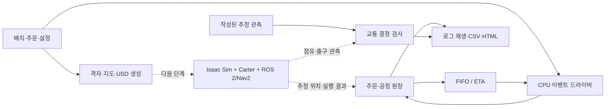

# 운영 모델과 시뮬레이터의 경계

현재 프로그램은 CPU에서 작성된 공장 배치와 업무 규칙을 검사한다. 실제 공장 데이터에 동기화한 디지털 트윈이나 Isaac Sim 주행 시스템은 후속 단계다.

## 현재 실행 계약

- 배치의 단일 입력은 `configs/factory-v3/layout.json`이다. 물리 장애물과 AMR 허용 영역을 분리하며 나머지 바닥은 정책 keepout으로 취급한다.
- 경로 검사는 50 mm 격자의 4방향 BFS다. 29×29 셀 probe는 계획 여유를 확인하는 도구이며 Carter footprint나 Nav2 costmap이 아니다.
- `Ledger`가 payload 소유권과 공정 상태를 관리한다. inbound 배정 시 CI 슬롯을 예약하고, CI drop에서 점유로 전환하며 처리 시작 시 슬롯을 반환한다. 처리 시작 시에는 CO 슬롯을 예약한다.
- pickup/drop은 task·order·payload·stage·robot·attempt 결속과 인계 station을 검사한다. station이 누락되거나 일치하지 않으면 상태를 바꾸지 않고 거부한다.
- 배차 두 정책은 `Ledger.can_assign` 조건을 공통으로 사용한다. FIFO는 오래된 실행 가능 작업에 가까운 로봇을 고른다. ETA는 현재 알려진 빈 이동·적재 이동 거리와 설정 속도·인계 대기로 후보 쌍을 비교한다.
- 새 주문은 release 시각에 원장에 추가한다. 배차에는 미래 주문, 장애 제거 시각, 시뮬레이터 GT를 전달하지 않는다.
- 교통 모듈은 자원·출구를 함께 예약한다. heartbeat TTL 만료만으로 점유를 반환하지 않는다. 신선한 추정 footprint 이탈과 출구 clearance가 확인되어야 release ACK를 낸다.
- grant·release ACK·resume은 기다리는 선행 예약 번호를 사용한다. 등록한 대기자는 해당 ACK를 한 번 소비하며, 다른 예약을 기다릴 때 과거 ACK를 재사용할 수 없다. 같은 대기자에 대한 자동 grant와 ACK 소비의 관계를 기록한다. stale 활성 소유자는 점유를 유지하지만 진행 명령을 받지 않는다. 미승인 stale 요청은 실제 점유와 구분한다.
- fresh 관측에 점유가 있으면 이동 금지 로봇도 점유자로 기록한다. 점유 기록과 이동 허가는 별개이며, 이동 금지 상태에는 정지를 요청한다.
- 교통은 `Z_UPPER`, `Z_LOWER`, `J_SHIP`에 한정한다. 전체 공장에 대한 deadlock-free나 안전 인증을 주장하지 않는다.
- 재배정은 pickup 전 실패에만 허용한다. pickup 후 다른 로봇으로 화물을 옮기는 동작은 구현하지 않았다.

## CPU 결과 해석

`smoke.py`의 두 AMR은 시간 예약이 있는 논리 운반 자원이다. 격자 거리/속도와 인계 대기만으로 이동 완료를 예약하므로 서로 통과할 수도 있다. `traffic_fixtures.py`의 관측 역시 작성된 입력이며 물리 실행 결과가 아니다. 이에 따라 충돌 수·주행 성공률·RTF·VRAM은 측정하지 않는다.

이 단계에서 확인하는 것은 주문 누락·이중 소유·버퍼 초과·비결정적 배차·로그 재생 차이와 같은 소프트웨어 오류다. GPU 단계에서는 실제 navigation action 결과가 pickup/drop commit의 근거가 되어야 하며, 현재 CPU 완료 타이머를 그대로 사용하면 안 된다.

교통 이벤트의 run ID·sequence·예약 번호와 `events_since(cursor)`는 같은 프로세스 실행 안의 결정 소비를 위한 계약이다. 어댑터는 이벤트 수신 후 현재 freshness·예약 번호를 재확인하고 이동 명령을 내려야 한다. `status` 문자열은 진단용이고, 동작 허용 여부는 `motion_allowed`로 구분한다. 이 모듈에는 DB·브로커·프로세스 재시작 복구나 무제한 운용을 위한 큐 제한이 없다. ROS 장기 운용 전에는 저장소와 bounded queue, overload·재시작·재전송 정책을 정해야 한다. 원장의 business no-op receipt도 프로세스 내부 캐시이므로 영속 수신 기록을 대신하지 않는다.

이벤트 해시 체인과 artifact SHA256은 저장된 파일의 일관성을 검사한다. 발행자 인증이나 악의적인 전체 이력 재작성 방지를 보장하는 서명은 아니다.

## GPU 단계의 검증 순서

| 단계 | 확인할 증거 | 다음 단계 조건 |
|---|---|---|
| G0 환경·장면 | 이미지·드라이버·ROS 버전, USD 파싱, 단위·원점, Carter footprint, VRAM·RTF | 한 로봇 장면과 지도·keepout 일치 |
| G1 단일 로봇 | 센서·TF·sim clock, Nav2 goal 결과, CI/CO 인계와 원장 | 주문 1개를 출하까지 완료 |
| G2 두 로봇 | namespace, 공유 통로 예약, F1/F2/F3 실행 로그 | 점유 유지·실제 이탈·ACK·재개 순서 확인 |
| G3 비교 평가 | 부하 보정 결과, 고정 입력·seed, 실패·미완료 포함 결과 | FIFO/ETA×3조건×10seed의 재현 가능한 기록 |
| G4 선택 SDG | RGB/Depth/Seg/bbox와 좌표·정렬 QA | 반복 촬영 수와 독립 장면 수 구분 |

각 단계에서 실패를 수정한 뒤 같은 조건으로 재검증한다. 물리·센서·ROS 실행을 통과하기 전에는 로컬 격자 수치를 현장 운행 수치로 바꾸어 표기하지 않는다.
