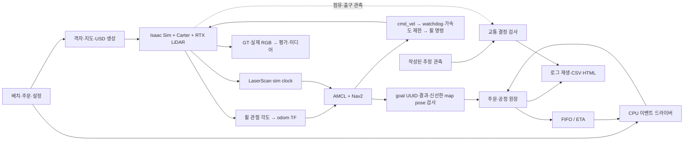

# 운영 모델과 시뮬레이터의 경계

프로그램은 CPU 운영 원장과 Isaac Sim·ROS 2/Nav2 실행 경계로 구성한다. 가상 센서 모듈 공장의 자재 투입, 공정 처리, 완료품 출하를 표현한다. 실공장의 설비 데이터나 MES를 동기화하는 시스템은 포함하지 않는다.

## 현재 실행 계약

- 배치의 단일 입력은 `configs/factory-v3/layout.json`이다. 물리 장애물과 AMR 허용 영역을 분리하며 나머지 바닥은 정책 keepout으로 취급한다.
- 경로 검사는 50 mm 격자의 4방향 BFS다. 29×29 셀 probe는 계획 여유를 확인하는 도구이며 Carter footprint나 Nav2 costmap이 아니다.
- `Ledger`가 payload 소유권과 공정 상태를 관리한다. inbound 배정 시 CI 슬롯을 예약하고, CI drop에서 점유로 전환하며 처리 시작 시 슬롯을 반환한다. 처리 시작 시에는 CO 슬롯을 예약한다.
- pickup/drop은 task·order·payload·stage·robot·attempt 결속과 인계 station을 검사한다. station이 누락되거나 일치하지 않으면 상태를 바꾸지 않고 거부한다.
- 배차 두 정책은 `Ledger.can_assign` 조건을 공통으로 사용한다. FIFO는 오래된 실행 가능 작업에 가까운 로봇을 고른다. ETA는 현재 알려진 빈 이동·적재 이동 거리와 설정 속도·인계 대기로 후보 쌍을 비교한다.
- 새 주문은 release 시각에 원장에 추가한다. 배차에는 미래 주문, 장애 제거 시각, 시뮬레이터 GT를 전달하지 않는다.
- 교통 모듈은 자원·출구를 함께 예약한다. heartbeat TTL 만료만으로 점유를 반환하지 않는다. 신선한 추정 footprint 이탈과 출구 clearance가 확인되어야 release ACK를 낸다.
- grant·release ACK·resume은 기다리는 선행 예약 번호를 사용한다. 등록한 대기자는 해당 ACK를 한 번 소비하며, 다른 예약을 기다릴 때 과거 ACK를 재사용할 수 없다. 같은 대기자에 대한 자동 grant와 ACK 소비의 관계를 기록한다. stale 활성 소유자는 점유를 유지하지만 진행 명령을 받지 않는다. 미승인 stale 요청은 실제 점유와 구분한다.
- fresh 관측에 점유가 있으면 이동 금지 로봇도 점유자로 기록한다. 점유 기록과 이동 허가는 별개이며, 이동 금지 상태에는 정지를 요청한다.
- 교통은 `Z_UPPER`, `Z_LOWER`, `J_SHIP`에 한정한다. 전체 공장에 대한 deadlock-free나 안전 인증을 주장하지 않는다.
- 재배정은 pickup 전 실패에만 허용한다. pickup 후 다른 로봇으로 화물을 옮기는 동작은 구현하지 않았다.

## CPU 결과 해석

`smoke.py`의 두 AMR은 시간 예약이 있는 논리 운반 자원이다. 격자 거리/속도와 인계 대기만으로 이동 완료를 예약하므로 서로 통과할 수도 있다. `traffic_fixtures.py`의 관측 역시 작성된 입력이며 물리 실행 결과가 아니다. 이에 따라 충돌 수·주행 성공률·RTF·VRAM은 측정하지 않는다.

이 단계에서 확인하는 것은 주문 누락·이중 소유·버퍼 초과·비결정적 배차·로그 재생 차이와 같은 소프트웨어 오류다. GPU 단계에서는 실제 navigation action 결과가 pickup/drop commit의 근거가 되어야 하며, 현재 CPU 완료 타이머를 그대로 사용하면 안 된다.

## G1 단일 주문 실행 경계

`SingleOrderMission`은 S1 pickup, CI drop, 설정된 공정 처리 20초, CO pickup, OUT drop을 연결한다. 이동 완료 타이머를 두지 않는다. `NavigateToPose`의 실제 goal UUID, task·order·payload·stage·robot·attempt, 성공 상태와 error code를 확인한 뒤 인계를 확정한다. `map` 좌표의 도착 pose는 수신 시점 기준 0~0.5초이고, 목표에서 위치 0.25 m·방향 0.25 rad 이내여야 한다. 공정 처리 20초와 화물 적재·하차는 논리 모델이다.

Nav2의 planner·controller·BT lifecycle이 모두 ACTIVE가 되고 시계·센서·TF가 준비된 후 첫 goal을 보낸다. action 실패·거부·시간 초과·잘못된 도착 pose는 임무를 실패로 남긴다. 이동 실패를 운영 원장의 성공으로 바꾸거나 pose를 목표로 이동시키는 분기는 없다.

위치 추정은 휠 관절 각도를 매 물리 프레임 적분한 `/odom`, RTX `/scan`, AMCL의 `map→odom`으로 구성한다. TF는 `map→odom→base_link→base_scan`을 사용한다. AMCL에는 물리 장애물 지도, 경로 계획에는 물리 장애물과 정책 keepout을 합친 지도를 제공한다. 시뮬레이터 GT는 ROS 제어 경계에 전달하지 않으며 궤적·RGB 대응, 지도 여유와 기울기 평가에만 사용한다.

평가 반경과 계획 반경은 구분한다. 평가는 실제 충돌 형상의 회전 외곽에 설정 여유 0.2 m를 더한다. 경로 계획은 여기에 위치 추정 오차를 위한 설정 여유 0.3 m를 추가하며, 두 반경과 계산 근거를 실행별 지도 provenance에 기록한다. 이 값은 위치 추정 정확도나 안전 보증을 뜻하지 않는다. G1 운행의 CI·CO·OUT 접근 정책 영역은 이 계획 반경을 수용하도록 폭 2.6 m로 작성한다. 다른 2 m 분기는 같은 조건의 통과를 검증하지 않았다. 설비 충돌 형상과 인계 위치는 유지한다.

구동 치수는 로드한 로봇의 활성 휠 충돌 형상에서 계산한다. 설정의 예상 치수와 다르면 실행을 거부하고 실제 측정값·단위·시각·형상 경로를 기록한다. 휠 각도의 표현 경계는 인접 물리 프레임의 최단 각도 차이로 처리한다. watchdog은 0.5초 지난 명령을 해제하며, 설정 가속도 한계는 선속도 0.25 m/s²·각속도 0.5 rad/s²다. roll 또는 pitch가 설정 한계 0.35 rad를 넘으면 휠 명령을 0으로 만들고 해당 실행을 실패로 보존한다. 이 검사는 자세를 보정하는 제어기가 아니다.

물리 바닥은 Z=0의 보이지 않는 정적 Plane이고, 40×24 m 시각용 슬랩은 비충돌 Cube다. Plane은 무한 평면이며 운행 범위는 유한한 지도와 정책 keepout으로 제한한다. 바닥·설비·마커의 정확한 collider 멤버십과 바닥 변환을 시작 전에 검사한다. 설비 19개의 박스 충돌 형상은 유지한다.

`CaptureSession`은 물리 시작 전에 Carter 섀시 하위의 추적 카메라와 고정 조감 카메라를 생성한다. 주행 중 카메라 USD 변환을 수정하지 않는다. 카메라 경로·부모 프레임·로컬 위치와 시선, 매 이미지의 물리 프레임·sim time·GT를 기록한다. 이 RGB는 주행 증거이며 학습용 카메라 데이터셋 승인을 뜻하지 않는다.

두 worker가 모두 종료한 뒤 `g1_evidence.py`가 결과를 대조한다. SQLite ROS bag의 CDR 메시지, action 상태와 원장 이벤트, 60 Hz 전체 궤적의 엔코더 재적분, quaternion·기울기, 실제 PNG와 마지막 프레임, 파일 해시를 검사한다. 프레임 누락이나 이미지·궤적의 frame/time/GT 불일치를 허용하지 않는다. 성공 조건은 주문 1개의 출하 완료이며, 반복 성공률·물리 접촉 수·두 AMR의 교통 성능은 별도 단계다.

교통 이벤트의 run ID·sequence·예약 번호와 `events_since(cursor)`는 같은 프로세스 실행 안의 결정 소비를 위한 계약이다. 어댑터는 이벤트 수신 후 현재 freshness·예약 번호를 재확인하고 이동 명령을 내려야 한다. `status` 문자열은 진단용이고, 동작 허용 여부는 `motion_allowed`로 구분한다. 이 모듈에는 DB·브로커·프로세스 재시작 복구나 무제한 운용을 위한 큐 제한이 없다. ROS 장기 운용 전에는 저장소와 bounded queue, overload·재시작·재전송 정책을 정해야 한다. 원장의 business no-op receipt도 프로세스 내부 캐시이므로 영속 수신 기록을 대신하지 않는다.

이벤트 해시 체인과 artifact SHA256은 저장된 파일의 일관성을 검사한다. 발행자 인증이나 악의적인 전체 이력 재작성 방지를 보장하는 서명은 아니다.

## GPU 단계의 검증 순서

| 단계 | 확인할 증거 | 다음 단계 조건 |
|---|---|---|
| G0a 환경·정적 장면 | 컨테이너 digest·드라이버, USD 파싱, 단위·원점·충돌 API, RGB와 종료 결과 | worker 종료·증거 대조·전체 배치 이미지 확인 |
| G0b 로봇 장면 | ROS 버전, Carter footprint·센서, VRAM·RTF | 한 로봇 장면과 지도·keepout 일치 |
| G1 단일 로봇 | 센서·TF·sim clock, Nav2 goal 결과, CI/CO 인계와 원장 | 주문 1개를 출하까지 완료 |
| G2 두 로봇 | namespace, 공유 통로 예약, F1/F2/F3 실행 로그 | 점유 유지·실제 이탈·ACK·재개 순서 확인 |
| G3 비교 평가 | 부하 보정 결과, 고정 입력·seed, 실패·미완료 포함 결과 | FIFO/ETA×3조건×10seed의 재현 가능한 기록 |
| G4 수집 데이터 QA | RGB/Depth/Seg/bbox와 좌표·정렬 QA | 반복 촬영 수와 독립 장면 수 구분 |

각 단계에서 실패를 수정한 뒤 같은 조건으로 재검증한다. 물리·센서·ROS 실행을 통과하기 전에는 로컬 격자 수치를 현장 운행 수치로 바꾸어 표기하지 않는다.

## 매 실행의 미디어·데이터 수집

G0a부터 성공·실패 실행을 별도 ID로 보존한다. G0a 도구는 조감 RGB, 카메라 위치·시선, 장면 SHA, 구성 검사와 종료 상태를 기록한다. GPU 사용 관측과 실행 환경·컨테이너 digest·코드 SHA도 같은 실행 기록에 연결한다. 정적 장면 이미지는 물리 주행 영상이나 학습용 라벨 데이터로 분류하지 않는다.

G0b는 센서 원본과 주행 영상·궤적을 수집한다. RGB·Depth·Segmentation·bbox는 frame ID와 sim time·pose로 대응시키고, 카메라 내부·외부 파라미터와 설정 SHA를 남긴다. 100개 주행 PNG·GIF, 601개 pose, 센서 3세트를 같은 manifest로 검사한다. 인계 이벤트와 ROS bag은 G1에서 연결한다. 동영상은 원본 프레임과 시각 정보를 대체하지 않는다.

G0b에서는 센서 정렬·깊이 무효값·bbox 범위·클래스 누락·독립 label ID 공간과 원본 파일 SHA를 검사했다. 자동 검사와 별도로 로봇 외형을 시각 검수한다. G4에서는 가림·화면 밖 객체·장면 다양성과 학습 분할을 포함한 데이터 QA를 수행한다. 동일 배치의 인접 프레임을 독립 장면으로 세지 않으며, GT는 평가·라벨 생성 경로에 두고 배차나 Nav2 입력으로 전달하지 않는다.
