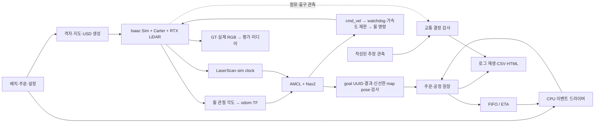

# 운영 모델과 시뮬레이터의 경계

프로그램은 CPU 운영 원장과 Isaac Sim·ROS 2/Nav2 실행 경계로 구성한다. 가상 센서 모듈 공장의 자재 투입, 공정 처리, 완료품 출하를 표현한다. 실공장의 설비 데이터나 MES를 동기화하는 시스템은 포함하지 않는다.

## 현재 실행 계약

- 기본 배치의 입력은 `configs/factory-v3/layout.json`이다. 물리 장애물과 AMR 허용 영역을 분리하며 나머지 바닥은 정책 keepout으로 취급한다. G3a는 `g3-routing.json`의 정책 영역 보정을 적용한 파생 배치를 사용한다.
- CPU 데모의 경로 검사는 50 mm 격자의 4방향 BFS다. 29×29 셀 probe는 계획 여유를 확인하는 도구이며 Carter footprint나 Nav2 costmap이 아니다. G3a의 경로 후보는 측정한 회전 외곽과 설정 여유를 사용해 별도로 검사한다.
- `Ledger`가 payload 소유권과 공정 상태를 관리한다. inbound 배정 시 CI 슬롯을 예약하고, CI drop에서 점유로 전환하며 처리 시작 시 슬롯을 반환한다. 처리 시작 시에는 CO 슬롯을 예약한다.
- pickup/drop은 task·order·payload·stage·robot·attempt 결속과 인계 station을 검사한다. station이 누락되거나 일치하지 않으면 상태를 바꾸지 않고 거부한다.
- 배차 두 정책은 `Ledger.can_assign` 조건을 공통으로 사용한다. FIFO는 오래된 실행 가능 작업에 가까운 로봇을 고른다. ETA는 현재 알려진 빈 이동·적재 이동 거리와 설정 속도·인계 대기로 후보 쌍을 비교한다.
- 새 주문은 release 시각에 원장에 추가한다. 배차에는 미래 주문, 장애 제거 시각, 시뮬레이터 GT를 전달하지 않는다.
- 교통 모듈은 자원·출구를 함께 예약한다. heartbeat TTL 만료만으로 점유를 반환하지 않는다. 신선한 추정 footprint 이탈과 출구 clearance가 확인되어야 release ACK를 낸다.
- grant·release ACK·resume은 기다리는 선행 예약 번호를 사용한다. 등록한 대기자는 해당 ACK를 한 번 소비하며, 다른 예약을 기다릴 때 과거 ACK를 재사용할 수 없다. 같은 대기자에 대한 자동 grant와 ACK 소비의 관계를 기록한다. stale 활성 소유자는 점유를 유지하지만 진행 명령을 받지 않는다. 미승인 stale 요청은 실제 점유와 구분한다.
- fresh 관측에 점유가 있으면 이동 금지 로봇도 점유자로 기록한다. 점유 기록과 이동 허가는 별개이며, 이동 금지 상태에는 정지를 요청한다.
- G2 교통은 `Z_UPPER`, `Z_LOWER`, `J_SHIP`에 한정한다. G3a의 전체 경로 후보·타일 예약은 별도의 로컬 계약이다. 전체 공장에 대한 deadlock-free나 안전 인증을 주장하지 않는다.
- 재배정은 pickup 전 실패에만 허용한다. pickup 후 다른 로봇으로 화물을 옮기는 동작은 구현하지 않았다.

## CPU 결과 해석

`smoke.py`의 두 AMR은 시간 예약이 있는 논리 운반 자원이다. 격자 거리/속도와 인계 대기만으로 이동 완료를 예약하므로 서로 통과할 수도 있다. `traffic_fixtures.py`의 관측 역시 작성된 입력이며 물리 실행 결과가 아니다. 이에 따라 충돌 수·주행 성공률·RTF·VRAM은 측정하지 않는다.

이 단계에서 확인하는 것은 주문 누락·이중 소유·버퍼 초과·비결정적 배차·로그 재생 차이와 같은 소프트웨어 오류다. GPU 단계에서는 실제 navigation action 결과가 pickup/drop commit의 근거가 되어야 하며, 현재 CPU 완료 타이머를 그대로 사용하면 안 된다.

## G1 단일 주문 실행 경계

`SingleOrderMission`은 S1 pickup, CI drop, 설정된 공정 처리 20초, CO pickup, OUT drop을 연결한다. 이동 완료 타이머를 두지 않는다. `NavigateToPose`의 실제 goal UUID, task·order·payload·stage·robot·attempt, 성공 상태와 error code를 확인한 뒤 인계를 확정한다. `map` 좌표의 도착 pose는 수신 시점 기준 0~0.5초이고, 목표에서 위치 0.25 m·방향 0.25 rad 이내여야 한다. 공정 처리 20초와 화물 적재·하차는 논리 모델이다.

Nav2의 planner·controller·BT lifecycle이 모두 ACTIVE가 되고 시계·센서·TF가 준비된 후 첫 goal을 보낸다. action 실패·거부·시간 초과·잘못된 도착 pose는 임무를 실패로 남긴다. 이동 실패를 운영 원장의 성공으로 바꾸거나 pose를 목표로 이동시키는 분기는 없다.

위치 추정은 휠 관절 각도를 매 물리 프레임 적분한 `/odom`, RTX `/scan`, AMCL의 `map→odom`으로 구성한다. TF는 `map→odom→base_link→base_scan`을 사용한다. AMCL에는 물리 장애물 지도, 경로 계획에는 물리 장애물과 정책 keepout을 합친 지도를 제공한다. 시뮬레이터 GT는 ROS 제어 경계에 전달하지 않으며 궤적·RGB 대응, 지도 여유와 기울기 평가에만 사용한다.

평가 반경과 계획 반경은 구분한다. 평가는 실제 충돌 형상의 회전 외곽에 설정 여유 0.2 m를 더한다. 경로 계획은 여기에 위치 추정 오차를 위한 설정 여유 0.3 m를 추가하며, 두 반경과 계산 근거를 실행별 지도 provenance에 기록한다. 이 값은 위치 추정 정확도나 안전 보증을 뜻하지 않는다. G1 운행의 CI·CO·OUT 접근 정책 영역은 이 계획 반경을 수용하도록 폭 2.6 m로 작성한다. 다른 2 m 분기는 같은 조건의 통과를 검증하지 않았다. 설비 충돌 형상과 인계 위치는 유지한다.

구동 치수는 로드한 로봇의 활성 휠 충돌 형상에서 계산한다. 설정의 예상 치수와 다르면 실행을 거부하고 실제 측정값·단위·시각·형상 경로를 기록한다. 휠 각도의 표현 경계는 인접 물리 프레임의 최단 각도 차이로 처리한다. watchdog은 0.5초 지난 명령을 해제하며, 설정 가속도 한계는 선속도 0.25 m/s²·각속도 0.5 rad/s²다. roll 또는 pitch가 설정 한계 0.35 rad를 넘으면 휠 명령을 0으로 만들고 해당 실행을 실패로 보존한다. 이 검사는 자세를 보정하는 제어기가 아니다.

물리 바닥은 Z=0의 보이지 않는 정적 Plane이고, 배치 경계에 맞춘 시각용 슬랩은 비충돌 Cube다. 기존 v3는 40×24 m, v4 후보는 32×20 m다. Plane은 무한 평면이며 운행 범위는 유한한 지도와 정책 keepout으로 제한한다. 바닥·설비·마커의 정확한 collider 멤버십과 바닥 변환을 시작 전에 검사한다. 각 배치의 설비 19개 충돌 형상을 해당 지도와 대조한다.

`CaptureSession`은 물리 시작 전에 Carter 섀시 하위의 추적 카메라와 고정 조감 카메라를 생성한다. 주행 중 카메라 USD 변환을 수정하지 않는다. 카메라 경로·부모 프레임·로컬 위치와 시선, 매 이미지의 물리 프레임·sim time·GT를 기록한다. 이 RGB는 주행 증거이며 학습용 카메라 데이터셋 승인을 뜻하지 않는다.

두 worker가 모두 종료한 뒤 `g1_evidence.py`가 결과를 대조한다. SQLite ROS bag의 CDR 메시지, action 상태와 원장 이벤트, 60 Hz 전체 궤적의 엔코더 재적분, quaternion·기울기, 실제 PNG와 마지막 프레임, 파일 해시를 검사한다. 프레임 누락이나 이미지·궤적의 frame/time/GT 불일치를 허용하지 않는다. 성공 조건은 주문 1개의 출하 완료이며, 반복 성공률·물리 접촉 수·두 AMR의 교통 성능은 별도 단계다.

교통 이벤트의 run ID·sequence·예약 번호와 `events_since(cursor)`는 같은 프로세스 실행 안의 결정 소비를 위한 계약이다. 어댑터는 이벤트 수신 후 현재 freshness·예약 번호를 재확인하고 이동 명령을 내려야 한다. `status` 문자열은 진단용이고, 동작 허용 여부는 `motion_allowed`로 구분한다. 이 모듈에는 DB·브로커·프로세스 재시작 복구나 무제한 운용을 위한 큐 제한이 없다. ROS 장기 운용 전에는 저장소와 bounded queue, overload·재시작·재전송 정책을 정해야 한다. 원장의 business no-op receipt도 프로세스 내부 캐시이므로 영속 수신 기록을 대신하지 않는다.

이벤트 해시 체인과 artifact SHA256은 저장된 파일의 일관성을 검사한다. 발행자 인증이나 악의적인 전체 이력 재작성 방지를 보장하는 서명은 아니다.

## G3a 연속 주문·경로 예약 계약

G3a는 로컬 준비 단계다. `FleetMission`, `RouteBook`, `RouteReservationManager`, 실험 입력과 패키지 생성기를 제공한다. G3b는 ROS action 어댑터·장벽 제어·실행 후 검증기를 연결하며 물리 실행 검증을 준비한다. G0a·G0b·G1·G2의 4/6 완료 상태는 유지한다.

`FleetMission`은 두 로봇이 공유하는 원장 하나를 사용한다. release 시각에만 주문을 공개하며, 시간 진행과 유효한 action 결과 수신 모두 새 주문·공정·활성 goal의 기한을 처리한다. goal UUID·task·station·attempt, 성공 상태·error code·도착 pose를 검사한 뒤 pickup/drop을 확정한다. 잘못된 배차 인자는 시간·원장·journal을 바꾸기 전에 거부한다. 배차 callback 예외는 이미 발생한 배정과 활성 intent를 실패 기록에 남기고 임무를 정지한다. 합성 성공 결과를 사용하는 단위시험은 물리 주행 증거가 아니다.

`RouteBook`은 6개 station·2개 포켓을 연결하는 21개 구간을 사용한다. G2의 충돌 외곽 측정 provenance에 설정 평가 여유·계획 여유를 더한다. 서쪽·S2·중앙의 정책 영역을 보정하며 station과 19개 설비 충돌 형상은 유지한다. 50 mm 격자와 선분 외곽의 연속 여유 검사로 112개 정상/폐쇄 경로 후보를 확인하고, 경로 외곽과 접촉하는 1 m 타일을 모두 포함한다. 타일은 예약의 보수적 공간 단위이며 실제 Nav2 경로를 대신하지 않는다.

G2의 자원 예약은 이전 자원에서 완전히 이탈해야 반환된다. 모든 dock·주차 영역까지 덮는 타일 경로에는 이 반환 조건을 그대로 적용할 수 없다. `RouteReservationManager`는 신선한 자기 점유가 이전·다음 예약의 교집합 안에 있고 추가 타일이 비었을 때 원자 전환한다. 공통 점유는 보존하고 이전 예약의 차집합만 반환한다. 거절·stale·잘못된 선행 세대는 이전 소유권을 유지한다. 주차 상태에서도 점유를 빈 집합으로 만들지 않는다.

주행 허가는 수락된 goal UUID·현재 예약 세대·모든 로봇의 신선한 추정 점유를 요구한다. 5초 wait cycle은 요청 내용·선행 세대·현재 blocker와 각 로봇의 freshness가 유지될 때만 보고한다. 이 보고는 자동 점유 해제나 복구 주행을 수행하지 않는다. 예약 축소의 `stopped=True` 자체는 호출자의 주장이다. G3b 어댑터는 물리 루프의 HOLD 적용 ACK 이후 서로 다른 휠 odometry 시각으로 정지 창을 확인한 뒤에만 이 값을 전달한다. CI/CO의 논리 2슬롯과 한 대가 차지하는 물리 dock은 분리하고, dock 이후 다음 구간이나 P1/P2 이탈 경로까지 연결한다.

`g3-experiment.json`은 3조건 × 2정책 × 10 seed의 60개 입력을 고정한다. 같은 조건·seed의 정책 쌍은 주문·초기 상태 hash가 같고 실행 순서를 교대한다. 폐쇄 제거 시각은 장면 이벤트에만 두며 배차에는 현재 폐쇄 상태만 노출한다. 최종 부하는 아직 보정하지 않았다. `assert_execution_ready`는 보정 자료가 없는 현 설정의 물리 평가 집계를 거부한다. 완료 주문 수는 실패·미완료를 포함한 모든 쌍에서 비교하고, makespan은 양쪽 완수 쌍만 사용하며 제외된 수를 함께 표시한다. 서로 다른 코드 commit의 결과를 같은 비교로 합치지 않는다.

`prepare-g3`는 새 폴더에 경로 검사·60개 미실행 계획·정상/폐쇄 지도·USD·대화형 HTML의 16개 파일과 manifest를 생성한다. USD는 기본 설비 장면이며 장벽 활성화는 G3b 실행 기능으로 남긴다. `verify-g3`는 manifest 범위·원본 SHA·실제 파일 집합을 검사한 뒤 현재 입력으로 경로와 계획을 재계산하고 16개 파일을 임시 폴더에서 재생성해 바이트를 대조한다. custom config를 쓰면 실제 해당 폴더의 layout·routing·G2·traffic 바인딩을 검사하며 검증 대상 파일은 수정하지 않는다.

G3b는 실제 수락된 goal UUID·예약 세대·신선한 map footprint·Nav2 경로를 연결해야 한다. S1/S2/S3·CI/CO/OUT과 dock→P1/P2 경로의 실제 주행, 구간 전환과 정지 유지, 장벽 collider·지도·경로 폐쇄의 시각 일치를 먼저 검사한다. 이후 물리 부하 보정과 6개 조건/정책 파일럿에서 RTF·기록 데이터량·실패를 측정해 최종 도착 간격과 60회 예산을 고정한다. 원본 수집·대표 촬영·C/E 백업과 GPU Stop은 실제 실행 단계에도 유지한다.

## G3b 실제 실행 경계

초기 예약을 만든 뒤 두 로봇에 HOLD를 한 번씩 발행하고 주기 갱신을 잠시 중단한다. 실행 ID·로봇·예약 세대·전체 scope·정확한 sequence가 일치하는 적용 ACK를 모은다. ACK에는 평가 시각과 물리 step 이후 표본 시각을 함께 담는다. 두 표본보다 늦고 초기 허가가 만료되기 전인 다음 시각부터 주문 타이머를 시작한다. 원본 검증기는 초기 허가 원장·ACK·해당 물리 프레임의 궤적·시작 이벤트를 대조한다.

계획기 응답과 운영 노드의 `/clock` callback은 같은 순서로 도착한다고 가정하지 않는다. Path header와 한 tick의 운영 시각을 정수 nanosecond로 비교하고, 경로가 미래이면 `computing` 상태에서 HOLD를 갱신하며 기다린다. 같은 결과 Path를 보존하고 5초 wall bound 안에 운영 시계가 경로 시각 이상이 된 뒤 기존 0.5초 경로 TTL·외곽 검사를 적용한다. 미래 허용 오차를 추가하지 않는다. 첫 관측 시각·경로 시각·admission 시각은 action 기록에 남긴다.

`g3_session`은 qualification/pilot만 생성한다. qualification의 1200초 horizon은 전체 경로 예약·구간별 회전과 정지·dock 이탈을 확인하기 위한 작성값이며 생산성 목표가 아니다. pilot의 900초와 최종 부하 보정 게이트는 별도로 유지한다. supervisor는 요청한 profile·condition·policy·seed와 세션을 대조한 뒤 raw session SHA를 두 worker와 검증기에 전달한다. 각 worker는 이 SHA와 현재 설정에서 재생성한 16개 파일을 대조한다. 독립적인 서명·발행자 인증을 제공하지 않는다.

첫 qualification은 전체 station 간 경로를 예약하고 한 edge씩 액션을 실행한다. 예약 외곽에는 기존 계획 반경에 추가 추정 이동 여유 0.3 m를 더한다. 이 추가값은 타일 점유에만 적용하며, 물리 지도 통과를 승인하는 로봇 반경을 바꾸지 않는다. 허가 발행마다 신선한 추정 위치의 계획 반경 원판이 보유 타일 안에 남는지 확인한다. 이탈·stale·액션 오류는 점유를 보존한 채 실패로 끝낸다. 이 설정은 전체 경로 충돌을 직렬화하므로 처리량 우열의 근거로 삼지 않는다.

경로는 Nav2 1.3.13의 `ComputePathToPose(GridBased, use_start=False)`로 계산한다. 반환 Path의 frame·시각·시작/끝·최종 yaw·연속 선분 외곽을 검사하고 원본을 보존한다. `FollowPath(FollowPath, goal_checker, progress_checker)`에는 복사본의 마지막 pose header 시각만 0으로 바꿔 전달한다. 이는 정적인 공장 목표를 최신 공통 TF 시각으로 변환하도록 요청하며, Path header의 신선도 판정이나 위치·자세·frame·나머지 pose 시각을 바꾸지 않는다. planner 원본과 실제 follow 요청의 payload·SHA 및 정규화 종류를 각각 기록하고, 사후 검증에서 이 한 항목 외의 차이를 거부한다. intermediate goal은 별도 UUID, 마지막 station goal은 `FleetMission` intent UUID를 사용한다. 요청 전에 UUID를 고정하고, 서버 수락 UUID와 예약 세대가 일치한 뒤에만 navigate 허가를 낸다. `plan`의 실제 CDR는 planner 원본의 전체 헤더·3차원 위치·quaternion과 정규 JSON SHA로 대조한다. 원본 CDR SHA는 보존 무결성 기록이며 재직렬화 바이트를 메시지 identity로 사용하지 않는다. RPP의 `received_global_plan`은 로봇 좌표로 변환·절단된 보조 자료여서 원본 Path SHA와 비교하지 않는다.

Jazzy의 `ActionClient`는 서비스 본문 introspection을 노출하지 않는다. `action_services.py`는 공개된 `node.create_client`, 생성된 SendGoal·GetResult와 표준 CancelGoal 서비스 타입으로 실제 FollowPath RPC를 전담한다. 일반 Client의 `configure_introspection(CONTENTS)`로 발행된 미들웨어 service event를 bag에 기록한다. 별도 ActionClient가 중복 요청을 보내지 않으며 private handle이나 작성한 service event를 사용하지 않는다. `(client_gid, sequence_number)`로 실제 요청·수락 응답·결과를 묶고, SendGoal의 UUID·전체 Path 내용을 기록된 실제 follow payload와 대조한다. planner CDR와 follow 요청 사이에는 위의 종단 pose 시각 정규화만 허용한다. 진행 중인 goal이 있으면 새 path 전송을 거부한다.

전환 순서는 terminal 성공 → HOLD 발행 → 물리 step의 해당 세대·goal·sequence ACK → 그 이후 odometry 표본의 0.5초 연속 정지 → goal finished → 다음 세대의 원자 전환이다. 정지 기준은 선속도·각속도 절댓값 0.02 이하이며 표본 간 공백은 0.3초를 넘을 수 없다. 이동·stale 이후에도 전역 관측 시각은 보존해 지연 표본이 정지 창에 끼어들지 못하게 한다. 중간 node에서는 hold를 줄이지 않으며 P1/P2에서만 정지 후 축소한다. 논리 원장의 station과 실제 도착 anchor를 분리해 dock 이탈 이후 배차 거리에도 실제 anchor를 사용한다.

두 주문·최종 주차가 끝나면 운영기는 완료 제어 파일을 쓰고 HOLD·ROS callback·scan 전달·녹화를 유지한다. 장면은 정상 감속·연속 0 명령 정지를 마친 뒤 기존 20 Hz 엔코더 발행 step에 종료를 맞춘다. 정렬에 필요한 추가 물리 step은 최대 2개이며 같은 마지막 프레임의 궤적·RGB·odometry/TF를 남긴다. 장면 결과의 검증 상태·실행 ID·정수 nanosecond 종료 시각과 양쪽 odometry 수신을 최대 60 wall 초 동안 확인한 뒤 recorder와 Nav2를 정리한다. 사후 검증기는 양쪽 최종 궤적 프레임·시각과 닫힌 bag의 정확한 odometry 시각을 대조한다. 원본 궤적의 끝부분을 잘라 종료 공백을 숨기지 않는다.

장벽은 준비 시 collider와 시각 형상을 함께 생성한다. 폐쇄 제거 시각은 장면 producer만 읽고, 운영 어댑터에는 현재 폐쇄 bool·상태 변경 시각·충돌 속성 readback만 전달한다. 지도 변경은 해당 현재 상태의 navigation map으로 수행한다. collision 속성 readback만으로 RTX LiDAR나 실제 costmap 관측을 검증했다고 판단하지 않는다. 두 worker와 recorder 종료 후 원본 궤적·CDR·실제 scan·RGB를 대조해야 한다.

API 근거는 [Nav2 1.3.13 planner](https://github.com/ros-navigation/navigation2/blob/f4108e5b1c2bce804a1aa0c7be6673a8eb4a1501/nav2_planner/src/planner_server.cpp), [controller](https://github.com/ros-navigation/navigation2/blob/f4108e5b1c2bce804a1aa0c7be6673a8eb4a1501/nav2_controller/src/controller_server.cpp), [RPP 경로 변환](https://github.com/ros-navigation/navigation2/blob/f4108e5b1c2bce804a1aa0c7be6673a8eb4a1501/nav2_regulated_pure_pursuit_controller/src/path_handler.cpp)에 고정한다.

서비스 기록은 [Jazzy rclpy Client introspection](https://github.com/ros2/rclpy/blob/4e607c09d624debc39a4ae5405680c06d87fac35/rclpy/rclpy/client.py#L193-L208)과 [표준 ServiceEventInfo](https://github.com/ros2/rcl_interfaces/blob/jazzy/service_msgs/msg/ServiceEventInfo.msg)를 따른다. 수락 응답은 UUID를 되돌려주지 않으므로 실제 SendGoal 요청 UUID·수락 응답·GetResult 요청 UUID·action status를 함께 대조한다.

Jazzy rosbag2의 [service event 판별](https://github.com/ros2/rosbag2/blob/12b5e8ba4eb5665501a16f0d9e050552a1149f56/rosbag2_cpp/src/rosbag2_cpp/service_utils.cpp#L25-L56)은 `/srv/` 타입만 인식한다. `/action/` 타입인 SendGoal·GetResult 이벤트는 `--topics`에도 명시하고 `--include-hidden-topics`를 사용한다. 표준 CancelGoal을 위한 `--services` 목록도 유지한다. 원본 구독이 확인되기 전에는 센서 전달·주행을 시작하지 않는다.

## GPU 단계의 검증 순서

| 단계 | 확인할 증거 | 다음 단계 조건 |
|---|---|---|
| G0a 환경·정적 장면 | 컨테이너 digest·드라이버, USD 파싱, 단위·원점·충돌 API, RGB와 종료 결과 | worker 종료·증거 대조·전체 배치 이미지 확인 |
| G0b 로봇 장면 | ROS 버전, Carter footprint·센서, VRAM·RTF | 한 로봇 장면과 지도·keepout 일치 |
| G1 단일 로봇 | 센서·TF·sim clock, Nav2 goal 결과, CI/CO 인계와 원장 | 주문 1개를 출하까지 완료 |
| G2 두 로봇 | namespace, 공유 통로 예약, F1/F2/F3 실행 로그 | 점유 유지·실제 이탈·ACK·재개 순서 확인 |
| G3 비교 평가 | 부하 보정 결과, 고정 입력·seed, 실패·미완료 포함 결과 | FIFO/ETA×3조건×10seed의 재현 가능한 기록 |
| G4 수집 데이터 QA | RGB/Depth/Seg/bbox와 좌표·정렬 QA | 반복 촬영 수와 독립 장면 수 구분 |

각 단계에서 실패를 수정한 뒤 같은 조건으로 재검증한다. 물리·센서·ROS 실행을 통과하기 전에는 로컬 격자 수치를 현장 운행 수치로 바꾸어 표기하지 않는다.

## 매 실행의 미디어·데이터 수집

G0a부터 성공·실패 실행을 별도 ID로 보존한다. G0a 도구는 조감 RGB, 카메라 위치·시선, 장면 SHA, 구성 검사와 종료 상태를 기록한다. GPU 사용 관측과 실행 환경·컨테이너 digest·코드 SHA도 같은 실행 기록에 연결한다. 정적 장면 이미지는 물리 주행 영상이나 학습용 라벨 데이터로 분류하지 않는다.

G0b는 센서 원본과 주행 영상·궤적을 수집한다. RGB·Depth·Segmentation·bbox는 frame ID와 sim time·pose로 대응시키고, 카메라 내부·외부 파라미터와 설정 SHA를 남긴다. 100개 주행 PNG·GIF, 601개 pose, 센서 3세트를 같은 manifest로 검사한다. 인계 이벤트와 ROS bag은 G1에서 연결한다. 동영상은 원본 프레임과 시각 정보를 대체하지 않는다.

G0b에서는 센서 정렬·깊이 무효값·bbox 범위·클래스 누락·독립 label ID 공간과 원본 파일 SHA를 검사했다. 자동 검사와 별도로 로봇 외형을 시각 검수한다. G4에서는 가림·화면 밖 객체·장면 다양성과 학습 분할을 포함한 데이터 QA를 수행한다. 동일 배치의 인접 프레임을 독립 장면으로 세지 않으며, GT는 평가·라벨 생성 경로에 두고 배차나 Nav2 입력으로 전달하지 않는다.
