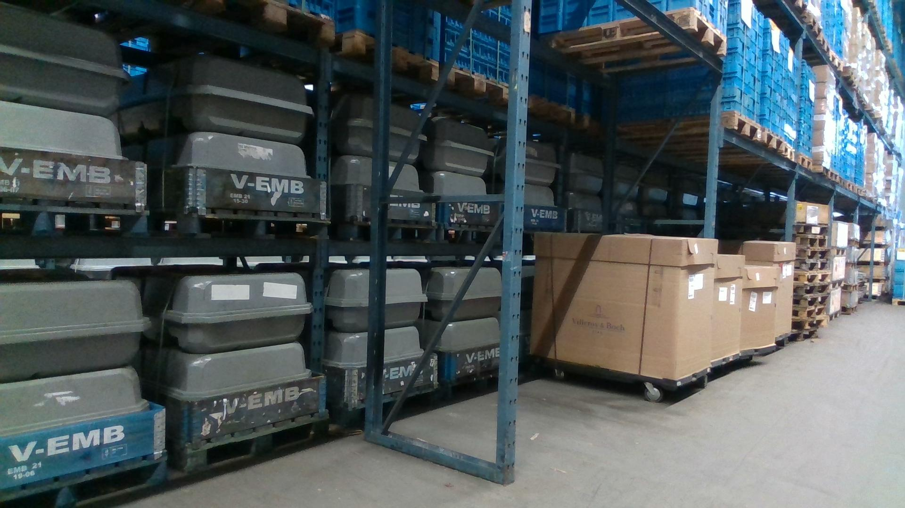

# LOCO 평가용 식별자·해시 index

[image-index.csv.gz](image-index.csv.gz)는 실제 RGB5,097장과 메타데이터를 연결한 index다. 사진 픽셀과 모델 가중치는 포함하지 않는다. 출처는 [LOCO](https://github.com/tum-fml/loco), 데이터 라이선스는 CC0-1.0이다.

현재 프로필은 `candidate_mapping_pending`이다. 합성 장면의 클래스/에셋 대응, 촬영 환경·시퀀스 그룹을 확인해야 학습을 시작할 수 있다. 검출기 성능 결과가 아니다.



위 사진은 sub2의 image14246 원본이다. 모델 예측이나 Cosmos 변환 결과가 아니다. 주석에는 소형 적재함18개·팔레트46개가 있고, 가림·원거리·서로 다른 용기 형상이 섞여 있다. 사진은 변경하지 않았으며 SHA-256은 `8e2fdecd8c982c10a3915961a4ead589fd7ae1320494927ece0cb3c61f720b9c`다. 원본 ZIP 경로는 `dataset/subset-2/` 아래의 index `archive_member`로 찾을 수 있다.

| 역할 | 파티션 | 이미지 |
|---|---|---:|
| 학습 | sub2·sub5 | 1,947 |
| 튜닝 | sub3·sub4 | 2,075 |
| 최종 평가 후보 | sub1 | 1,075 |

초기 후보에서 sub4만 튜닝에 쓰면 `small_load_carrier` 박스가0개라, 모델 결과를 보기 전에 sub3을 튜닝에 포함했다. 두 주 클래스 `pallet`과 `small_load_carrier`의 박스 수는 [분할 근거](../../evidence/loco-split-251.json)에 있다. 이전 후보 역할은 CSV의 `original_split_role`에 보존했다.

이 표는 프로젝트의 보조 실험 분할이다. [고정 상류 배포물](https://api.github.com/repos/tum-fml/loco/git/trees/b460ab8c37f09162f0613c7546948c496e1b1628?recursive=1)의 이름은 sub2·3·5=`train`, sub1·4=`val`이다. sub1은 원본 val 일부를 heldout 후보로 고정했으며 공식 LOCO test라고 부르지 않는다. CSV의 `original_split_role`도 이전 프로젝트 후보 역할을 보존한 필드이며 상류 train/val 명칭이 아니다. [범주·분할 출처](../../evidence/loco-protocol-310.json)

압축본은593,127바이트다. 압축 SHA-256은 `a967f0489e694baa621239f68176bdcfad4b4974e45944b4fb137a832c3b5a1a`, 복원 CSV SHA-256은 `537966dc9dd41531aecc05fca534db5fd92b144786b202c8f8d6b0bdda448298`이다.

파일·디코딩 픽셀의 같은 SHA, DCT pHash64 Hamming 거리6 이하의 교차 분할 후보는0건이었다. 이 결과로 촬영 환경·시퀀스 누출까지 없다고 결론 내리지 않는다. 이미지나 어려운 샘플을 자동 삭제하지 않았다. 공식 ZIP에는5,593장이 있고, 고정한 메타데이터에 없는496장은 원본에 보존한다.

공개 자료에서는 이미지별 `recording_id`, `frame_index` 또는 timestamp, `environment_id`의 대응을 확인하지 못했다. 이 정보 없이 파일 경로만으로 sequence-disjoint나 environment-disjoint 평가를 선언하지 않는다. 최종 평가 후보 sub1의 개별 이미지·라벨을 이용한 에셋 선택과 튜닝은 하지 않는다.

## 재현

기본 CPU 공정 모델은 추가 Python 의존성이 없다. RGB 감사는 별도 분석 환경의 Pillow와 NumPy를 사용했다(Pillow12.1.1, NumPy2.3.5, SciPy 미사용). 압축본을 전부 풀지 않고 이미지별로 읽어 검사한다.

```powershell
cd "$HOME/factory-ops-twin"
python scripts/data/audit_loco.py --fetch-metadata --output artifacts/data/my-loco-metadata
```

[공식 주석 포함 ZIP](https://go.mytum.de/239870)의 이번 해시는 `f3629d989071b824edc63e000f45ccc5826cfbb201a338f16ed87ab3e10bcdcf`, 크기는769,055,500바이트다. RGB 감사를 실행할 때는 새 출력 폴더를 사용한다.

```powershell
cd "$HOME/factory-ops-twin"
$locoArchive = 'E:/FactoryOpsData/loco-20261024/rgb-annotated.zip'
python scripts/data/audit_loco_rgb.py --archive $locoArchive --annotations-dir artifacts/data/my-loco-metadata --output-dir artifacts/data/my-loco-rgb-audit
```

평가 프로필은 검증된 원본 report/index의 SHA를 고정한다. 위 명령의 새 report는 실행 시간·경로가 달라 해시도 달라지므로, 기존 프로필에 맞춘 것처럼 취급하지 않는다. 새 실험은 입력 해시를 반영한 별도 프로필을 만들고 `scripts/data/prepare_loco_split.py`로 분할 index를 생성한다. 원본 report를 새 결과로 덮어쓰지 않는다.
