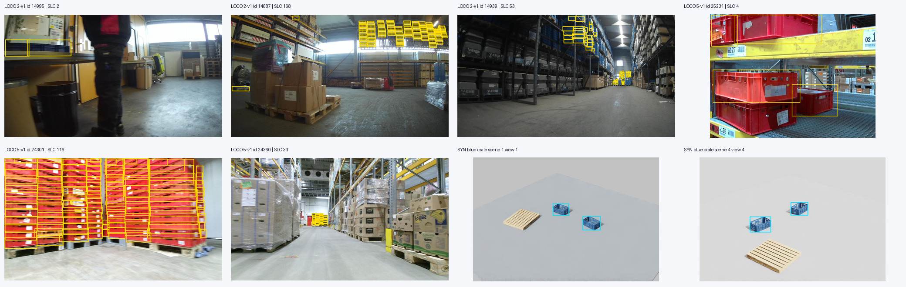

# 합성 데이터의 실사 전이 실험

## 질문과 본체와의 관계

16대 AMR 운영·장애 대응을 본체로 유지한다. 이 실험은 공장에서 생성한 학습 자료가 실제 물류 사진의 검출 성능과 필요한 실제 라벨 수에 어떤 영향을 주는지 측정하는 보조 트랙이다. 검출 결과를 교통 예약이나 안전 정지의 권한으로 사용하지 않는다. LOCO 평가로 AMR 주행이나 반도체 공장의 현장 성능까지 입증하지 않는다.

답할 질문은 두 가지다.

1. 같은 검출기·초기 가중치·평가 집합에서 합성 학습과 Cosmos 외관 변환의 성능 차이는 얼마인가?
2. 같은 실제 라벨 예산에서 합성 사전 학습이 유리한가? 두 학습 곡선이 겹치는 구간에서 실제 라벨 몇 장에 해당하는 차이가 있는가?

성공을 전제로 결론을 정하지 않는다. 개선이 없거나 변환이 라벨을 훼손하면 그 조건과 비용을 결과로 남긴다.

## 현재 실행: 제한된512장과 실제50장 비교

2026-10-25 작업은 오늘17:00 KST까지 진행한다. 새 GPU 입장은16:40 KST까지로 제한하고, 남은 시간은 결과·대표 이미지·백업·소유 프로세스 정리에 사용한다. Cosmos 대량 변환은 이번 로컬 파일럿의 완료 조건으로 추가하지 않는다.

- 촬영340: 128개 장면×4시점의512장·객체2,812개를768×512로 완성했다. 전체3,713개 파일의 크기·해시가 일치하고 Job/lease 마감·owned0을 확인했다. 원본 candidate의 `training_ready/mapping_approved=false`는 유지한다. [촬영 근거](evidence/perception-pilot-340.json)
- 학습 릴리스: 팔레트1종·강체 용기2종의 제한된 프록시 대응, 준비 USD의 root/leaf 의미 경계와 실제512장의 객체별 mask/bbox 근거를 별도 계산해 학습 릴리스를 승인했다. [릴리스 근거](evidence/perception-release-340.json). 원래 반도체 ESD 트레이 매핑이나 기존1,080장의 승인을 바꾸지 않는다.
- 비교: TorchVision Faster R-CNN MobileNetV3 Large FPN의 COCO_V1 가중치와3분류 head, min640/max960을 사용한다. 합성S 1,024 update, 실제R50 256 update, 합성 후 실제SR50 256 update다. SR50에는1,024 합성 update의 추가 계산이 있으므로 순수 사전 학습 효과로 해석하지 않는다.
- 실제 자료: 고정 subset seed5701, train50/tune200/test1,075장만 ZIP에서 선별하고 기존 RGB 감사의 바이트 해시와 대조했다. test 바이트를 준비했지만 모델 추론·시각 선정에는 사용하지 않았다. 모든 학습과 튜닝 평가 뒤 모델별 고정 test를1회 수행한다.
- seed1701/1702/1703과 실행 순서는 첫 학습 전에 동결했다. 관측 AP와 무관하게 남은 실행 상한 안에서 다음 seed를 입장시킨다. 미완료 seed는 보존하고 완료 평균에서 제외한다. threshold0.001/maxDets100을 고정하고 최종 test 예측만 압축 보존한다. 촬영 그룹 독립성과 라벨 비용 절감은 주장하지 않는다.

## 첫3seed 결과와 다음 개발 비교

[고정 실사 평가 원본](evidence/detector-pilot-v1-347/report.json)에서 mAP(0–100)는 S: 0.024±0.010, R50 0.765±0.261, SR50 1.668±0.108이다. 500회 paired image bootstrap의 SR50−R50 차이는+0.903 AP point, 조건부95% 구간[+0.746,+1.037]이다. 이 구간은 같은 고정 모델과 이미지 재표본화에 조건부이며 미확인 촬영 그룹이나 학습 seed 모집단의 불확실성을 대체하지 않는다. 전체9개 모델의 실제 COCOeval AP와 cache identity AP가 일치했다. [bootstrap 원본](evidence/detector-pilot-v1-347/bootstrap.json)

현재 합성만 학습한 실사 성능은 거의0에 가깝다. 실제50장 뒤의 개선도 절대 성능이 낮으므로 라벨 대체 비용이나 현장 배치 성능으로 확장하지 않는다. 같은 실제 사진의 예측과 GT, 입력 구성·소스·학습 계산을 결과와 함께 보존한다. [시각 비교](images/detector-pilot-341/fixed-test-examples.jpg) · [모델/예측 백업](evidence/detector-storage-349.json)

350~352의 v2 development 비교는 완료했다. v1에서 초기 COCO constructor는 FrozenBatchNorm2d였으나 checkpoint 재구성은 BatchNorm2d와 다른 학습 가능 층 집합을 사용했다. v2는 모든 constructor의 COCO normalization/freezing 계약을 유지했다. 같은3seed의 초기284개 tensor는 키·dtype·shape·값·metadata가 같았으며, 같은 실제50장·튜닝200장·업데이트 상한을 사용했다. 같은 튜닝 집합의 mAP(0–100)는 S 0.052→0.054, R50 0.726→1.074, SR50 0.789→1.004다. v2는 모든 seed에서 R50이 SR50보다 높았다. normalization/freezing을 분리한 효과나 낮은 성능의 유일 원인으로 단정하지 않는다. 고정test 메타데이터·이미지·추론을 사용하지 않았으며 v1 고정test 결과와 백업은 변경하지 않았다. [비교 원본](evidence/detector-backbone-v2-353/report.json) · [초기 상태 비교](evidence/detector-backbone-v2-353/initialization.json)

입력 진단355는 합성512장과 실제 train50장 메타데이터만 읽었다. 모델 리사이즈 후32×32px 미만 객체 비율은1.24% 대73.28%, 이미지당 대상 객체 평균은5.49 대31.36이었다. 이는 coverage 진단이며 성능 원인·촬영 높이·형상 동등성을 증명하지 않는다. 실제 사진과 tuning/test 메타데이터는 읽지 않았다. [분포 도표](evidence/detector-input-gap-355/input-gap.png) · [진단 원본](evidence/detector-input-gap-355/report.json)

후속 v3는 기존512장 중 서로 다른9개 scene의3×3 모자이크를 S 학습에만 적용한다. 출력 tensor2304×1536을 기존 min640/max960으로 리사이즈하며 라벨은 타일 XY 오프셋만 더한다. 실제 R50/SR50 입력과 v2 백본 계약은 유지한다. 전체512개 source-ID plan과3개 seed는 첫 GPU 전에 동결한다. 1,024 update·batch2에서 S 원본 제시는2,048→18,432회, 추가 CPU decode는16,384회이므로 동일 계산/노출 비교가 아니다. 튜닝 전용 dual gate와 고정test 접근 차단을 유지하며 새3D 공장·새 heldout 성과로 표현하지 않는다. [CPU 미리보기](images/detector-mosaic-356/mosaic-3x3-training-preview.png) · [입력 출처](images/detector-mosaic-356/provenance.json)

v3 356~358의3seed를 완료했다. 같은 튜닝200장 mAP(0–100)는 S 0.017±0.003, R50 0.982±0.164, SR50 1.081±0.180이다. 초기284개 tensor는 모두 같았으나 R50 최종70개 tensor가 각 seed의 v2 대응과 달랐다. 데이터·설정·runtime 결속은 일치하고 원인은 미확정이다. 순수 모자이크 효과로 표현하지 않으며 `complete_with_control_drift` 상태로 보고한다. 등록된512개 모자이크의 작은 객체 비율은51.4~51.9%·평균 객체 수49.4~49.6개였다. 입력 크기·밀도를 바꾼 사실과 실제 검출 성능의 개선 입증을 구분한다. [실제 비교·노출·입력·대조군 차이](evidence/detector-mosaic-v3-366/report.json)

v4는 같은 단일 합성 입력의 FasterRCNN ResNet50 FPN COCO_V1 후보다. 실제 CPU에서 초기·재구성 모두 FrozenBatchNorm2d53개/BatchNorm2d0개·같은 학습 층 이름·state key를 확인했다. 640×960 입력의 특징맵 stride는4/8/16/32/64이며 Mobile의32/32/64와 다르다. COCO 가중치와 FPN·기본 RPN 등 모델 묶음이 함께 바뀌므로 stride나 백본만의 효과로 해석하지 않는다. 같은 S1024/R50 256/SR50 256 update·batch2·3seed·train50/tune200을 사전등록하고 batch2 OOM 시 batch1로 바꾸지 않는다. 단일 실행 상한은1,200초이며17시 마감 안에 정리할 여유가 있을 때만 입장한다. 고정test와 Cosmos 출력은 사용하지 않는다. [실제 CPU 준비·전체 weight SHA](evidence/detector-resnet-preparation-362.json) · [공식 모델](https://docs.pytorch.org/vision/stable/models/generated/torchvision.models.detection.fasterrcnn_resnet50_fpn.html)

v4 363~365는 모두 완료했다. 튜닝 mAP(0–100)는 S 0.297±0.226, R50 2.973±0.336, SR50 3.532±1.343이다. 실제50장 학습 뒤의 모델 묶음 차이는 관측됐으나, 절대 성능은 낮고 SR50은 seed1702에서 R50보다 낮았다. 합성 추가 효과·현장 배치·라벨 대체를 입증하지 않는다. 같은 RTX3060에서 평균 프로세스 경과441초·PyTorch peak allocation2.95GiB였고 GPU kernel 시간이나 전체 장치 메모리와 구분한다. 입력 불변·고정test 비접근·소유PID0·lease 반환을 확인했다. [3seed 실제 결과·측정 범위](evidence/detector-model-v4-370/report.json) · [모델12개·재현 근거 백업](evidence/detector-resnet-storage-371.json)

## 현재 확보한 자료

- 기존 Replicator 파이프라인: 12개 시각 구성·30시점·3카메라, RGB 1,080장과 라벨 생성 기록이 있다. 데이터 검사에는 결정적 생성 검사와 일부 QA 통과가 있지만 최종 production/human release는 미승인이다. 학습 가중치·실사 mAP는 없다. 기존 전체 RGB의 현재 복원 가능성도 새 학습 전에 확인해야 한다. 대표 자료 36개라는 수를 전체 RGB의 고유 이미지 수로 해석하지 않는다.
- LOCO 단계 0: 상류 커밋 `b460ab8c37f09162f0613c7546948c496e1b1628`의 5개 RGB COCO JSON을 받았다. 총 103,438,944바이트, 이미지 행 5,097개·어노테이션 151,428개다. 잘못된 참조·박스·경계 초과와 ID/파일명 중복은 검출되지 않았다. [감사 원장](evidence/loco-metadata-242.json)
- 공식 주석 포함 RGB ZIP 769,055,500바이트를 받았다. 압축본의5,593장 중 메타데이터5,097장 모두 단일 매칭·디코딩·해상도 일치를 확인했다. 미참조496장은 보존하며 라벨 없는 음성 샘플로 사용하지 않는다. 파일·디코딩 픽셀 SHA와 DCT pHash64 거리6 이하의 교차 분할 후보는0개다. 이는 촬영 환경·시퀀스 누출을 모두 해결했다는 뜻은 아니다. 이후 검출기 파일럿용 COCO_V1 가중치를 별도 E: 캐시에 받았고 전체 SHA를 확인했다. [RGB 감사](evidence/loco-rgb-249.json)
- [LOCO 공식 설명](https://github.com/tum-fml/loco)은 전체 37,988장 중 수동 라벨 5,593장·152,421개 어노테이션을 명시한다. 이번 RGB 메타데이터는 라벨 이미지 기준 496장, 어노테이션 993개 적다. 릴리스 범위 차이의 원인은 아직 확인되지 않았다.

## 클래스와 평가 분할

LOCO 라이선스는 [CC0-1.0](https://github.com/tum-fml/loco/blob/b460ab8c37f09162f0613c7546948c496e1b1628/LICENSE)이다. 클래스는 `pallet`, `small_load_carrier`, `stillage`, `pallet_truck`, `forklift`이고 AMR은 없다. `stillage`를 창고 랙으로 치환하지 않는다.

우선 교집합 후보는 팔레트와 소형 적재함 두 종류다. LOCO의 `small_load_carrier`는 검출 범주이며, 공개 정의에 KLT·ESD 규격이나 표준 치수는 없다. 반도체 트레이·매거진을 이 범주로 자동 매핑하지 않는다. 나머지 세 클래스는 대응 에셋과 시험 표본이 확보될 때 별도 범위로 추가한다. 특히 고정 평가 후보 sub1의 forklift는 박스가5개뿐이어서 지게차 일반 성능을 결론 내리기 어렵다. [원 논문](https://mediatum.ub.tum.de/doc/1578845/1578845.pdf) · [범주·분할 근거](evidence/loco-protocol-310.json)

학습용 export에서는 bbox의 tight/amodal 기준, 가림·잘림·최소 크기와 ignore 정책을 맞춘다. compound root의 bbox/가림 정보와 leaf mesh 측정치를 같은 검사로 취급하지 않는다. 기존 G4의 일부 root 정보 미측정과 최종 승인 실패를 해결하지 않은 채 전체1,080장을 적합 데이터로 재사용하지 않는다.

현재 반도체 설정의 `FG_LOW`/`FG_HIGH`는 semantic 이름이 `pallet`이지만 실제 recipe는 `esd_packing`/`esd_tray_loadport`다. 포장 설비·트레이 인계대 전체를 LOCO 팔레트로 학습시키지 않는다. `visual_scene.py`의 `finished_goods_pallet`과 `inventory_tote`/`finished_goods_tote`는 형상 비교 후보이고, `jedec_tray_stack`·`jedec_tray_magazine`·`covered_esd_carrier`는 소형 적재함으로 자동 매핑하지 않는다. 다음 합성 export는 class 문자열만 치환하지 않고 객체별 형상·root/leaf 경계와 bbox를 기준으로 허용 목록을 확정한다. 이 대응이 끝날 때까지 프로필의 `asset_mapping`은 pending으로 유지한다.

| 용도 | 상류 파티션 | 사용 규칙 |
|---|---|---|
| 학습 | sub2·sub5, 1,947장 | 실제 라벨 예산 추출, 합성 데이터와 혼합 |
| 튜닝 | sub3·sub4, 2,075장 | 두 주 클래스의 support를 확보, test 결과로 설정을 바꾸지 않음 |
| 고정 최종 평가 후보 | sub1, 1,075장 | 시퀀스·에셋 매핑 이후 최종 비교에 사용 |

위 표는 이 실험의 보조 분할이다. [고정한 상류 배포물](https://api.github.com/repos/tum-fml/loco/git/trees/b460ab8c37f09162f0613c7546948c496e1b1628?recursive=1)은 sub2·3·5를 `train`, sub1·4를 `val`로 명명한다. 따라서 sub1은 원본 val 일부를 고정한 heldout 후보이며 공식 LOCO test가 아니다. 아래 test라는 표현은 이 프로젝트의 고정 평가 역할을 뜻한다.

초기 메타데이터 후보의 튜닝 sub4에는 소형 적재함 박스가0개였다. 학습 점수를 보기 전에 클래스 support를 기준으로 sub3을 튜닝에 포함한 `loco-eval-v1`을 작성했다. 기존 감사의 후보 역할은 원본으로 보존하고 새 프로필을 선택한 실험만 역할을 바꾼다. 기존 이미지 index에서 새 교차 분할 해시/pHash 후보도0개로 확인했다. [프로필](../configs/perception/loco-eval-v1.json) · [역할별 클래스 수와 고정 입력 해시](evidence/loco-split-251.json) · [공개 이미지 식별자·해시 index](data/loco-eval-v1/README.md)

파일명/시퀀스·촬영 환경 그룹 확인은 남아 있다. 공식 자료에서 `recording_id`, `frame_index` 또는 timestamp, `environment_id`의 이미지별 대응은 확인하지 못했다. 파일 경로의 날짜·센서 문자열을 검증된 그룹 키로 사용하지 않는다. 현재 근거는 이미지 중복 검사까지이며, sequence-disjoint·environment-disjoint 성능을 주장하지 않는다. 추가 그룹 정보가 확보되면 유사 프레임을 같은 역할에 묶고 분할을 다시 고정한다. 최종 평가 집합을 이용한 튜닝이나 학습 예산 추출은 금지한다.

## 현재 에셋 대응과 소량 촬영 준비

CPU 매핑 검사기는 배치254의 시각 인스턴스1,152개를 읽고, 팔레트 이름의4개와 적재함 이름의452개를 모두 거절했다. ESD 로드포트·트레이·매거진을 물류 팔레트나 소형 적재함으로 자동 변환하지 않는다. 승인 에셋과 root/leaf·bbox export 근거가 없으면 `training_ready=false`를 반환한다. 후속 공장 배치의 전체 인스턴스 수와 이 고정 감사의 입력을 혼용하지 않는다. [매핑 설정](../configs/perception/loco-asset-map-v1.json) · [검사와 후보 근거](evidence/loco-asset-map-266.json)

별도 지각 실험용으로 NVIDIA의 `pallet_block_a01`과 `crate_gray_a20` 원본68파일·43,484,400바이트를 확보했다. 라이선스는 CC-BY-4.0이며 모든 파일의 크기·해시를 대조했다. 기존 CPU 준비 도구로 물리 API를 제거한 소비용 USD를 만들었고 각각 가시 mesh1개, 미터·Z-up의 유한 외곽을 확인했다. 치수는 팔레트 약1.000×1.200×0.120m, 얕은 크레이트 약0.612×0.412×0.090m다. 제조사 정격이나 KLT 규격 인증이 아니라 USD의 가시 형상 외곽이다. 두 모델은 현재 운용 공장에 추가된 물건이 아니라 새 데이터 fixture의 후보이며, 다운로드·파싱을 라벨 승인으로 세지 않는다.

실행270은 원본 의미 속성을 제거한 지각 전용 사본을 작성하고 비의미 USD 계약·형상·재질 보존을 확인했다. 원본과 범용 사본은 유지한다. 실행278은4개 scene seed×4시점의16장과 원시 bbox/label map·semantic uint32 map·카메라·객체 pose·입력 해시를 남겼다. 별도 사후 감사에서60개 객체의 raw tight bbox가 class/object_id별 semantic 마스크의 inclusive min/max와 모두 일치했다. 원래 dataset.json은 수정하지 않고 사후 근거를 분리했다. [사본 준비](evidence/perception-prepare-270.json) · [촬영·라벨·종료 근거](evidence/perception-probe-278.json)

현재 소형 적재함 후보는 더 깊은 청색 천공 용기 `crate_blue_a02`다. 가시 외곽은 약0.612×0.412×0.240m이며 CC-BY-4.0 원본·재질·해시를 보존했다. 실행302에서4개 seed×4시점의16장과 bbox/semantic/provenance를 생성했고, 객체60개의 bbox가 같은 object ID의 semantic mask 외곽과 모두 일치했다. 데이터 매니페스트101개 파일의 크기·해시와 소유 프로세스 종료도 확인했다. [촬영 결과](evidence/perception-blue-probe-302.json) · [대표 이미지](images/perception-blue-probe-302/contact-sheet.png)

후속 export의 `validate_capture`는 semantic의 `object_id`를 기준으로 객체별 visible mask와 tight bbox의 inclusive min/max를 대조한다. bbox와 segmentation의 숫자 ID가 같다고 가정하지 않는다. 경계에 닿은 객체는 허용하고, 기대한 객체가 완전히 가려지거나 화면 밖이라 visible pixel이 없으면 해당 probe export를 거부한다. 향후 가림이 많은 학습 파일럿에서는 이 실패를 재샘플링하거나 별도 visibility/ignore 정책으로 처리해야 하며, 이 probe 검사를 amodal bbox 정책으로 확대하지 않는다. 관련12검사와 기존302의16프레임·60개 객체 읽기 전용 재검증을 통과했다. [export 정합 근거](evidence/perception-object-mask-export.json)

이 자료는 단순 바닥 위 후보 에셋의 export 확인이다. 청색 용기는 제한된 합성 시각 대리물 후보이며 LOCO 전체 용기 형상이나 KLT·ESD 규격을 대표하지 않는다. 가림·복잡한 배경·크기별 support와 촬영 그룹에 관한 실험 범위를 고정한 뒤512장으로 확대한다. `training_ready=false`, `mapping_approved=false`를 유지하며 검출기 학습·실사 성능은 아직 없다.16대 운영 로직 완성을 우선하며 같은 입력의 probe를 반복 수집하지 않는다.

### 실제 학습 사진과 합성 후보의 차이

LOCO 학습용 sub2·sub5의6장을 기존302 합성 장면과 비교했다. 고정 평가 후보 sub1은 열지 않았다. 선택 사진에는 단단한 개방형 토트뿐 아니라 얕은 빈·트레이·접이식 캐리어가 있고, 적층·가림·잘림·원거리의 작은 객체와 랙·팔레트·포장물 배경이 나타났다.302는 단일 청색 형상을 깨끗한 바닥에 배치한 export 시험이어서 이 조건들을 충분히 포함하지 않는다.6장 관찰을 데이터셋 전체의 빈도 추정으로 사용하지 않는다.



객체를 올바른 하위 유형으로 라벨링하는 것과 클래스 전체 외형을 학습 자료가 덮는 것은 구분한다. 기존 회색 얕은 용기와 청색 rigid crate를 제한된 baseline에 사용하는 것은 가능하며, 재현하지 않은 형상은 도메인 차이로 명시한다. 모든 실사 외형을 재현해야 파일럿을 시작할 수 있다는 조건은 추가하지 않는다.512장 촬영 전에는 이 제한 범위와 적층·가림·크기·배경 변형을 설정하고 객체별 bbox·semantic 정합을 유지한다. 아직512장 생성·검출기 학습은 시작하지 않았다. [선택 규칙·관찰·원본 해시](evidence/perception-class-readiness.json)

512장 파일럿의 입력과 exporter는 구현했다.128개 고유 scene seed에4개 시점을 배정하고 회색·청색 용기를 장면별로 균등하게 사용한다. 적층 지지 관계·가림용 소품·배경·크기·조명·카메라 변형을 recipe에 고정했다. exporter는 RGB·객체별 tight bbox/semantic·카메라 거리·pose·해시와 COCO 후보를 작성하며, 알 수 없는 recipe 필드와 바뀐 입력을 거절한다. 표적19검사와 main 통합 후 실제 manifest·준비 에셋 pin 검사가 통과했다. 깊이 검사는 배경의0/+inf와 가시 객체의 유한 양수 범위를 구분하고, 음수·NaN 거절을 포함한 후속3검사를 통과했다. 설치된 Replicator1.11.35와 [같은 버전의 공식 annotator 문서](https://docs.omniverse.nvidia.com/kit/docs/omni_replicator/1.11.35/source/extensions/omni.replicator.core/docs/API.html#distance-to-camera)를 참조했다. 후속 GPU323은9번째 프레임의 객체 semantic identity0으로 중단됐다. 앞8프레임·객체32개만 박스/마스크·깊이 사후 검사를 통과했으며512장 완성 데이터나 학습 승인으로 사용하지 않는다. 실패RGB 미보존으로 완전가림 원인은 아직 확정하지 않는다. [323 마감·부분 원본·종료 근거](evidence/perception-pilot-323.json)16대 운영을 우선하며 같은 probe를 반복 수집하지 않는다. [입력·구현·확인 범위](evidence/perception-pilot-512-preparation.json)

## 순서와 확대 조건

| 단계 | 실행 내용 | 위치·현재 상태 | 다음 단계 조건 |
|---|---|---|---|
| 0 | 메타데이터·RGB·라이선스·클래스 support·분할 후보 감사 | CPU, 완료 | 촬영 그룹·클래스/에셋 매핑 확인 |
| 1 | 128개 독립 장면 seed × 4시점 = 512장 합성 파일럿, RGB·bbox·semantic·깊이와 provenance | Isaac Sim GPU, 준비 대상 | 라벨/에셋 매핑과 학습용 export가 실제로 맞음 |
| 2 | 동일 source의 depth/seg/edge를 사용해 Cosmos 클립 10개만 변환 | 별도 호환 GPU, 미실행 | 설치·추론 시간, peak VRAM, 비용, 객체 보존을 측정 |
| 3 | 고정 실제 예산 50장의 R(50)와 SR(50), synthetic-only를 같은 검출기로 소량 학습 | GPU, 미실행 | 실제 학습·평가 코드와 데이터 계약이 작동 |
| 4 | 선택한 데이터 크기에서 4조건·3seed·라벨 예산 곡선 비교 | 파일럿 근거 후 확대 | 효과·실패·비용을 함께 공개 |
| 5 | 고정 test의 클래스별 AP·오류 예시·CI, 관제에 읽기 전용 검출 overlay | CPU/GPU, 선택 연결 | 해당 데이터셋과 모델 버전·지연·confidence 표시 |

2만~5만 장 생성, 300클립 변환, 12개 이상의 장기 학습을 먼저 예약하지 않는다. 생성물은 seed·카메라·source/변환 ID·출력 해시로 연결하고, 유사 프레임을 독립 표본 수로 세지 않는다. 개발 원본은 소량만 남기고 최종 학습 자료·설정·가중치·평가 결과를 선별 보존한다.

## 비교 조건과 지표

- **S:** 합성 데이터, 실제 target-domain 학습 라벨 0장.
- **SC:** S와 동일한 source subset의 Cosmos 변환본을 사용한다. 샘플 수/optimizer step을 맞춘 비교와 추가 데이터량 효과를 구분한다. 라벨 보존이 확인되지 않은 프레임은 제외하거나 재라벨링하고 그 비용을 집계한다.
- **R(n):** 실제만, `n ∈ {10,25,50,100}`. 성능 상한이라는 표현은 쓰지 않는다.
- **SR(n):** S로 사전 학습한 뒤 R(n)과 정확히 같은 실제 이미지로 미세 조정한다.

모든 조건에 같은 detector 구조·초기 가중치·해상도·augmentation·튜닝 탐색 예산을 사용한다. detector와 실제 pretrained checkpoint hash, 데이터 manifest, 3개 seed, optimizer step/최대 학습량, 조기 종료 규칙은 첫 학습 전에 고정한다. 사전 학습 가중치에 COCO 등 실제 사진이 포함됐다면 S는 'target-domain 실제 라벨 0장'이고 순수 합성으로만 학습한 모델이 아니다. detector 선택·설치는 아직 하지 않았다.

주 지표는 지원하는 클래스의 COCO AP@[.50:.95], 보조 지표는 AP50·클래스별 recall·객체 크기/가림별 실패다. 각 n의 이미지 수와 클래스별 박스 수도 함께 적는다. seed별 결과와 평균을 공개하고, 동일 test 이미지/시퀀스 그룹을 짝지어 bootstrap한 95% CI로 조건 차이를 산출한다. seed 간 변동과 test 표본 불확실성은 별도로 표시한다. 연속 프레임이나 개별 박스를 독립 표본처럼 재추출하지 않는다.

'라벨 절감'은 공통 성능 범위 안의 R(n)과 SR(n) 곡선에서만 비교한다. 예를 들어 SR(25)가 R(50)과 통계적으로 구분되지 않는다는 결과와 실제 비용 절감을 동일시하지 않으며, annotation 시간·변환 검사·추론 비용은 따로 집계한다. 곡선 밖의 예산으로 외삽하지 않는다.

## Cosmos와 GPU 선택

[Transfer2.5 모델 표](https://docs.nvidia.com/cosmos/2.1.0/transfer2.5/model_matrix.html)는 일반 2B 모델에 GPU 1장·VRAM 65.4GB를 명시한다. 현재 보존한 2×L40S 48GB를 단일 96GB 카드로 계산하지 않는다. 이 구성에서 해당 단일 GPU 경로가 성공했다고 주장하지 않는다.

H100만 가능한 것은 아니다. [Cosmos NIM 3.0.0 지원 표의 Transfer2.5 절](https://docs.nvidia.com/nim/cosmos/3.0.0/support-matrix.html#cosmos-transfer2-5-2b)은 RTX PRO 6000 Blackwell 96GB도 지원한다. 이 표는 NIM 프로필이며 오픈 소스 설치 경로와 서로 바꿔 인용하지 않는다. 현재 latest NIM 문서는 Cosmos3로 바뀌었으므로 Transfer2.5의 고정 버전 문서를 사용한다. 기존 다른 프로젝트의 96GB VM은 빌려 쓰거나 변경하지 않는다.

Transfer2.5는 제안된 비교 후보이며 최신 모델이라는 주장은 하지 않는다. 실제 모델 경로를 고정할 때 Cosmos3의 transfer와 설치·메모리·비용을 한 번 비교한다. 이름만 최신 버전으로 바꾸거나2.5의65.4GB 수치를 다른 모델에 적용하지 않는다. 비교 결과와 checkpoint/runtime 버전을 고정한 뒤 같은10클립 계약으로 실행한다.

[모델 카드](https://huggingface.co/nvidia/Cosmos-Transfer2.5-2B)는 객체가 사라지거나 변형되는 현상과 시공간 부정확성을 공개한다. 따라서 원본 bbox/semantic을 변환 영상에 무조건 복사할 수 없다. 10클립의 객체 수·존재·박스 정합·가림 변화를 확인하고, 사람이 보기 좋은 영상과 학습 라벨이 유효한 영상을 구분한다. source/변환본을 같은 분할에 두어 짝이 test로 새지 않게 한다.

공식 H100 추론 시간은 입력 프레임 수·제어 모달리티·구현 버전에 따라 다르며 설치·다운로드·warmup·검사 시간도 든다. 제안된 총액 $150~400은 확정 견적이 아니다. 첫 파일럿의 실제 end-to-end 시간과 당시 GPU 시간당 가격, 디스크·전송 비용으로 다시 산정한다. 현재 묶음의 6시간·$40 상한을 이 문서로 늘리지 않는다. Cosmos 전용 유료 배치는 입력·모델 접근·Stop 가능한 SKU와 별도 소량 상한이 구체화된 뒤 시작한다.

병렬 작업은 CPU 데이터 정리와 본체 운영 구현부터 진행한다. 추후 서로 다른 클라우드 GPU라면 병렬 실행할 수 있으나 동일 GPU에서 Isaac Sim 렌더와 Cosmos/검출기 학습을 겹치지 않는다. 로컬 GPU 작업은 공용 lease를 따른다. 장기 실행은 종료 기한·독립 Stop 감시·백업과 실제 STOPPED를 조건으로 한다.

검출기 파일럿까지 H100에 고정하지 않는다. 선택한 모델의 첫 batch peak VRAM과 학습 속도를 측정해 기존3060 또는 L40S 사용 가능성을 먼저 판단한다. Isaac Sim 장면 생성·Cosmos 외관 변환·검출기 학습은 서로 다른 하드웨어 계약이며, 어느 한 단계의 큰 VRAM 요건을 전체 프로젝트의 GPU 요건으로 확대하지 않는다.

## 공개할 산출물

라벨 예산–mAP 곡선, seed별 원시 점수와 CI, 조건별 고정 test 예시, 합성→변환본의 라벨 보존/실패 예시, GPU 시간·검사 시간·해시를 남긴다. 관제 연결은 후순위다. 실제 검출 모델 없이 그럴듯한 박스를 그린 영상이나 생성 영상 자체를 실사 전이 성과로 공개하지 않는다.

### 후속v4 입력의 가시성 대리 검사

323에서 보존하지 못한 실패 프레임 원본은 복구하지 않았다. 대신 원본 recipe의 카메라·대상AABB·소품을 CPU에서 투영했다. 대상 전체가 화면 밖이거나 앞쪽 소품의 투영 외곽/중심 시선에 완전히 막히는 후보를 확인했다. v4는 카메라 target offset·eye-target 거리와 소품 위치를 명시한 작성 범위 안에서 조정한다.128scene·512frame·회색/청색 균등 배치와 대상 객체 recipe는 유지하며, 양의 화면 교차·소품 가림 대리 검사를 통과했다. 부분 잘림은 허용하고 대상이나 소품을 조용히 삭제하지 않는다. 이는 mesh/raster 검사가 아니므로 실제 RGB·객체별 semantic·tight bbox·깊이는 GPU 결과에서 다시 확인해야 한다. 생성기 표적6검사·capture 계약1검사와 main의 실제 입력 pin 확인을 통과했다. 학습 승인·실사 성능은 아직 없다. [작성 경계·해시·확인 범위](evidence/perception-pilot-v4-preparation.json)

### 최신 촬영325와v5의 경계

v4-v2 입력의 실제GPU325는12프레임·객체60개의 박스/마스크·깊이 검사를 통과한 뒤 frame13의 객체 identity0으로 중단됐다. 새 진단 저장 경로는 실패RGB·semantic·거리·bbox·카메라·recipe를 보존했다. 배경 staging-wall이 대상AABB의 투영 외곽을 덮고 중심 시선과 교차하며, 보존RGB에서도 벽이 앞을 막는 상태를 확인했다. v4의 가림 검사가 전용 occluder만 대상으로 삼고 불투명 배경 상자를 빠뜨린 경계다. 이 기하 근거를 모든 mesh와 semantic 처리 경로의 완전한 진단으로 일반화하지 않는다. [325 원본·부분 미디어·종료 근거](evidence/perception-pilot-325.json)

v5는 같은 검사를 모든 불투명 절차형 컨텍스트 상자로 확장했다. 대상 객체와 카메라 recipe는 v4-v2와 같고, 컨텍스트86개의 위치만 고정 범위의 seed 기반 탐색으로 조정했다.128scene·512frame의 화면 밖 대상과 컨텍스트 대리 충돌은0건이며, 기존frame9·신규frame13·CRLF 거절의 표적3검사와 main 입력 pin 확인을 통과했다. 실제GPU 결과나 완성 데이터는 없다.16대 운영을 우선하며 추가 촬영·학습은 보류한다. [v5 입력과 확인 범위](evidence/perception-pilot-v5-preparation.json)

### v5 단일 촬영328의 부분 결과

본선327의 소스 동결 뒤 유휴 공용GPU lease로v5를 한 번 촬영했다. 유효101프레임의545개 객체(pallet198·small_load_carrier347)는 실제semantic 마스크외곽==raw tight bbox, inclusive COCO후보좌표, 객체영역 유한양수깊이 검사를 통과했다. frame102/scene25/aisle_low는5개 expected객체 중 bbox5개·semantic identity4개여서 거절됐다. bbox가 발행된 small_load_carrier-026-03의semantic ID가 없다는 관측까지 확인했으며, 가림·잘림·renderer ID처리 중 원인은 미확정이다.

원본745파일·342,849,517바이트와실패진단을 보존하고 dataset.json은 작성하지 않았다. Job닫힘·owned0·lease반환·입력13개불변을 확인했다. 실패프레임은 유효자료/COCO에서 제외하고, 같은입력을 재시도하거나 GPU를 추가로 실행하지 않는다. 데이터는 export 계약 진단용 부분자료이며 클래스 매핑/학습 승인·512장 완성·실사mAP·Cosmos 결과로 사용하지 않는다. [328 마감·대표10장·원본 해시](evidence/perception-pilot-328.json)

객체별bbox/semantic 집합일치는 공식SDK가보장하는동등성이 아니라 프로젝트의추가품질gate다. frame102의누락대상은raw x=0..0/y=388..389, inclusive1×2픽셀의화면좌측경계사례다. numeric ID를같다고가정하지않고 object_id라벨로대조하며, occlusionRatio0.0을가시성보증으로사용하지않는다. 이후진단은고정1프레임의loose bbox·instance segmentation으로범위를좁히고, 결과를보기전전체촬영을반복하지않는다. [공식Replicator1.11.35 API](https://docs.omniverse.nvidia.com/kit/docs/omni_replicator/1.11.35/source/extensions/omni.replicator.core/docs/API.html)

### 고정 프레임102의 단일 진단336

장면25·aisle_low의 recipe/camera/seed/5객체를 바꾸지 않고 한 프레임을 촬영했다. tight와 loose bbox는 모두 `[0,388,0,389]`를 재현했고 문제 객체의 semantic/instance mask는 모두0픽셀이었다. 다른4객체의 두 마스크 화소 수와 bbox는 서로 일치했고, 원본328의 카메라 문서와 bbox도 동일했다. semantic label-map만의 누락은 아니며 viewport 경계 clipping과 renderer/annotator 결함 중 원인은 확정하지 않는다.

공용 lease/Windows Job으로76.552초·4.95MB의 진단만 남겼고 입력24개·출력15개 해시와 Kit/owned0·lease반환을 확인했다. scene.usda는 실제 카메라 자세 설정 후 저장한다. 학습/COCO/mapping 승인은 false이고 전체512촬영·Cosmos·검출기 학습은 재개하지 않았다. [다섯 객체 비교 도판](images/perception-frame102-336/diagnostic.png) · [실행·해시·관측 한계](evidence/perception-frame102-336.json)

## 제한 파일럿의 실행과 보존

실제 환경은 Python3.12.13·torch2.14.1+cu130·torchvision0.29.1+cu130·pycocotools2.0.11이다. 기존 로봇/Isaac 환경을 바꾸지 않고 `E:/FactoryOpsData/venvs/factoryops-detector-py312`에 분리했다. 공식 가중치 `fasterrcnn_mobilenet_v3_large_fpn-fb6a3cc7.pth`의 SHA는 `fb6a3cc702b1df54c18a44b26708cd083614211062d0c36d2ca7bf9270df3533`다. [TorchVision 모델 정의](https://docs.pytorch.org/vision/main/models/generated/torchvision.models.detection.fasterrcnn_mobilenet_v3_large_fpn.html) · [고정 버전 소스](https://github.com/pytorch/vision/blob/v0.29.1/torchvision/models/detection/faster_rcnn.py)

아래 입력 확인은 CUDA를 시작하지 않는다. 실제 학습은 새 출력 경로를 사용하고 공용 GPU lease·Windows Job으로 감싼 host spec에서 실행한다. 세 seed 비교는 같은 소스 checkout을 유지하고 설정의 pilot seed만 바꾼다. 이번 host spec과 종료 영수증은 선별 백업에 보존한다.

```powershell
cd "$HOME/factory-ops-twin"
$detectorPython = 'E:/FactoryOpsData/venvs/factoryops-detector-py312/Scripts/python.exe'
& $detectorPython -X utf8 -c "from pathlib import Path; from scripts.perception.run_detector_pilot import validate_synthetic_release; print(validate_synthetic_release(Path('E:/FactoryOpsData/perception-pilot-v6-340-release/release-manifest.json')))"
& $detectorPython -X utf8 scripts/perception/run_detector_pilot.py --help
```

원본 촬영·릴리스 근거·입력 matrix는 `D:/FactoryOpsPortfolio/perception-pilot-340.zip`에 보존했다. 512개 hardlink RGB는 capture에 한 번만 넣었고, 릴리스에는 이미지 재연결 방법을 남겼다. 실제 LOCO 사진·제공처 에셋·SDK·모델 가중치는 이 ZIP에 중복하지 않는다. [보존 SHA·검사·복구 범위](evidence/perception-storage-340.json)

## Cosmos3 호환성 smoke의 CPU 준비

공식 Transfer2.5 일반2B의65.4GB 요구량에 현재 단일 L40S48GB는 미달한다. 최신 Cosmos3 NIM에는 단일 L40S의 Nano FP8 layer-offload 후보가 있으며 Transfer floor는 GPU당38GiB·시스템 RAM36GiB다. 두 L40S의 VRAM을 하나로 합산하지 않는다. 후보 이미지는 `nvcr.io/nim/nvidia/cosmos3:2.1.0`, 실제 digest와 선택 profile은 기동 후 확인해야 한다. [지원표](https://docs.nvidia.com/nim/cosmos/latest/support-matrix.html) · [배포·접근 조건](https://docs.nvidia.com/nim/cosmos/latest/deployment.html)

346은 검증된 원본 frame1을 종횡비 유지 crop/resize하여1280×720의121-frame/30fps 정지 반복 MP4와 채워진 `POST /v1/infer` 파생-edge request를 작성했다. 디코딩121프레임이 모두 같은 픽셀 해시이며 원본3개 객체가 남아 있다. 모션 학습 자료나 시간적 사실성의 성공 근거가 아니다. 원본 bbox를 변환 출력에 복사하지 않고 결과의 객체 소실·합침·형상/박스 drift·edge agreement·flicker를 별도 확인한다.

현재 클라우드 조회에서 FactoryOps g0와234는 실제 STOPPED다. 새 VM·모델/컨테이너 다운로드·약관 수락·NGC 자격증명 조회·GPU 변환은 하지 않았다. 실제 실행에는 NGC entitlement/약관, 독립 Stop 복구, 컨테이너 digest/profile·메모리·health/schema 확인이 남아 있다. [입력·API·실행 gate](evidence/cosmos-smoke-preparation-346.json) · [공식 Transfer API](https://docs.nvidia.com/nim/cosmos/latest/transfer.html)

NGC API 키는 NGC Catalog의 모델·컨테이너 다운로드에 쓰는 인증 수단이며 Brev 계산 크레딧과 별개다. Windows의 process/user/machine 환경 변수에는 준비된 `NGC_API_KEY`가 없음을 값 출력 없이 확인했다. 다른 자격증명 저장소를 검색하지 않았다. 실행 준비 시 [NGC 계정의 API Keys](https://org.ngc.nvidia.com/account/api-keys)에서 개인 키를 만들고 필요한 `NGC Catalog` 권한을 선택한다. 실제 계정 권한·모델 접근 약관·NIM 이용 조건을 확인하며, 키는 저장소·로그·채팅에 기록하지 않는다. [공식 키 생성 안내](https://docs.nvidia.com/ngc/latest/ngc-user-guide.html#generating-ngc-api-keys)

## 키 인증 이후의 단일 클라우드 시험

377에서 로컬DPAPI 파일을 사용한NGC 인증과 Cosmos3 2.1.0 manifest 접근이 모두HTTP200이었다. image index digest는 `sha256:2add946b316a0baf72a15be4da85132d127c34da22d2fe4e9c4bd146ad8c4020`이다. 키는 Windows 영구 환경변수·argv·저장소·로그에 넣지 않고 계정의 암호문에서 읽어 자식 stdin과 SSH stdin으로 보낸다. 원격 tmpfs의 임시 키·Docker 인증정보·컨테이너 환경은 같은 실행의 종료 처리에서 제거한다. 사용자는 이 버전의 NVIDIA Software License·AI Product Terms·OpenMDW-1.1과 기존VM의1개 정지입력 시험에 동의했다. [인증](evidence/cosmos-ngc-auth-377.json) · [승인 범위·동결 입력·실행 소스](evidence/cosmos-execution-plan-379.json)

378의 실제 제어 API는 Healthy였으며234는 STOPPED/HEALTHY, g0는 STOPPED/UNHEALTHY였다. 기존234의현재카탈로그는2×L40S·384GiB·Stop지원·$5.48256/시간이다. Cosmos에는 GPU0 한 장만 노출하고 text/video guardrail을 모두 offload하는 layer profile을 요청한다. 고정346 입력은 보존하며 실제379의 selector가 실행 계약이다. 독립Stop timer7200초를 시작 전에 검증하고 실행 뒤 실제STOPPED와timer/keepalive 종료를 확인한다.2시간 계산 비용은 약$10.97의카탈로그 추정이며 저장비·실제정산·중지지연을 보장하는 상한이 아니다. [현재 제어상태·가격·보호조건](evidence/cosmos-brev-preflight-378.json)

profile preflight는 키 없이 수행하며 이를 통과하기 전 모델을 내려받지 않는다. 추론은 정지121frame1clip·seed2026으로 한정하고 원본 bbox를 변환 출력의 승인 라벨로 복사하지 않는다. 다른프로젝트 RBY1의실행은 분리된VM이므로 유지한다. 새 환경 생성·reset·다른환경 정지는 하지 않는다.

379는부팅중STARTING/NOT READY/UNHEALTHY의health필드만으로조기중단했다. 모델이나image layer를내려받지않았으며실제STOPPED와감시종료를확인했다.380은부팅대기조건을수정한새소스로같은단일입력만시도한다. health는보조값으로기록하고실제SSH·GPU/메모리·NIM preflight와모델ready로실행을판정한다.379의입력·판정·원본은변경하지않는다. [실제379마감](evidence/cosmos-cloud-379.json) · [수정한실행계약](evidence/cosmos-execution-plan-380.json)

`inspect_cosmos_smoke.py`는 ffprobe/ffmpeg의 CPU 디코딩을 사용해121frame·30fps·1280×720 계약과 실제프레임 수를 비교한다. 입력대표1장·출력first/middle/last3장·비교sheet1장·JSON만보존한다. 인접프레임평균절대RGB차이는0–1 정규화의정지영상흔들림진단이며 객체라벨의유효성을대체하지않는다. NumPy·Pillow·ffmpeg·ffprobe가필요하다. CPU fixture는기존입력영상을양쪽에넣어121frame·0차이를확인했고Cosmos결과로사용하지않는다. 실제변환후에도 training_ready/model_output_labels_approved=false와라벨미전사를유지한다.

380은 정상 기동 후 호스트 SSH 포트가 시간 초과되어 다운로드 전에 종료됐다. 실제STOPPED와 감시 종료를 확인했고 네트워크 원인은 미확정이다.381은 같은 입력·동의·고정 image digest를 유지하면서 기존 g0의 기본 SSH 별칭을 사용한다. 단일 L40S에 generator layer offload와 guardrail resident를 선택하고 실제 VRAM38GiB·RAM36GiB를 확인한다. 독립7200초 Stop timer의 대상도 g0로 결속하며 계산비는 카탈로그 기준 약$5.38의 추정이다. 중지 지연·저장비·실제 정산의 보장 상한은 아니다. 새 VM과 다른 프로젝트 환경은 사용하지 않는다. [380 실제 종료](evidence/cosmos-cloud-380.json) · [381 실행 계약](evidence/cosmos-execution-plan-381.json)

381은 CLI 표시 UNHEALTHY를 raw lifecycle 실패로 해석해 SSH 전에 중단했다. 설치 v0.6.335의 upstream 소스로 raw RUNNING·health UNHEALTHY가 해당 표시로 바뀌는 것을 확인했으며 실제 중지와 감시 정리를 마쳤다.382는 같은 g0·프로필·원본·예산을 유지하고 이 조합을 실제 SSH/GPU probe의 준비 후보로 허용한다. 건강 상태의 경고를 모델 실행 성공으로 해석하지 않는다. [381 원인](evidence/cosmos-cloud-381.json) · [수정한382 계약](evidence/cosmos-execution-plan-382.json)

382에서 실제 g0의 SSH·L40S·Docker 접근을 확인했다. WSL 중간 셸의 HOME 확장으로 디스크 조회가 실패해 다운로드 전에 중단했고 실제Stop을 확인했다.383은 로컬 재현을 통과한 `wsl --exec`로 원격 명령을 전달한다. source346·단일 입력·동의·image digest·g0 프로필·7200초 Stop timer를 유지한다. [382 실제 결과](evidence/cosmos-cloud-382.json) · [383 계약](evidence/cosmos-execution-plan-383.json)

383은 g0의 authored 디스크 여유 기준에 못 미쳐 다운로드 전에 끝났으며 실제Stop을 확인했다.384는 기존234의 default SSH를 사용하고 GPU0 한 장·layer/guardrail offload를 선택한다. 새 VM과 g0 데이터 삭제는 없으며 원본1clip·image digest·동의·7200초 감시를 유지한다. 종료한379~383의 카탈로그 경과 비용 추정은 약$3.02이며 이번2시간 추정$10.97을 더해 약$13.99다. 실제 정산·저장비·중지 지연을 보장하는 상한은 아니며 승인된$40 계산 예산을 늘리지 않는다. [383](evidence/cosmos-cloud-383.json) · [384 계약과 비용 범위](evidence/cosmos-execution-plan-384.json)

384는 실제2GPU 환경의 GPU·RAM·결과 회수까지 통과했지만 디스크 여유93.84GiB로100GiB 기준에 못 미쳤다.385는 조건부로 표준 pip 캐시·미사용 BuildKit 캐시를 정리하고 최종 기준은 유지한다. 경로 검증이나 선택 정리가 실패해도 실제 여유와 진단 집계는 남긴다. SDK·이미지·데이터·가중치·볼륨은 보존한다. 종료한379~384의 카탈로그 경과 비용 추정 약$4.40과 이번2시간 추정$10.97을 합해 약$15.36이며 실제 정산의 보장 상한은 아니다. [384 실제 결과](evidence/cosmos-cloud-384.json) · [385 실행·정리 범위](evidence/cosmos-execution-plan-385.json)
